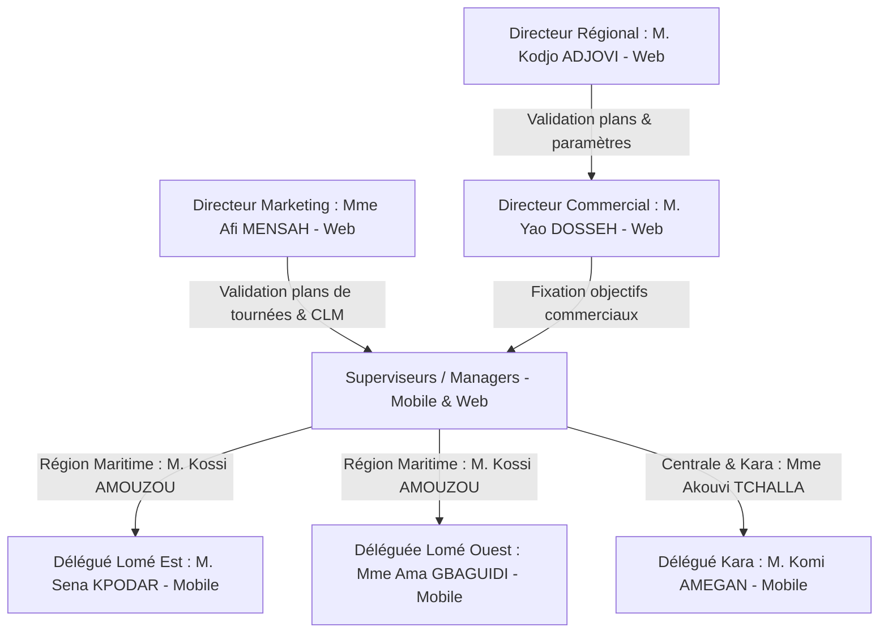
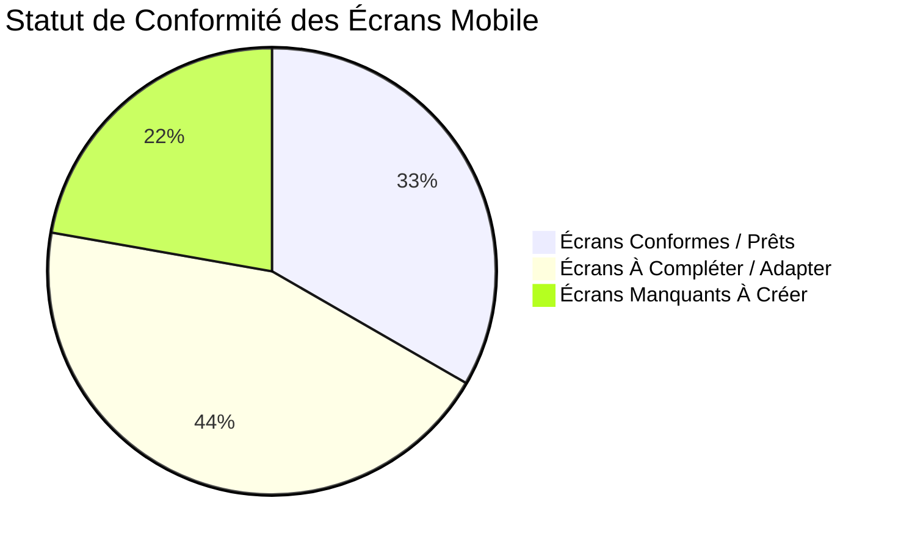

# 📖 GUIDE COMPLET DE SPÉCIFICATIONS, AUDIT DES ÉCRANS & SCÉNARIOS MÉTIER (TOGO-PHARMA) — MEDCRM PRO / CRM SKYNITY

Ce document est le **guide exhaustif et opérationnel de référence** destiné aux équipes de développement Mobile (Flutter) et Backend (Laravel). Il réunit les règles de gestion, l'illustration concrète de chaque workflow à travers le cas réel de **TOGO-PHARMA**, l'audit comparatif des 18+ écrans de l'application mobile, la modélisation de la base de données locale (SQLite / Offline-First), ainsi que des **prompts de développement d'écrans prêt-à-l'emploi**.

---

## 📑 TABLE DES MATIÈRES
1. [Organigramme & Hiérarchie des Acteurs (Cas TOGO-PHARMA)](#1-organigramme--hiérarchie-des-acteurs-cas-togo-pharma)
2. [Explication Détaillée des 14 Workflows Métier avec Exemples Concrets au Togo](#2-explication-détaillée-des-14-workflows-métier-avec-exemples-concrets-au-togo)
3. [Audit Comparatif des Écrans Mobile Existants (`lib/presentation/views/`)](#3-audit-comparatif-des-écrans-mobile-existants-libpresentationviews)
4. [Spécifications Techniques de la Couche Offline-First (SQLite & Sync Engine)](#4-spécifications-techniques-de-la-couche-offline-first-sqlite--sync-engine)
5. [Spécifications Écran par Écran & Contrats JSON API REST `/api/v1/`](#5-spécifications-écran-par-écran--contrats-json-api-rest-apiv1)
6. [Prompts de Code Prêts-à-l'Emploi pour les Développeurs Mobile Flutter](#6-prompts-de-code-prêts-à-lemploi-pour-les-développeurs-mobile-flutter)

---

## 1. ORGANIGRAMME & HIÉRARCHIE DES ACTEURS (CAS TOGO-PHARMA)

Pour illustrer le fonctionnement réel de l'application **MEDCRM PRO**, nous prenons l'exemple de la société **TOGO-PHARMA** opérant sur l'ensemble du territoire togolais.



### 1.1. Répartition du Personnel au Togo

| Rôle | Titulaire (Exemple) | Zone / Périmètre | Responsabilités Principales sur MEDCRM PRO |
| :--- | :--- | :--- | :--- |
| **Directeur Régional** | M. Kodjo ADJOVI | National (Tout le Togo) | Valide les plans d'actions, enregistre les produits/laboratoires, gère les dotations de supports. |
| **Directeur Marketing** | Mme Afi MENSAH | National (Tout le Togo) | Valide les plans de tournées, crée et gère les supports CLM et les campagnes. |
| **Directeur Commercial (DC)** | M. Yao DOSSEH | National (Tout le Togo) | Définit les objectifs commerciaux des superviseurs, réajuste les plans d'actions, traite les demandes. |
| **Superviseur (Manager)** | M. Kossi AMOUZOU | Région Maritime (Lomé + environs) | Valide prescripteurs/établissements, effectue 2 duos/mois minimum, arbitre le portefeuille prescripteurs. |
| **Superviseure (Manager)** | Mme Akouvi TCHALLA | Région Centrale + Kara | Encadre les délégués du Nord Togo, suit les objectifs et valide les comptes rendus. |
| **Délégué Médical** | M. Sena KPODAR | Secteur Lomé Est (Bè, Tokoin, Adidogomé) | Réalise les tournées, visites, comptes rendus, saisit les ventes grossistes (SOCOPHAR). |
| **Déléguée Médicale** | Mme Ama GBAGUIDI | Secteur Lomé Ouest (Agoè, Légbassito) | Visite les prescripteurs du secteur, gère son stock d'échantillons et ses comptes rendus. |

---

## 2. EXPLICATION DÉTAILLÉE DES 14 WORKFLOWS MÉTIER AVEC EXEMPLES CONCRETS AU TOGO

### 🔄 2.1. Planification des Tournées (Visites Terrain)
- **Chaîne de Validation** :
  $$\text{Délégué Médical} \xrightarrow{\text{Saisie Plan}} \text{Superviseur} \xrightarrow{\text{Contrôle}} \text{Directeur Marketing} \xrightarrow{\text{Validation Finale}} \text{Exécution}$$
- **Scénario Concret au Togo** :
  1. **Sena KPODAR** (Délégué Lomé Est) prépare son plan de tournée de la semaine du 15 au 19 janvier 2026.
     - *Lundi* : CHU Sylvanus Olympio (Tokoin).
     - *Mardi* : Clinique Biasa (Bè).
     - *Mercredi* : Cabinet médical du Dr AMEGBOR (Adidogomé).
     - *Jeudi* : Polyclinique Solidarité (Bè-Kpota).
     - *Vendredi* : Pharmacie du Port + Réunion d'équipe.
  2. Sena soumet son plan. Il passe en statut `En_Attente_Superviseur`.
  3. **Kossi AMOUZOU** (Superviseur) reçoit une notification. Il remarque que mardi comprend trop de visites. Il déplace une visite au jeudi et valide.
  4. **Mme Afi MENSAH** (Directrice Marketing) reçoit le plan. Elle vérifie l'alignement avec la campagne nationale sur les antibiotiques. Elle valide définitivement.
  5. Sena reçoit une notification PUSH sur sa tablette : `✅ Plan de tournée validé par la Direction Marketing`.

### 🎯 2.2. Plans d'Actions Commerciaux
- **Chaîne de Validation** :
  $$\text{Superviseur} \xrightarrow{\text{Proposition}} \text{Directeur Commercial (Réajuste)} \xrightarrow{\text{Directeur Régional} \xrightarrow{\text{Validation}} \text{Exécution}}$$
- **Scénario Concret** :
  1. Kossi AMOUZOU (Superviseur) propose un plan d'actions Q1 2026 : $+20\%$ de ventes d'antibiotiques à Lomé, 2 duos/mois par délégué, 500 échantillons distribués.
  2. M. Yao DOSSEH (DC) réajuste l'objectif à $+12\%$ et ajoute une action de formation sur le nouveau produit Sanofi.
  3. M. Kodjo ADJOVI (Directeur Régional) valide le budget global. Le plan passe en statut `En_Exécution`.

### 📦 2.3. Dotation & Distribution des Supports Commerciaux
- **Principe Descendant** : Les supports proviennent du niveau supérieur et descendent la hiérarchie.
- **Scénario Concret** :
  - M. Kodjo ADJOVI reçoit du laboratoire partenaire Sanofi : $1\,000$ boîtes d'échantillons Doliprane 1g, $200$ stylos et $100$ dépliants.
  - Il affecte $400$ boîtes et $80$ stylos à Kossi AMOUZOU (Région Maritime).
  - Kossi distribue $200$ boîtes à Sena KPODAR et $200$ boîtes à Ama GBAGUIDI.
  - Le CRM suit en temps réel le solde de stock de chaque délégué.

### 💊 2.4. Enregistrement des Laboratoires et Fiche Produit
- **Règle Stricte** : **Un produit ne peut être rattaché qu'à un seul laboratoire fournisseur**.
- **Exemple Fiche Produit "AMOXIL 500mg"** :
  - *DCI* : Amoxicilline
  - *Nom Commercial* : Amoxil 500mg
  - *Forme Galénique* : Gélule
  - *Conditionnement* : Boîte de 12 gélules
  - *Classe Thérapeutique* : Antibiotique (Pénicilline)
  - *Indications* : Infections ORL, respiratoires, urinaires
  - *Posologie* : 1 gélule 3 fois par jour pendant 7 jours
  - *Effets Secondaires* : Diarrhée, nausées, éruptions cutanées
  - *Prix Grossiste HT* : $2\,500$ FCFA
  - *Laboratoire Fournisseur* : **Sanofi** (Le système refuse toute tentative de doublon sous un autre laboratoire).

### 🏥 2.5. Enregistrement et Validation des Prescripteurs (HCP)
- **Scénario Concret** :
  1. Sena KPODAR rencontre le **Dr Kodjo AMEGBOR** (Cardiologue) à la Clinique Biasa à Bè (Lomé Est).
  2. Sena saisit le prescripteur sur sa tablette :
     - *Établissement Principal* : Clinique Biasa (Bè).
     - *Établissements Secondaires* : CHU Sylvanus Olympio (Tokoin), Clinique St Paul (Adidogomé).
     - Statut initial = `En_Attente_Validation`.
  3. Kossi AMOUZOU (Superviseur) contrôle les données et valide le prescripteur. Le médecin passe en statut `Validé_Officiel`.

### 🏢 2.6. Enregistrement et Validation des Établissements
- **Scénario Concret** :
  - Ama GBAGUIDI (Lomé Ouest) découvre la "Clinique Espoir" à Agoè-Nyivé. Elle l'enregistre sur l'application mobile.
  - Kossi AMOUZOU reçoit la demande et valide l'établissement.
  - *Cas particulier* : Si Kossi crée lui-même l'établissement sur le terrain, celui-ci est directement validé sans étape intermédiaire.

### 📝 2.7. Compte Rendu de Visite & Traçabilité des Échantillons
- **Scénario de la Visite de Sena du 15/01/2026 au CHU Sylvanus Olympio** :
  - *Visite* : Dr Kodjo AMEGBOR | Heure : 10h30 | Motif : Présentation Amoxil 500mg.
  - *Échantillons Remis avec Traçabilité Légale* :
    - 5 boîtes d'Amoxil 500mg (Lot : `LOT-2025-A456` | Péremption : 12/2027).
    - 10 boîtes de Doliprane 1g (Lot : `LOT-2025-D789` | Péremption : 06/2028).
  - *Signature Tactile* : Le Dr AMEGBOR signe directement sur l'écran de la tablette pour attester de la réception des échantillons.
  - *Gadgets Remis* : 3 stylos Sanofi, 1 bloc-notes.
  - *Informations Financières* : Affichage du PGHT ($2\,500$ FCFA pour Amoxil).

### ⏱️ 2.8. Cycle de Vie du Compte Rendu (Brouillon ➔ Soumis)
- **Scénario** :
  - *15/01 à 10h30* : Sena rédige son compte rendu dans sa voiture mais est interrompu. Il clique sur **"Sauvegarder en Brouillon"**. Le compte rendu est stocké dans la base SQLite locale.
  - *16/01 à 08h00* : Sena rouvre son brouillon, complète ses notes cliniques et clique sur **"Soumettre Définitivement"**.
  - Une fois soumis définitivement, le compte rendu est verrouillé et ne peut être modifié que sur autorisation spéciale du Superviseur.

### 👥 2.9. Visites en Duo (Superviseur – Délégué)
- **Obligation** : Minimum **2 duos par mois** par superviseur.
- **Scénario Concret (Kossi AMOUZOU & Sena KPODAR)** :
  1. *Planification Amont (05/01/2026)* : Kossi planifie un duo avec Sena pour le 20/01/2026 à Lomé Est.
     - *Objectifs Prévus du Duo* : 1) Réaliser 5 visites conjointes. 2) Présenter Amoxil à 3 cardiologues. 3) Obtenir 2 engagements de prescription.
  2. *Réalisation sur le Terrain (20/01/2026)* : Kossi et Sena effectuent 4 visites ensemble (1 médecin étant indisponible).
  3. *Compte Rendu Aval & Comparatif* :
     - *Visites réalisées* : 4 / 5 prévues ($80\%$).
     - *Présentations Amoxil* : 2 / 3 prévues ($66\%$).
     - *Engagements de prescription* : 2 / 2 prévus ($100\%$).
     - *Taux d'atteinte global* : $82\%$.
     - *Recommandation du Superviseur* : "Sena maîtrise bien le discours produit. Renforcer la gestion de l'objection prix sur Amoxil."

### 📊 2.10. Arbitrage & Gestion du Portefeuille de Prescripteurs
- **Capacité Maximale** : Fixée à **100 prescripteurs maximum** par le Directeur Régional M. Kodjo ADJOVI.
- **Scénario d'Arbitrage par Kossi AMOUZOU** :
  1. Sena a 100 prescripteurs actifs dans son portefeuille. Il enregistre un nouveau cardiologue : le **Dr Afi SODJI** (Bè).
  2. Le CRM alerte Kossi : `Portefeuille de Sena KPODAR à capacité maximale (100/100)`.
  3. Kossi consulte les statistiques de visites du secteur Lomé Est :
     - Dr AMEGBOR : 8 visites sur les 6 derniers mois.
     - **Dr Kossi AGBEKO** : 1 seule visite sur les 6 derniers mois (Prescripteur le moins visité).
  4. Kossi effectue l'ARBITRAGE :
     - Retrait du Dr Kossi AGBEKO du portefeuille actif de Sena.
     - Affectation du Dr Afi SODJI à Sena.
  5. **Conservation de l'Historique** : Le Dr Kossi AGBEKO n'est JAMAIS supprimé du système. Son historique complet reste archivé, et il est remis dans le bassin de réaffectation (ex: réaffecté le lendemain à Ama GBAGUIDI sur Lomé Ouest).

### 📩 2.11. Demandes des Délégués
- **Chaîne de Validation** :
  $$\text{Sena (Délégué)} \xrightarrow{\text{Demande 200 boîtes échantillons}} \text{Kossi (Superviseur)} \xrightarrow{\text{Validation}} \text{Yao DOSSEH (DC)} \xrightarrow{\text{Accord Final}}$$
- **Filtrage Superviseur** : Si Ama GBAGUIDI demande 500 boîtes alors qu'il lui en reste 300 en stock, Kossi rejette la demande avec le motif "Stock local suffisant". La demande ne parvient pas au Directeur Commercial.

### 🎯 2.12. Cascade Descendante des Objectifs Commerciaux
- **Niveau 1 (DC ➔ Superviseur)** : Yao DOSSEH fixe à Kossi AMOUZOU un objectif Q1 2026 de $50\,000$ boîtes et $150\,000\,000$ FCFA de chiffre d'affaires sur la Région Maritime.
- **Niveau 2 (Superviseur ➔ Délégués)** : Kossi ventile cet objectif entre ses délégués :
  - Sena KPODAR (Lomé Est) : $28\,000$ boîtes ($84\,000\,000$ FCFA).
  - Ama GBAGUIDI (Lomé Ouest) : $22\,000$ boîtes ($66\,000\,000$ FCFA).
  - *Somme des objectifs délégués = Objectif superviseur* ($28k + 22k = 50k$).

### 📈 2.13. Suivi des Ventes Grossistes (SOCOPHAR, TOP PHARMA, COPHARMA)
- **Saisie Terrain Délégué** : En janvier 2026, Sena consulte les sorties du grossiste **SOCOPHAR** sur son secteur et saisit :
  - Amoxil 500mg : $1\,500$ boîtes ($3\,750\,000$ FCFA).
  - Doliprane 1g : $3\,200$ boîtes ($3\,840\,000$ FCFA).
- **Consolidation Superviseur** : Kossi visualise sur son tableau de bord la progression des ventes de la Région Maritime par secteur, par grossiste et par produit par rapport aux objectifs fixés.

---

## 3. AUDIT COMPARATIF DES ÉCRANS MOBILE EXISTANTS (`lib/presentation/views/`)

Une analyse approfondie du code source Flutter de l'application mobile a permis d'évaluer la conformité de chaque écran par rapport aux exigences du cahier des charges.



### 3.1. Tableau d'Audit Exhaustif des Écrans

| Écran Existant dans le Projet | Statut Actuel | Modifications Complémentaires Requises |
| :--- | :---: | :--- |
| `auth/login_view.dart` | ✅ Conforme | Intégrer l'étape 2FA OTP (`POST /api/v1/verify-otp`). |
| `delegate/delegate_dashboard_view.dart` | 🟡 À Compléter | Intégrer la jauge dynamique du portefeuille ($N/100$) et le widget d'alerte des 2 duos mensuels. |
| `delegate/delegate_planning_view.dart` | 🟡 À Compléter | Gérer le double niveau de validation des tournées (Superviseur ➔ Dir. Marketing). |
| `delegate/visit_report_view.dart` | 🟡 À Compléter | Ajouter les 2 états (Brouillon/Soumis), le PGHT, le lot d'échantillon et la signature tactile. |
| `delegate/stock_view.dart` | ✅ Conforme | Affichage des dotations d'échantillons et gadgets attribués par le Superviseur. |
| `hcp/hcp_list_view.dart` | 🟡 À Compléter | Gérer la distinction Établissement Principal / Établissements Secondaires et le statut de validation. |
| `products/product_detail_view.dart` | 🟡 À Compléter | Compléter la Fiche Produit (DCI, Forme galénique, PGHT, Contre-indications, Laboratoire unique). |
| `manager/supervisor_dashboard_view.dart` | 🟡 À Compléter | Ajouter la carte du suivi des duos ($X/2$ requis ce mois) et les alertes d'arbitrage de portefeuille. |
| `manager/manager_validations_view.dart` | 🟡 À Compléter | Permettre la validation des prescripteurs et des établissements créés par les délégués. |
| `manager/coaching_detail_view.dart` | 🔴 À Refondre | Créer `supervisor_duo_view.dart` avec tableau comparatif [Objectifs Prévus] vs [Résultats Constatés]. |
| **`hcp_portfolio_arbitrage_view.dart`** | 🔴 **Manquant** | **Créer l'écran d'arbitrage du portefeuille prescripteur lors du dépassement du quota (100).** |
| **`wholesale_sales_entry_view.dart`** | 🔴 **Manquant** | **Créer l'écran de saisie et de suivi des ventes grossistes par secteur.** |
| **`delegate_requests_view.dart`** | 🔴 **Manquant** | **Créer l'écran de création et de suivi des demandes délégués (DM ➔ SUP ➔ DC).** |
| `documents/full_screen_edetailing_view.dart` | ✅ Conforme | Lecteur interactif de présentations CLM avec enregistrement du temps par slide. |
| `messaging/internal_messaging_view.dart` | ✅ Conforme | Messagerie instantanée d'équipe entre Délégués et Superviseurs. |
| `notifications/notifications_view.dart` | ✅ Conforme | Notifications Push pour rappels de visites et alertes de validations. |
| `pharmacovigilance/pharmacovigilance_view.dart` | ✅ Conforme | Déclaration d'urgence des effets indésirables avec transmission réseau. |

---

## 4. SPÉCIFICATIONS TECHNIQUES DE LA COUCHE OFFLINE-FIRST (SQLITE & SYNC ENGINE)

### 4.1. Structure de la Base de Données Locale SQLite (`sqflite`)

```sql
-- Table des Prescripteurs Locaux
CREATE TABLE local_contacts (
    id TEXT PRIMARY KEY,
    nom TEXT NOT NULL,
    prenom TEXT NOT NULL,
    titre TEXT,
    telephone TEXT,
    email TEXT,
    account_id_principal TEXT NOT NULL,
    account_ids_secondaires TEXT, -- Format JSON Array
    statut_validation TEXT DEFAULT 'en_attente', -- en_attente, valide, rejete
    sync_status TEXT DEFAULT 'synced',
    updated_at TEXT
);

-- Table des Comptes Rendus de Visite
CREATE TABLE local_visits (
    id TEXT PRIMARY KEY,
    contact_id TEXT NOT NULL,
    account_id TEXT NOT NULL,
    date_visite TEXT NOT NULL,
    heure_debut TEXT,
    heure_fin TEXT,
    motif TEXT NOT NULL,
    statut TEXT NOT NULL, -- brouillon, soumis_definitif
    notes TEXT,
    niveau_interet INTEGER DEFAULT 3,
    pght_total REAL DEFAULT 0.0,
    signature_base64 TEXT,
    sync_status TEXT DEFAULT 'pending_insert',
    created_at TEXT
);

-- Table des Échantillons Remis avec Traçabilité
CREATE TABLE local_visit_samples (
    id TEXT PRIMARY KEY,
    visit_id TEXT NOT NULL,
    product_id TEXT NOT NULL,
    quantite INTEGER NOT NULL,
    num_lot TEXT NOT NULL,
    date_peremption TEXT,
    FOREIGN KEY(visit_id) REFERENCES local_visits(id)
);

-- Table des Visites en Duo Superviseur
CREATE TABLE local_duo_sessions (
    id TEXT PRIMARY KEY,
    delegate_id TEXT NOT NULL,
    date_duo TEXT NOT NULL,
    zone TEXT NOT NULL,
    motif TEXT NOT NULL,
    objectifs_json TEXT NOT NULL, -- Format JSON Array
    resultats_json TEXT, -- Format JSON Array
    taux_atteinte_pct REAL DEFAULT 0.0,
    statut TEXT DEFAULT 'planifie', -- planifie, cloture
    sync_status TEXT DEFAULT 'pending_insert'
);

-- Queue de Synchronisation Reseau
CREATE TABLE sync_queue (
    id INTEGER PRIMARY KEY AUTOINCREMENT,
    endpoint TEXT NOT NULL,
    method TEXT NOT NULL, -- POST, PUT, DELETE
    payload_json TEXT NOT NULL,
    created_at TEXT NOT NULL
);
```

---

## 5. SPÉCIFICATIONS ÉCRAN PAR ÉCRAN & CONTRATS JSON API REST `/api/v1/`

### 5.1. Soumission d'un Compte Rendu de Visite (`POST /api/v1/activities`)
```json
{
  "contact_id": "01a06925-8391-739e-9129-9043632517a3",
  "account_id": "01a06925-8387-7370-aba9-da5d44dcbe79",
  "activity_type": "visite",
  "date_activite": "2026-09-18",
  "heure_debut": "10:30",
  "heure_fin": "11:15",
  "statut": "soumis_definitif",
  "motif": "Présentation Amoxil 500mg et remise d'échantillons",
  "notes": "Médecin très intéressé. Demande des études complémentaires.",
  "niveau_interet": 4,
  "samples": [
    {
      "product_id": "prod_amoxil_500",
      "quantite": 5,
      "num_lot": "LOT-2025-A456",
      "date_peremption": "2027-12-31"
    }
  ],
  "gadgets": [
    {
      "gadget_id": "gad_stylo_01",
      "quantite": 3,
      "beneficiaire": "Dr Kodjo AMEGBOR"
    }
  ],
  "signature_base64": "data:image/png;base64,iVBORw0KGgoAAAANSUhEUgAA..."
}
```

### 5.2. Clôture d'une Visite en Duo Superviseur (`PUT /api/v1/coaching-sessions/{id}/complete`)
```json
{
  "delegate_id": "user_sena_kpodar",
  "date_duo": "2026-09-20",
  "zone": "Secteur Lomé Est",
  "motif": "Accompagnement terrain et observation de l'argumentaire Amoxil",
  "objectifs_prevus": [
    "Effectuer 5 visites conjointes",
    "Présenter Amoxil 500mg à 3 cardiologues",
    "Obtenir 2 engagements de prescription"
  ],
  "activites_realisees": "4 visites effectuées conjointement au CHU Sylvanus Olympio",
  "resultats_constates": [
    "4 visites réalisées sur 5 prévues",
    "2 présentations Amoxil effectuées",
    "2 engagements de prescription obtenus"
  ],
  "taux_atteinte_pct": 82.0,
  "commentaires_superviseur": "Sena maîtrise bien le discours produit. Poursuivre le travail sur la gestion des objections prix.",
  "plan_action_recommande": "Formation de 30 min sur la fiche d'argumentaire prix d'Amoxil."
}
```

### 5.3. Saisie des Ventes Grossistes par Secteur (`POST /api/v1/sales`)
```json
{
  "periode": "2026-01",
  "grossiste_id": "gross_socophar_togo",
  "secteur_id": "sec_lome_est",
  "delegate_id": "user_sena_kpodar",
  "ventes": [
    {
      "product_id": "prod_amoxil_500",
      "quantite_boites": 1500,
      "pght_unitaire": 2500.0,
      "chiffre_affaires": 3750000.0
    },
    {
      "product_id": "prod_doliprane_1g",
      "quantite_boites": 3200,
      "pght_unitaire": 1200.0,
      "chiffre_affaires": 3840000.0
    }
  ]
}
```

### 5.4. Soumission d'une Demande par le Délégué (`POST /api/v1/requests`)
```json
{
  "delegate_id": "user_sena_kpodar",
  "type_demande": "echantillons_supplementaires",
  "objet": "Augmentation dotation Doliprane 1g pour la zone Bè",
  "description": "Forte demande pédiatrique et épidémie de grippe saisonnière sur Lomé Est.",
  "justification": "Il ne reste que 20 boîtes en stock local.",
  "statut": "en_attente_superviseur"
}
```

---

## 6. PROMPTS DE CODE PRÊTS-À-L'EMPLOI POUR LES DÉVELOPPEURS MOBILE FLUTTER

Les prompts ci-dessous peuvent être directement transmis à votre équipe de développeurs Flutter.

---

### 🤖 PROMPT 1 : Compte Rendu de Visite avec Traçabilité Échantillons & Signature Tactile

```markdown
### TÂCHE FLUTTER : Refonte du Compte Rendu de Visite avec Signature Tactile et Gestion des Lots

**Fichiers concernés** :
- `lib/presentation/views/delegate/visit_report_view.dart`
- `lib/presentation/controllers/visit_report_controller.dart`
- `lib/presentation/widgets/doctor_signature_pad_modal.dart`

**Consignes d'implémentation** :
1. **Double Action Brouillon / Soumission Définitive** :
   - Ajouter un bouton secondaire "Sauvegarder en Brouillon" qui enregistre l'état courant dans la base SQLite locale (`local_visits`) sans exiger les champs optionnels.
   - Ajouter un bouton principal "Soumettre Définitivement" (Vert) qui valide les champs obligatoires (Motif, Produits, Observations, Signature si échantillons remis).

2. **Formulaire de Traçabilité des Échantillons** :
   - Pour chaque échantillon ajouté :
     - Dropdown de sélection du Produit (avec affichage du PGHT).
     - Champ numérique "Quantité remise".
     - Champ texte obligatoire "Numéro de Lot" (validation RegExp `^[A-Z0-9-]+$`).
     - Sélecteur de Date "Date de péremption du Lot".

3. **Pad de Signature Tactile du Médecin** :
   - Intégrer un pad de dessin tactile (`hand_signature` ou `signature`).
   - Sauvegarder la signature sous forme de chaîne Base64 PNG.

**Contraintes** :
- Architecture GetX réactive avec gestion 100% offline-first.
```

---

### 🤖 PROMPT 2 : Module des Visites en Duo Superviseur

```markdown
### TÂCHE FLUTTER : Écran des Visites en Duo pour Superviseur

**Fichiers à créer** :
- `lib/presentation/views/manager/supervisor_duo_view.dart`
- `lib/presentation/controllers/supervisor_duo_controller.dart`

**Consignes d'implémentation** :
1. **Compteur de Quota Obligatoire** :
   - Afficher en haut de l'écran : "Duos réalisés ce mois : X / 2 minimum requis" avec badge de couleur dynamique.

2. **Onglet Planification Amont** :
   - Sélecteur du Délégué de l'équipe (ex: Sena KPODAR).
   - Date, Heure & Zone géographique.
   - Liste dynamique des "Objectifs Prévus du Duo".

3. **Onglet Clôture & Compte Rendu** :
   - Tableau dynamique comparatif :
     - Colonne 1 : Objectif Prévu.
     - Colonne 2 : Résultat Constaté.
     - Colonne 3 : Taux d'atteinte (Slider de 0% à 100%).
   - Saisie des observations du superviseur et du plan d'action d'accompagnement.

**Contraintes** :
- Connexion API `PUT /api/v1/coaching-sessions/{id}/complete`.
```

---

### 🤖 PROMPT 3 : Module d'Arbitrage et Réaffectation du Portefeuille Prescripteurs

```markdown
### TÂCHE FLUTTER : Arbitrage du Portefeuille Prescripteurs (Superviseur)

**Fichiers à créer** :
- `lib/presentation/views/manager/hcp_portfolio_arbitrage_view.dart`
- `lib/presentation/controllers/hcp_portfolio_arbitrage_controller.dart`

**Consignes d'implémentation** :
1. **Visualisation de la Jauge** :
   - Afficher la barre de capacité du portefeuille du délégué (ex: 100 / 100 prescripteurs - Jauge saturée).

2. **Système d'Arbitrage** :
   - Lors de la tentative d'ajout d'un 101ème prescripteur (ex: Dr Afi SODJI), lister les prescripteurs actuels du délégué triés par **fréquence de visite croissante**.
   - Mettre en évidence le prescripteur le moins visité (ex: Dr Kossi AGBEKO - 1 seule visite en 6 mois).
   - Bouton d'action "Valider l'Arbitrage et Permuter" : Retirer le prescripteur recommandé du portefeuille du délégué et lui affecter le nouveau prescripteur.

3. **Garantie de Traçabilité** :
   - Afficher l'avertissement : "L'ancien prescripteur n'est pas supprimé du système. Son historique reste conservé et il réintègre le bassin régional pour réaffectation."

**Contraintes** :
- Connexion API `POST /api/v1/contacts/arbitrage`.
```

---

### 🤖 PROMPT 4 : Saisie et Suivi des Ventes Grossistes par Secteur

```markdown
### TÂCHE FLUTTER : Module de Saisie des Ventes Grossistes

**Fichiers à créer** :
- `lib/presentation/views/delegate/wholesale_sales_entry_view.dart`
- `lib/presentation/controllers/wholesale_sales_controller.dart`

**Consignes d'implémentation** :
1. **Mode Saisie Terrain Délégué** :
   - Sélecteur de mois/année et du Grossiste du secteur (SOCOPHAR, TOP PHARMA, COPHARMA).
   - Tableau interactif par Produit : Nombre de boîtes vendues, calcul automatique du Chiffre d'Affaires total ($\text{Boîtes} \times \text{PGHT}$).
   - Bouton "Soumettre les Ventes Mensuelles".

2. **Mode Consolidation Superviseur** :
   - Vue régionale montrant les ventes de tous les délégués de l'équipe.
   - Graphique linéaire/barres (`fl_chart`) comparant : Objectif de Vente Fixé vs Ventes Grossistes Réelles Saisies.

**Contraintes** :
- Stockage local SQLite avant envoi `POST /api/v1/sales`.
```

---

### 🤖 PROMPT 5 : Demandes des Délégués avec Validation à Niveaux

```markdown
### TÂCHE FLUTTER : Module de Demandes des Délégués (Workflow DM ➔ SUP ➔ DC)

**Fichiers à créer** :
- `lib/presentation/views/delegate/delegate_requests_view.dart`
- `lib/presentation/controllers/delegate_requests_controller.dart`

**Consignes d'implémentation** :
1. **Saisie & Suivi Délégué** :
   - Formulaire : Type de demande (Budget, Échantillons supplémentaires, Matériel, Formation, Congé), Description, Justification.
   - Suivi de statut avec badges de couleur :
     - `En_Attente_Superviseur` (Jaune)
     - `Rejeté_Superviseur` (Rouge)
     - `Transmis_DC` (Bleu)
     - `Validé_Final` (Vert)

2. **Espace de Validation Superviseur** :
   - Liste des demandes des délégués de l'équipe.
   - Boutons : "Valider et Transmettre au DC" ou "Rejeter avec Motif".

**Contraintes** :
- Endpoint API `POST /api/v1/requests` & `POST /api/v1/requests/{id}/approve`.
```

---

### 🤖 PROMPT 6 : Service Moteur de Synchronisation Offline (`SyncEngineService`)

```markdown
### TÂCHE FLUTTER : Moteur de Synchronisation Hors-Ligne & Gestion des Conflits

**Fichiers à créer / modifier** :
- `lib/core/services/sync_engine_service.dart`
- `lib/data/datasources/local_database_service.dart`

**Consignes d'implémentation** :
1. **File d'Attente de Synchronisation (`sync_queue`)** :
   - Enregistrer chaque mutation effectuée en mode déconnecté dans la table `sync_queue` avec l'endpoint cible, la méthode HTTP et le payload JSON.
   - Écouter l'état du réseau avec le package `connectivity_plus`.

2. **Vidage de la File (`Flush Queue`)** :
   - Dès la restauration de la connexion Internet, dépiler dans l'ordre chronologique (FIFO) les requêtes enregistrées.
   - En cas d'erreur HTTP 422 ou 500, conserver la requête en queue et retenter jusqu'à 3 fois maximum avec backoff exponentiel.

3. **Mise à Jour de la Base Locale** :
   - Après chaque envoi réussi vers l'API Laravel, mettre à jour le champ `sync_status = 'synced'` dans SQLite.
```

---

## 7. NORMES DE DÉVELOPPEMENT & CHECKLIST FINALE

1. **Zéro Donnée Factice (Mock)** : Toutes les vues Flutter doivent être raccordées aux DataSources et au `SyncEngineService`.
2. **Couverture d'Analyse Statique** : Tout code soumis doit passer la commande `dart analyze` avec **0 erreur de compilation**.
3. **Synchronisation Réseau Automatique** : Utiliser `connectivity_plus` pour détecter le retour d'Internet et purger la file `sync_queue` vers les APIs Laravel.

