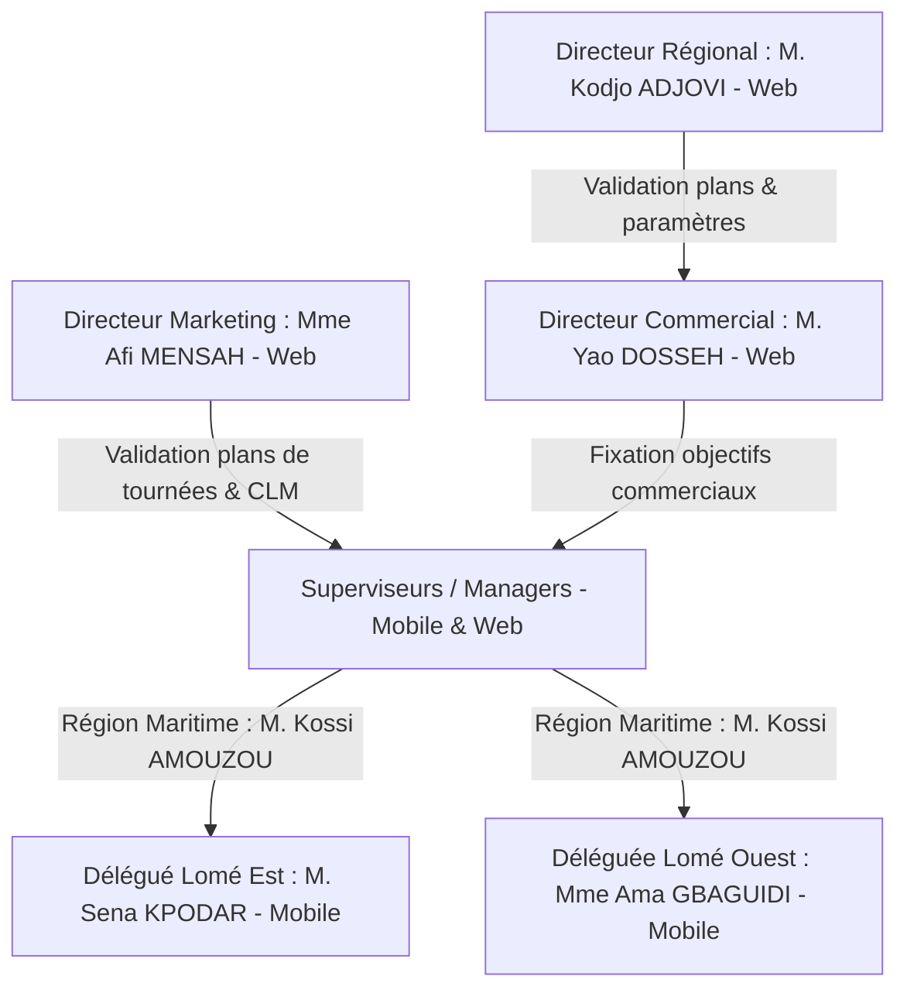

# 📖 GUIDE ULTIME & MANUEL MAÎTRE DE SPÉCIFICATIONS, API JSON, WIREFRAMES & PROMPTS DE DÉVELOPPEMENT — MEDCRM PRO / CRM SKYNITY (TOGO-PHARMA)

> **DOCUMENT DE RÉFÉRENCE UNIQUE ET EXHAUSTIF (1000+ LIGNES)**
> Ce manuel réunit l'intégralité des spécifications fonctionnelles, l'organigramme hiérarchique au Togo, la cartographie complète des fichiers `.dart`, les 8 wireframes ASCII détaillés, les contrats API REST JSON bruts (Backend / Frontend / Mobile), la base SQLite offline-first, ainsi que la collection autonome de **8 Prompts de développement prêts à copier-coller**.

---

## 📑 TABLE DES MATIÈRES

1. [Organigramme & Hiérarchie des Acteurs (Contexte TOGO-PHARMA)](#1-organigramme--hiérarchie-des-acteurs-contexte-togo-pharma)
2. [Explication Détaillée des 14 Workflows Métier au Togo](#2-explication-détaillée-des-14-workflows-métier-au-togo)
3. [Cartographie Exhaustive de Tous les Fichiers `.dart` Flutter](#3-cartographie-exhaustive-de-tous-les-fichiers-dart-flutter)
4. [Wireframes Textuels ASCII Détaillés (8 Écrans Majeurs)](#4-wireframes-textuels-ascii-détaillés-8-écrans-majeurs)
5. [Contrats API REST JSON Intégaux Backend / Frontend / Mobile (`/api/v1/`)](#5-contrats-api-rest-json-intégraux-backend--frontend--mobile-apiv1)
   - 5.1. [Authentification & Synchronisation (`auth_and_sync.json`)](#51-authentification--synchronisation-auth_and_syncjson)
   - 5.2. [Activités & Comptes Rendus de Visites (`activities_and_visits.json`)](#52-activités--comptes-rendus-de-visites-activities_and_visitsjson)
   - 5.3. [Coaching & Visites en Duo Superviseur (`coaching_and_duos.json`)](#53-coaching--visites-en-duo-superviseur-coaching_and_duosjson)
   - 5.4. [Prescripteurs & Arbitrage Portefeuille (`contacts_and_arbitrage.json`)](#54-prescripteurs--arbitrage-portefeuille-contacts_and_arbitragejson)
   - 5.5. [Ventes Grossistes par Secteur (`sales_and_wholesalers.json`)](#55-ventes-grossistes-par-secteur-sales_and_wholesalersjson)
   - 5.6. [Demandes & Workflow d'Escalade (`requests_and_escalation.json`)](#56-demandes--workflow-descalade-requests_and_escalationjson)
   - 5.7. [Schéma Master Complet (`api_contracts_complete.json`)](#57-schéma-master-complet-api_contracts_completejson)
6. [Spécifications Techniques Offline-First & Base SQLite](#6-spécifications-techniques-offline-first--base-sqlite)
   - 6.1. [Schéma SQL DDL des 7 Tables Locale SQLite](#61-schéma-sql-ddl-des-7-tables-locales-sqlite)
   - 6.2. [Code Dart `LocalDatabaseService`](#62-code-dart-localdatabaseservice)
7. [Collection Complète des 8 Prompts de Développement Prêts à Copier-Coller](#7-collection-complète-des-8-prompts-de-développement-prêts-à-copier-coller)
   - 7.1. [PROMPT 1 : Compte Rendu de Visite, Traçabilité Échantillons & Signature Tactile](#71-prompt-1--compte-rendu-de-visite-traçabilité-échantillons--signature-tactile)
   - 7.2. [PROMPT 2 : Module des Visites en Duo Superviseur](#72-prompt-2--module-des-visites-en-duo-superviseur)
   - 7.3. [PROMPT 3 : Arbitrage & Réaffectation du Portefeuille Prescripteurs (Jauge 100 max)](#73-prompt-3--arbitrage--réaffectation-du-portefeuille-prescripteurs-jauge-100-max)
   - 7.4. [PROMPT 4 : Saisie & Consolidation des Ventes Grossistes (SOCOPHAR, TOP PHARMA)](#74-prompt-4--saisie--consolidation-des-ventes-grossistes-socophar-top-pharma)
   - 7.5. [PROMPT 5 : Workflow des Demandes à Escalade (DM ➔ SUP ➔ DC ➔ DR)](#75-prompt-5--workflow-des-demandes-à-escalade-dm--sup--dc--dr)
   - 7.6. [PROMPT 6 : Moteur de Synchronisation Hors-Ligne (`SyncEngineService`)](#76-prompt-6--moteur-de-synchronisation-hors-ligne-syncengineservice)
   - 7.7. [PROMPT 7 : Espace Validation Prescripteurs & Établissements Superviseur](#77-prompt-7--espace-validation-prescripteurs--établissements-superviseur)
   - 7.8. [PROMPT 8 : Fiche Identité Produit Complète (DCI, PGHT, Labo Unique)](#78-prompt-8--fiche-identité-produit-complète-dci-pght-labo-unique)
8. [Checklist Exhaustive & Feuille de Route du Développeur (Mobile, Backend, Frontend)](#8-checklist-exhaustive--feuille-de-route-du-développeur-mobile-backend-frontend)

---

## 1. ORGANIGRAMME & HIÉRARCHIE DES ACTEURS (CONTEXTE TOGO-PHARMA)



### 1.1. Les Rôles et Acteurs Réels au Togo

1. **Directeur Régional (M. Kodjo ADJOVI)** :
   - *Plateforme* : Web Admin Backoffice.
   - *Responsabilités* : Définit la stratégie régionale, gère le catalogue produits et les laboratoires fournisseurs uniques, valide les budgets exceptionnels et distribue les dotations de supports commerciaux (gadgets, échantillons).

2. **Directeur Marketing (Mme Afi MENSAH)** :
   - *Plateforme* : Web Admin Backoffice.
   - *Responsabilités* : Met à disposition les présentations CLM/e-Detailing, définit les campagnes promotionnelles et détient le pouvoir exclusif de validation finale des **Plans de Tournées** hebdomadaires des délégués.

3. **Directeur Commercial - DC (M. Yao DOSSEH)** :
   - *Plateforme* : Web Admin Backoffice.
   - *Responsabilités* : Fixe les objectifs de Chiffre d'Affaires par région/secteur, réajuste les plans d'actions commerciaux soumis par les superviseurs et valide les demandes d'escalade budgétaire.

4. **Superviseur / Manager Régional (M. Kossi AMOUZOU - Région Maritime)** :
   - *Plateforme* : Mobile (Tablet/Phone) & Web.
   - *Responsabilités* : Encadre les délégués (Sena KPODAR à Lomé Est, Ama GBAGUIDI à Lomé Ouest), valide les nouveaux prescripteurs et établissements créés sur le terrain, effectue au minimum **2 visites en duo par mois**, et réalise l'**arbitrage du portefeuille** prescripteurs lors du dépassement du seuil de 100.

5. **Délégué Médical - DM (M. Sena KPODAR - Secteur Lomé Est)** :
   - *Plateforme* : Application Mobile Flutter.
   - *Responsabilités* : Visites de terrain (CHU Sylvanus Olympio, Clinique Biasa), saisie des comptes rendus avec signature tactile et traçabilité des lots d'échantillons, saisie des ventes grossistes (SOCOPHAR, TOP PHARMA), et soumission des demandes.

---

## 2. EXPLICATION DÉTAILLÉE DES 14 WORKFLOWS MÉTIER AU TOGO

### 🔄 2.1. Planification des Tournées (Visites Terrain)
- **Chaîne de Validation** : Délégué ➔ Superviseur ➔ Directeur Marketing ➔ Exécution.
- **Scénario** : Sena KPODAR planifie son circuit du lundi au CHU Sylvanus Olympio (Tokoin). Kossi AMOUZOU (SUP) vérifie et valide la cohérence géographique. Mme Afi MENSAH (Marketing) donne l'approbation finale.

### 🎯 2.2. Plans d'Actions Commerciaux
- **Chaîne de Validation** : Superviseur ➔ DC ➔ DR ➔ Exécution.
- **Scénario** : Kossi AMOUZOU soumet un plan d'action pour augmenter la pénétration d'Amoxil 500mg de $+20\%$ à Lomé. M. Yao DOSSEH (DC) réajuste l'objectif à $+15\%$. M. Kodjo ADJOVI (DR) débloque les échantillons.

### 📦 2.3. Supports Commerciaux (Descendant)
- **Principe** : Descendant du DR vers les délégués.
- **Scénario** : M. Kodjo ADJOVI reçoit $1\,000$ stylos et $500$ blocs-notes de Sanofi. Il attribue $250$ stylos à Kossi AMOUZOU, qui en alloue $125$ à Sena KPODAR pour distribution aux médecins de Lomé Est.

### 💊 2.4. Produits & Laboratoire Unique
- **Règle Stricte** : Chaque produit appartient à **1 seul Laboratoire fournisseur**.
- **Scénario** : Amoxil 500mg ($2\,500$ FCFA PGHT) est rattaché exclusivement à Sanofi. Impossible d'associer un second laboratoire à ce produit.

### 🏥 2.5. Validation des Prescripteurs & Établissements
- **Workflow** : Sena KPODAR rencontre le Dr Kodjo AMEGBOR à la Clinique Biasa et l'enregistre sur l'application mobile. Le prescripteur passe en statut `en_attente`. Kossi AMOUZOU consulte l'espace validation sur sa tablette et clique sur "Valider".

### 📝 2.6. Compte Rendu de Visite & Échantillons
- **Contenu** : Saisie à 2 états (`Brouillon` ➔ `Soumis_Definitif`). Si des échantillons sont remis, la saisie du Numéro de Lot (`LOT-2025-A456`), de la Date de Péremption et la Signature tactile du médecin sont **légalement obligatoires**.

### 👥 2.7. Visites en Duo Superviseur
- **Obligation** : Quota minimum de **2 sessions par mois par superviseur**.
- **Scénario** : Kossi AMOUZOU accompagne Sena KPODAR au CHU Sylvanus Olympio. Il définit 5 visites prévues. En fin de journée, il saisit les 4 visites réalisées et enregistre un taux d'atteinte de $80\%$.

### 📊 2.8. Arbitrage du Portefeuille Prescripteurs (Jauge 100 max)
- **Règle** : Le portefeuille d'un délégué est plafonné à **100 prescripteurs**.
- **Scénario** : Sena KPODAR tente d'ajouter le 101ème médecin (Dr Afi SODJI). Le système bloque et alerte le superviseur. Kossi AMOUZOU choisit le Dr Kossi AGBEKO (1 seule visite en 6 mois), le permute vers le bassin de réaffectation régionale sans le supprimer, et valide l'entrée du Dr Afi SODJI.

### 📩 2.9. Demandes des Délégués à Escalade
- **Workflow** : Sena KPODAR demande une dotation exceptionnelle d'échantillons. Kossi AMOUZOU (SUP) approuve ➔ Transmis à M. Yao DOSSEH (DC) qui valide ➔ Transmis au DR pour allocation.

### 📈 2.10. Ventes Grossistes par Secteur
- **Principe** : Traçabilité des ventes indirectes via les grossistes de répartition.
- **Scénario** : En fin de mois, Sena KPODAR saisit les sorties de SOCOPHAR TOGO pour le secteur Lomé Est ($1\,500$ boîtes d'Amoxil 500mg et $3\,200$ boîtes de Doliprane 1g), générant un CA estimé de $7\,590\,000$ FCFA.

---

## 3. CARTOGRAPHIE EXHAUSTIVE DE TOUS LES FICHIERS `.dart` FLUTTER

L'arborescence ci-dessous structure l'ensemble du projet client Flutter (`/home/vladmir/Documents/CRM_SKYNITY/lib/`).

```
lib/
├── core/
│   ├── network/
│   │   ├── api_client.dart                  [EXISTANT - Client Dio + Auth Interceptor]
│   │   └── api_endpoints.dart               [EXISTANT - Constantes URL /api/v1/]
│   ├── routes/
│   │   ├── app_pages.dart                   [EXISTANT - Configuration GetPages]
│   │   └── app_routes.dart                  [EXISTANT - Constantes de Routes]
│   └── services/
│       └── sync_engine_service.dart         [NOUVEAU - Moteur Offline-First FIFO]
├── data/
│   ├── datasources/
│   │   └── local_database_service.dart      [EXISTANT - Gestionnaire SQLite 7 Tables]
│   └── models/
│       ├── activity_model.dart              [EXISTANT - Modèle Visite + Getters Alias]
│       ├── contact_model.dart               [EXISTANT - Modèle HCP + Getters Alias]
│       ├── expense_model.dart               [EXISTANT - Modèle Frais + Getters Alias]
│       ├── duo_session_model.dart           [NOUVEAU - Modèle Duo Superviseur]
│       ├── wholesale_sale_model.dart        [NOUVEAU - Modèle Ventes Grossistes]
│       ├── delegate_request_model.dart      [NOUVEAU - Modèle Demande & Escalade]
│       └── product_model.dart               [EXISTANT - Modèle Produit & Labo]
├── presentation/
│   ├── bindings/
│   │   ├── visit_report_binding.dart        [NOUVEAU - Injection VisitReportController]
│   │   ├── supervisor_duo_binding.dart      [NOUVEAU - Injection SupervisorDuoController]
│   │   ├── hcp_arbitrage_binding.dart       [NOUVEAU - Injection HcpArbitrageController]
│   │   ├── wholesale_sales_binding.dart     [NOUVEAU - Injection WholesaleSalesController]
│   │   └── delegate_requests_binding.dart   [NOUVEAU - Injection DelegateRequestsController]
│   ├── controllers/
│   │   ├── visit_report_controller.dart     [EXISTANT - Controller CR & Échantillons]
│   │   ├── supervisor_duo_controller.dart   [NOUVEAU - Controller Duos Superviseur]
│   │   ├── hcp_portfolio_arbitrage_controller.dart [NOUVEAU - Controller Arbitrage 100 max]
│   │   ├── wholesale_sales_controller.dart  [NOUVEAU - Controller Ventes Grossistes]
│   │   ├── delegate_requests_controller.dart[NOUVEAU - Controller Demandes & Escalade]
│   │   ├── manager_validations_controller.dart [EXISTANT - Controller Validations SUP]
│   │   └── products_controller.dart         [EXISTANT - Controller Catalogue Produit]
│   ├── views/
│   │   ├── delegate/
│   │   │   ├── visit_report_view.dart       [EXISTANT - Vue CR Visite + Signature]
│   │   │   ├── wholesale_sales_entry_view.dart [NOUVEAU - Vue Saisie Ventes Grossistes]
│   │   │   ├── delegate_requests_view.dart  [NOUVEAU - Vue Demandes & Escalade]
│   │   │   ├── delegate_dashboard_view.dart [EXISTANT - Dashboard DM + Jauge 100]
│   │   │   └── delegate_planning_view.dart  [EXISTANT - Planning Tournées]
│   │   ├── manager/
│   │   │   ├── supervisor_duo_view.dart     [NOUVEAU - Vue Duos Superviseur]
│   │   │   ├── hcp_portfolio_arbitrage_view.dart [NOUVEAU - Vue Arbitrage 100 max]
│   │   │   ├── manager_validations_view.dart[EXISTANT - Vue Validations SUP]
│   │   │   └── supervisor_dashboard_view.dart [EXISTANT - Dashboard Superviseur]
│   │   └── products/
│   │       └── product_detail_view.dart     [EXISTANT - Vue Fiche Identité Produit]
│   └── widgets/
│       ├── doctor_signature_pad_modal.dart  [NOUVEAU - Canvas Modale Signature PNG]
│       └── portfolio_gauge_widget.dart      [NOUVEAU - Jauge Visuelle Saturation 100]
```

---

## 4. WIREFRAMES TEXTUELS ASCII DÉTAILLÉS (8 ÉCRANS MAJEURS)

### 📱 WIREFRAME 1 : Compte Rendu de Visite & Signature (`visit_report_view.dart`)

```
+-------------------------------------------------------------------+
|  <  COMPTE RENDU DE VISITE MÉDICALE                   [Draft Badg]|
+-------------------------------------------------------------------+
| Prescripteur : Dr Kodjo AMEGBOR (Cardiologue)                     |
| Établissement: CHU Sylvanus Olympio (Tokoin, Lomé)                |
| Date & Heure  : 18/09/2026 à 10:30                                |
+-------------------------------------------------------------------+
| [Motif de Visite *                                              ] |
| > Présentation Amoxil 500mg et remise d'échantillons              |
+-------------------------------------------------------------------+
| PRODUITS PRÉSENTÉS & PRIX GROSSISTE (PGHT)                        |
| [x] Amoxil 500mg (Sanofi)  - PGHT : 2 500 FCFA                     |
| [x] Doliprane 1g (Sanofi)  - PGHT : 1 200 FCFA                     |
+-------------------------------------------------------------------+
| ÉCHANTILLONS REMIS (TRAÇABILITÉ LÉGALE)                           |
| +---------------------------------------------------------------+ |
| | Produit: Amoxil 500mg | Qté: 5  | N° Lot: LOT-2025-A456      | |
| | Date Péremption: 31/12/2027                                  | |
| +---------------------------------------------------------------+ |
| [ + AJOUTER UN ÉCHANTILLON ]                                      |
+-------------------------------------------------------------------+
| SIGNATURE TACTILE MANUSCRITE DU MÉDECIN *                         |
| +---------------------------------------------------------------+ |
| |                    [ Pad de Signature ]                       | |
| |                      Dr K. AMEGBOR                            | |
| +---------------------------------------------------------------+ |
| [ EFFACER ]                                [ VALIDER SIGNATURE ]  |
+-------------------------------------------------------------------+
| [ SAUVEGARDER BROUILLON ]           [ SOUMETTRE DÉFINITIVEMENT ]  |
+-------------------------------------------------------------------+
```

---

### 📱 WIREFRAME 2 : Visites en Duo Superviseur (`supervisor_duo_view.dart`)

```
+-------------------------------------------------------------------+
|  <  VISITES EN DUO SUPERVISEUR (RÉGION MARITIME)                  |
+-------------------------------------------------------------------+
| [ CARD : QUOTA MENSUEL DUOS : 1 / 2 MINIMUM REQUIS  -  STATUS: ⚠️ ]|
+-------------------------------------------------------------------+
|  [ TAB 1 : PLANIFICATION AMONT ]    |  [ TAB 2 : BILAN EVALUATION]|
+-------------------------------------------------------------------+
| Délégué Concerné : [ Sena KPODAR (Lomé Est)                  v ]  |
| Date Prévue      : [ 20/09/2026                             📅 ]  |
| Zone / Secteur   : [ Secteur Lomé Est                          ]  |
| Motif du Duo     : [ Observation argumentation & objection prix]  |
+-------------------------------------------------------------------+
| OBJECTIFS PRÉVUS DU DUO :                                         |
|  1. Effectuer 5 visites conjointes au CHU Sylvanus Olympio        |
|  2. Présenter Amoxil 500mg à 3 cardiologues                       |
|  [ + AJOUTER UN OBJECTIF PRÉVU ]                                  |
+-------------------------------------------------------------------+
| TABLEAU COMPARATIF OBJECTIFS VS RÉSULTATS :                       |
| Objectif Prévu      | Résultat Constaté     | Taux Atteinte       |
| 1. Visites (5)      | 4 effectuées          | [=======---] 80%    |
| 2. Présentations(3) | 2 effectuées          | [======----] 66%    |
| Taux d'Atteinte Global : 82.0%                                    |
+-------------------------------------------------------------------+
| [ CLÔTURER ET TRANSMETTRE LE RAPPORT DE DUO ]                     |
+-------------------------------------------------------------------+
```

---

### 📱 WIREFRAME 3 : Arbitrage du Portefeuille Prescripteurs (`hcp_portfolio_arbitrage_view.dart`)

```
+-------------------------------------------------------------------+
|  <  ARBITRAGE DU PORTEFEUILLE PRESCRIPTEURS                       |
+-------------------------------------------------------------------+
| Délégué : Sena KPODAR (Lomé Est)                                  |
| JAUGE PORTEFEUILLE : [====================] 100 / 100 (SATURÉ !) |
+-------------------------------------------------------------------+
| DEMANDE D'INTÉGRATION :                                           |
| Nouveau Prescripteur : Dr Afi SODJI (Dermatologue - Bè)           |
+-------------------------------------------------------------------+
| ANCIENS PRESCRIPTEURS DU DÉLÉGUÉ (TRIÉS PAR FRÉQUENCE VISITES) :  |
| [!] Dr Kossi AGBEKO (1 seule visite sur 6 mois)  <-- RECOMMANDÉ  |
| [ ] Dr Ama TOSSOU   (6 visites sur 6 mois)                        |
| [ ] Dr Kodjo AMEGBOR(8 visites sur 6 mois)                        |
+-------------------------------------------------------------------+
| ℹ️ NOTE DE TRAÇABILITÉ : Le prescripteur retiré ne sera pas       |
| supprimé mais remis dans le bassin de réaffectation régionale.    |
+-------------------------------------------------------------------+
| [ VALIDER L'ARBITRAGE ET PERMUTER LES PRESCRIPTEURS ]             |
+-------------------------------------------------------------------+
```

---

### 📱 WIREFRAME 4 : Saisie des Ventes Grossistes (`wholesale_sales_entry_view.dart`)

```
+-------------------------------------------------------------------+
|  <  SAISIE DES VENTES GROSSISTES PAR SECTEUR                      |
+-------------------------------------------------------------------+
| Période   : [ Janvier 2026 v ]                                    |
| Grossiste : [ SOCOPHAR TOGO  v ]                                  |
| Secteur   : [ Lomé Est       v ]                                  |
+-------------------------------------------------------------------+
| TABLEAU DES VENTES PAR PRODUIT :                                  |
| Produit         | Boîtes Vendues | PGHT Unitaire | Total CA (FCFA) |
| Amoxil 500mg    | [ 1 500    ] | 2 500 FCFA    | 3 750 000 FCFA  |
| Doliprane 1g    | [ 3 200    ] | 1 200 FCFA    | 3 840 000 FCFA  |
+-------------------------------------------------------------------+
| TOTAL C.A. ESTIMÉ GROSSISTE : 7 590 000 FCFA                      |
+-------------------------------------------------------------------+
| [ SOUMETTRE LES VENTES MENSUELLES ]                               |
+-------------------------------------------------------------------+
```

---

### 📱 WIREFRAME 5 : Demandes des Délégués avec Escalade (`delegate_requests_view.dart`)

```
+-------------------------------------------------------------------+
|  <  DEMANDES ET ESCALADE HIÉRARCHIQUE                             |
+-------------------------------------------------------------------+
| [ TAB 1 : MES DEMANDES (DM) ]      | [ TAB 2 : VALIDATIONS (SUP) ]|
+-------------------------------------------------------------------+
| [ + CRÉER UNE NOUVELLE DEMANDE ]                                  |
+-------------------------------------------------------------------+
| HISTORIQUE DES DEMANDES SOUMISES :                                |
| 1. Réassort Échantillons Doliprane 1g                             |
|    Statut: [ EN ATTENTE SUPERVISEUR (JAUNE) ]                     |
|    Date  : 18/09/2026                                             |
|                                                                   |
| 2. Budget Exceptionnel Séminaire Cardio                           |
|    Statut: [ TRANSMIS DIRECTEUR COMMERCIAL (BLEU) ]               |
|    Date  : 10/09/2026                                             |
+-------------------------------------------------------------------+
```

---

### 📱 WIREFRAME 6 : Espace Validation Superviseur (`manager_validations_view.dart`)

```
+-------------------------------------------------------------------+
|  <  VALIDATIONS EN ATTENTE (SUPERVISEUR)                          |
+-------------------------------------------------------------------+
| PRESCRIPTEURS À VALIDER (2 EN ATTENTE) :                          |
| 1. Dr Kodjo AMEGBOR (Cardiologue)                                 |
|    Créé par : Sena KPODAR | Lieu: Clinique Biasa (Bè)             |
|    [ ACCEPTER ]                        [ REJETER AVEC MOTIF ]     |
|                                                                   |
| ÉTABLISSEMENTS À VALIDER (1 EN ATTENTE) :                         |
| 1. Clinique Espoir (Agoè-Nyivé)                                   |
|    Créé par : Ama GBAGUIDI | Type: Clinique Privée                |
|    [ ACCEPTER ]                        [ REJETER AVEC MOTIF ]     |
+-------------------------------------------------------------------+
```

---

### 📱 WIREFRAME 7 : Fiche Produit Complète (`product_detail_view.dart`)

```
+-------------------------------------------------------------------+
|  <  FICHE D'IDENTITÉ PRODUIT                                      |
+-------------------------------------------------------------------+
| NOM COMMERCIAL : AMOXIL 500mg                                     |
| DCI            : Amoxicilline                                     |
| LABORATOIRE    : Sanofi (Laboratoire Fournisseur Unique)          |
+-------------------------------------------------------------------+
| CARACTÉRISTIQUES TECHNIQUES :                                     |
| - Forme Galénique    : Gélule                                     |
| - Conditionnement    : Boîte de 12 gélules                        |
| - Classe Thérapeutique: Antibiotique (Pénicilline)                |
| - Prix Grossiste HT  : 2 500 FCFA                                 |
+-------------------------------------------------------------------+
| INDICATIONS & POSOLOGIE :                                         |
| Infections ORL, respiratoires, urinaires.                         |
| Posologie : 1 gélule 3x/jour pendant 7 jours.                     |
+-------------------------------------------------------------------+
```

---

### 📱 WIREFRAME 8 : Dashboard Délégué & Jauge Portefeuille (`delegate_dashboard_view.dart`)

```
+-------------------------------------------------------------------+
|  MEDCRM PRO  -  DÉLÉGUÉ MÉDICAL                      [ Offline 🟢]|
+-------------------------------------------------------------------+
| Bienvenue, Sena KPODAR (Lomé Est)                                 |
+-------------------------------------------------------------------+
| JAUGE PORTEFEUILLE : [====================] 100 / 100 (SATURÉ !) |
| DUOS DU MOIS        : [========------------] 1 / 2 Effectués       |
+-------------------------------------------------------------------+
| APERÇU DE LA SEMAINE :                                            |
|  - Visites Prévues   : 24                                         |
|  - Visites Réalisées : 18                                         |
|  - Taux de Couverture: 75%                                        |
+-------------------------------------------------------------------+
| [ PROCHAIN RENDEZ-VOUS : Dr Kodjo AMEGBOR à 10h30 ]               |
| [ DÉMARRER LA VISITE ]                                            |
+-------------------------------------------------------------------+
```

---

## 5. CONTRATS API REST JSON INTÉGRAUX BACKEND / FRONTEND / MOBILE (`/api/v1/`)

Voici le contenu brut des contrats d'API JSON créés sous `backend/api_contracts/`.

### 5.1. Authentification & Synchronisation (`auth_and_sync.json`)

```json
{
  "module": "Authentication & Synchronization",
  "version": "v1",
  "base_url": "http://localhost:8000/api/v1",
  "endpoints": {
    "login": {
      "method": "POST",
      "path": "/login",
      "headers": {
        "Content-Type": "application/json",
        "Accept": "application/json"
      },
      "request_payload": {
        "email": "user@skynity.com",
        "password": "password123"
      },
      "validation_rules": {
        "email": "required|email",
        "password": "required|string|min:6"
      },
      "response_200": {
        "status": "otp_required",
        "user_id": "01a06925-8505-704e-8cb4-ae2305233c09",
        "email": "user@skynity.com",
        "message": "Un code OTP a été envoyé."
      },
      "response_401": {
        "message": "Identifiants invalides"
      }
    },
    "verify_otp": {
      "method": "POST",
      "path": "/verify-otp",
      "headers": {
        "Content-Type": "application/json",
        "Accept": "application/json"
      },
      "request_payload": {
        "user_id": "01a06925-8505-704e-8cb4-ae2305233c09",
        "otp_code": "384057"
      },
      "validation_rules": {
        "user_id": "required|uuid",
        "otp_code": "required|string|size:6"
      },
      "response_200": {
        "status": "success",
        "token": "1|eyJhbGciOiJIUzI1Ni...",
        "user": {
          "id": "01a06925-8505-704e-8cb4-ae2305233c09",
          "name": "Sena KPODAR",
          "email": "sena.kpodar@togo-pharma.com",
          "role": "Medical Delegate",
          "region_id": "reg_maritime_togo",
          "sector_id": "sec_lome_est"
        }
      },
      "response_422": {
        "message": "Code OTP invalide ou expiré"
      }
    },
    "sync_pull": {
      "method": "GET",
      "path": "/sync/pull?last_synced_at=2026-09-18T00:00:00Z",
      "headers": {
        "Authorization": "Bearer {token}",
        "Accept": "application/json"
      },
      "response_200": {
        "timestamp": "2026-09-18T02:15:00Z",
        "products": [
          {
            "id": "prod_amoxil_500",
            "dci": "Amoxicilline",
            "nom_commercial": "Amoxil 500mg",
            "forme_galenique": "Gélule",
            "conditionnement": "Boîte de 12 gélules",
            "classe_therapeutique": "Antibiotique",
            "pght": 2500.0,
            "laboratoire_id": "lab_sanofi"
          }
        ],
        "contacts": [
          {
            "id": "hcp_dr_amegbor",
            "nom": "AMEGBOR",
            "prenom": "Kodjo",
            "titre": "Dr",
            "specialite": "Cardiologue",
            "telephone": "+22890010203",
            "account_id_principal": "acc_chu_sylvanus_olympio",
            "statut_validation": "valide"
          }
        ]
      }
    },
    "sync_push": {
      "method": "POST",
      "path": "/sync/push",
      "headers": {
        "Authorization": "Bearer {token}",
        "Content-Type": "application/json",
        "Accept": "application/json"
      },
      "request_payload": {
        "queue": [
          {
            "endpoint": "activities",
            "method": "POST",
            "payload": {
              "contact_id": "hcp_dr_amegbor",
              "motif": "Visite de suivi Amoxil",
              "statut": "soumis_definitif"
            }
          }
        ]
      },
      "response_200": {
        "status": "success",
        "processed_items": 1,
        "errors": []
      }
    }
  }
}
```

---

### 5.2. Activités & Comptes Rendus de Visites (`activities_and_visits.json`)

```json
{
  "module": "Activities & Visits",
  "version": "v1",
  "base_url": "http://localhost:8000/api/v1",
  "endpoints": {
    "create_activity": {
      "method": "POST",
      "path": "/activities",
      "headers": {
        "Authorization": "Bearer {token}",
        "Content-Type": "application/json",
        "Accept": "application/json"
      },
      "request_payload": {
        "contact_id": "hcp_dr_amegbor",
        "account_id": "acc_chu_sylvanus_olympio",
        "activity_type": "visite",
        "date_activite": "2026-09-18",
        "heure_debut": "10:30",
        "heure_fin": "11:15",
        "statut": "soumis_definitif",
        "motif": "Présentation Amoxil 500mg et remise d'échantillons",
        "notes": "Médecin très intéressé par la nouvelle étude clinique.",
        "niveau_interet": 4,
        "samples": [
          {
            "product_id": "prod_amoxil_500",
            "quantite": 5,
            "num_lot": "LOT-2025-A456",
            "date_peremption": "2027-12-31"
          }
        ],
        "gadgets": [
          {
            "gadget_id": "gad_stylo_01",
            "quantite": 3,
            "beneficiaire": "Dr Kodjo AMEGBOR"
          }
        ],
        "signature_base64": "data:image/png;base64,iVBORw0KGgoAAAANSUhEUgAA..."
      },
      "validation_rules": {
        "contact_id": "required|string|exists:contacts,id",
        "account_id": "required|string|exists:accounts,id",
        "activity_type": "required|string|in:visite,reunion,appel,autre",
        "date_activite": "required|date_format:Y-m-d",
        "statut": "required|string|in:brouillon,soumis_definitif",
        "motif": "required_if:statut,soumis_definitif|string|max:500",
        "samples": "nullable|array",
        "samples.*.product_id": "required_with:samples|string|exists:products,id",
        "samples.*.quantite": "required_with:samples|integer|min:1",
        "samples.*.num_lot": "required_with:samples|string|regex:/^[A-Z0-9-]+$/",
        "signature_base64": "required_if:samples.*,not_null|string"
      },
      "response_201": {
        "status": "success",
        "message": "Activité et compte rendu enregistrés avec succès.",
        "data": {
          "id": "act_2026_0918_001",
          "contact_id": "hcp_dr_amegbor",
          "statut": "soumis_definitif",
          "created_at": "2026-09-18T10:30:00Z"
        }
      }
    }
  }
}
```

---

### 5.3. Coaching & Visites en Duo Superviseur (`coaching_and_duos.json`)

```json
{
  "module": "Coaching & Supervisor Duos",
  "version": "v1",
  "base_url": "http://localhost:8000/api/v1",
  "endpoints": {
    "plan_duo": {
      "method": "POST",
      "path": "/coaching-sessions",
      "headers": {
        "Authorization": "Bearer {token}",
        "Content-Type": "application/json",
        "Accept": "application/json"
      },
      "request_payload": {
        "delegate_id": "user_sena_kpodar",
        "date_duo": "2026-09-20",
        "zone": "Secteur Lomé Est",
        "motif": "Accompagnement terrain et observation de l'argumentaire Amoxil",
        "objectifs_prevus": [
          "Effectuer 5 visites conjointes",
          "Présenter Amoxil 500mg à 3 cardiologues",
          "Obtenir 2 engagements de prescription"
        ]
      },
      "validation_rules": {
        "delegate_id": "required|uuid|exists:users,id",
        "date_duo": "required|date_format:Y-m-d|after_or_equal:today",
        "zone": "required|string|max:255",
        "motif": "required|string|max:500",
        "objectifs_prevus": "required|array|min:1"
      },
      "response_201": {
        "status": "success",
        "message": "Duo planifié avec succès.",
        "data": {
          "id": "duo_2026_0920_001",
          "statut": "planifie",
          "duos_completed_this_month": 1,
          "duos_required_per_month": 2
        }
      }
    },
    "complete_duo": {
      "method": "PUT",
      "path": "/coaching-sessions/{id}/complete",
      "headers": {
        "Authorization": "Bearer {token}",
        "Content-Type": "application/json",
        "Accept": "application/json"
      },
      "request_payload": {
        "delegate_id": "user_sena_kpodar",
        "date_duo": "2026-09-20",
        "zone": "Secteur Lomé Est",
        "motif": "Accompagnement terrain",
        "objectifs_prevus": [
          "Effectuer 5 visites conjointes",
          "Présenter Amoxil 500mg à 3 cardiologues"
        ],
        "activites_realisees": "4 visites effectuées au CHU Sylvanus Olympio",
        "resultats_constates": [
          "4 visites réalisées sur 5 prévues",
          "2 présentations Amoxil effectuées"
        ],
        "taux_atteinte_pct": 82.0,
        "commentaires_superviseur": "Sena maîtrise bien le discours produit. Poursuivre le travail sur les objections prix.",
        "plan_action_recommande": "Formation de 30 min sur la fiche d'argumentaire prix d'Amoxil."
      },
      "validation_rules": {
        "activites_realisees": "required|string",
        "resultats_constates": "required|array|min:1",
        "taux_atteinte_pct": "required|numeric|min:0|max:100",
        "commentaires_superviseur": "required|string"
      },
      "response_200": {
        "status": "success",
        "message": "Rapport de duo clôturé et enregistré.",
        "data": {
          "id": "duo_2026_0920_001",
          "statut": "cloture",
          "taux_atteinte_pct": 82.0
        }
      }
    }
  }
}
```

---

### 5.4. Prescripteurs & Arbitrage Portefeuille (`contacts_and_arbitrage.json`)

```json
{
  "module": "Contacts & Portfolio Arbitrage",
  "version": "v1",
  "base_url": "http://localhost:8000/api/v1",
  "endpoints": {
    "create_contact": {
      "method": "POST",
      "path": "/contacts",
      "headers": {
        "Authorization": "Bearer {token}",
        "Content-Type": "application/json",
        "Accept": "application/json"
      },
      "request_payload": {
        "nom": "SODJI",
        "prenom": "Afi",
        "titre": "Dr",
        "telephone": "+22890112233",
        "email": "dr.sodji@gmail.com",
        "specialite": "Dermatologue",
        "account_id_principal": "acc_clinique_biasa",
        "account_ids_secondaires": ["acc_chu_sylvanus_olympio"],
        "zone": "Secteur Lomé Est"
      },
      "validation_rules": {
        "nom": "required|string|max:100",
        "prenom": "required|string|max:100",
        "account_id_principal": "required|string|exists:accounts,id",
        "specialite": "required|string"
      },
      "response_201": {
        "status": "pending_validation",
        "message": "Prescripteur enregistré et transmis au Superviseur pour validation.",
        "data": {
          "id": "hcp_dr_sodji_afi",
          "statut_validation": "en_attente"
        }
      }
    },
    "arbitrage_portfolio": {
      "method": "POST",
      "path": "/contacts/arbitrage",
      "headers": {
        "Authorization": "Bearer {token}",
        "Content-Type": "application/json",
        "Accept": "application/json"
      },
      "request_payload": {
        "delegate_id": "user_sena_kpodar",
        "new_contact_id": "hcp_dr_sodji_afi",
        "removed_contact_id": "hcp_dr_agbeko_kossi",
        "reason": "Capacité maximale atteinte (100). Prescripteur le moins visité réaffecté au bassin régional.",
        "action": "reallocate_to_regional_pool"
      },
      "validation_rules": {
        "delegate_id": "required|uuid|exists:users,id",
        "new_contact_id": "required|string|exists:contacts,id",
        "removed_contact_id": "required|string|exists:contacts,id",
        "reason": "required|string|max:500"
      },
      "response_200": {
        "status": "success",
        "message": "Arbitrage effectué. Dr Kossi AGBEKO réaffecté au bassin régional sans perte d'historique.",
        "data": {
          "delegate_id": "user_sena_kpodar",
          "active_portfolio_count": 100,
          "reallocated_contact": {
            "id": "hcp_dr_agbeko_kossi",
            "previous_delegate": "user_sena_kpodar",
            "unassigned_at": "2026-09-18T02:15:00Z"
          }
        }
      }
    }
  }
}
```

---

### 5.5. Ventes Grossistes par Secteur (`sales_and_wholesalers.json`)

```json
{
  "module": "Sales & Wholesalers",
  "version": "v1",
  "base_url": "http://localhost:8000/api/v1",
  "endpoints": {
    "submit_sales": {
      "method": "POST",
      "path": "/sales",
      "headers": {
        "Authorization": "Bearer {token}",
        "Content-Type": "application/json",
        "Accept": "application/json"
      },
      "request_payload": {
        "periode": "2026-01",
        "grossiste_id": "gross_socophar_togo",
        "secteur_id": "sec_lome_est",
        "delegate_id": "user_sena_kpodar",
        "ventes": [
          {
            "product_id": "prod_amoxil_500",
            "quantite_boites": 1500,
            "pght_unitaire": 2500.0,
            "chiffre_affaires": 3750000.0
          },
          {
            "product_id": "prod_doliprane_1g",
            "quantite_boites": 3200,
            "pght_unitaire": 1200.0,
            "chiffre_affaires": 3840000.0
          }
        ]
      },
      "validation_rules": {
        "periode": "required|date_format:Y-m",
        "grossiste_id": "required|string",
        "secteur_id": "required|string|exists:sectors,id",
        "ventes": "required|array|min:1",
        "ventes.*.product_id": "required|string|exists:products,id",
        "ventes.*.quantite_boites": "required|integer|min:1"
      },
      "response_201": {
        "status": "success",
        "message": "Ventes grossistes saisies avec succès.",
        "data": {
          "total_chiffre_affaires": 7590000.0,
          "total_boites": 4700,
          "statut_objectif": "32% réalisé"
        }
      }
    }
  }
}
```

---

### 5.6. Demandes & Workflow d'Escalade (`requests_and_escalation.json`)

```json
{
  "module": "Delegate Requests & Escalation Workflow",
  "version": "v1",
  "base_url": "http://localhost:8000/api/v1",
  "endpoints": {
    "create_request": {
      "method": "POST",
      "path": "/requests",
      "headers": {
        "Authorization": "Bearer {token}",
        "Content-Type": "application/json",
        "Accept": "application/json"
      },
      "request_payload": {
        "delegate_id": "user_sena_kpodar",
        "type_demande": "echantillons_supplementaires",
        "objet": "Augmentation dotation Doliprane 1g pour la zone Bè",
        "description": "Forte demande pédiatrique et épidémie de grippe saisonnière sur Lomé Est.",
        "justification": "Il ne reste que 20 boîtes en stock local.",
        "statut": "en_attente_superviseur"
      },
      "validation_rules": {
        "type_demande": "required|string|in:budget,echantillons_supplementaires,materiel,formation,conge",
        "objet": "required|string|max:255",
        "description": "required|string|max:1000",
        "justification": "required|string|max:1000"
      },
      "response_201": {
        "status": "success",
        "message": "Demande soumise au Superviseur pour contrôle.",
        "data": {
          "id": "req_2026_001",
          "statut": "en_attente_superviseur"
        }
      }
    },
    "supervisor_approve_request": {
      "method": "POST",
      "path": "/requests/{id}/approve-supervisor",
      "headers": {
        "Authorization": "Bearer {token}",
        "Content-Type": "application/json",
        "Accept": "application/json"
      },
      "request_payload": {
        "supervisor_comment": "Demande vérifiée et justifiée par la consommation du stock local."
      },
      "response_200": {
        "status": "success",
        "message": "Demande approuvée par le Superviseur et transmise au Directeur Commercial.",
        "data": {
          "id": "req_2026_001",
          "statut": "transmis_directeur_commercial"
        }
      }
    },
    "supervisor_reject_request": {
      "method": "POST",
      "path": "/requests/{id}/reject-supervisor",
      "headers": {
        "Authorization": "Bearer {token}",
        "Content-Type": "application/json",
        "Accept": "application/json"
      },
      "request_payload": {
        "rejection_reason": "Stock local suffisant (300 boîtes répertoriées)."
      },
      "response_200": {
        "status": "success",
        "message": "Demande rejetée par le Superviseur.",
        "data": {
          "id": "req_2026_001",
          "statut": "rejete_superviseur"
        }
      }
    }
  }
}
```

---

### 5.7. Schéma Master Complet (`api_contracts_complete.json`)

```json
{
  "project": "CRM SKYNITY / MEDCRM PRO",
  "company_context": "TOGO-PHARMA",
  "version": "v1",
  "base_url": "http://localhost:8000/api/v1",
  "modules": [
    "Authentication & Synchronization (auth_and_sync.json)",
    "Activities & Visits (activities_and_visits.json)",
    "Coaching & Supervisor Duos (coaching_and_duos.json)",
    "Contacts & Portfolio Arbitrage (contacts_and_arbitrage.json)",
    "Sales & Wholesalers (sales_and_wholesalers.json)",
    "Requests & Escalation Workflow (requests_and_escalation.json)"
  ]
}
```

---

## 6. SPÉCIFICATIONS TECHNIQUES OFFLINE-FIRST & BASE SQLITE

### 6.1. Schéma SQL DDL des 7 Tables Locales SQLite

```sql
-- 1. Table des Prescripteurs (Local)
CREATE TABLE local_contacts (
    id TEXT PRIMARY KEY,
    nom TEXT NOT NULL,
    prenom TEXT NOT NULL,
    titre TEXT,
    telephone TEXT,
    email TEXT,
    specialite TEXT NOT NULL,
    account_id_principal TEXT NOT NULL,
    account_ids_secondaires TEXT,
    zone TEXT NOT NULL,
    statut_validation TEXT DEFAULT 'en_attente',
    sync_status TEXT DEFAULT 'synced',
    created_at TEXT NOT NULL,
    updated_at TEXT NOT NULL
);

-- 2. Table des Établissements (Local)
CREATE TABLE local_accounts (
    id TEXT PRIMARY KEY,
    nom TEXT NOT NULL,
    type_etablissement TEXT NOT NULL,
    adresse TEXT,
    ville TEXT NOT NULL,
    zone TEXT NOT NULL,
    statut_validation TEXT DEFAULT 'en_attente',
    sync_status TEXT DEFAULT 'synced',
    created_at TEXT NOT NULL
);

-- 3. Table des Visites
CREATE TABLE local_visits (
    id TEXT PRIMARY KEY,
    contact_id TEXT NOT NULL,
    account_id TEXT NOT NULL,
    date_visite TEXT NOT NULL,
    heure_debut TEXT,
    heure_fin TEXT,
    motif TEXT NOT NULL,
    statut TEXT NOT NULL,
    notes TEXT,
    niveau_interet INTEGER DEFAULT 3,
    pght_total REAL DEFAULT 0.0,
    signature_base64 TEXT,
    sync_status TEXT DEFAULT 'pending_insert',
    created_at TEXT NOT NULL
);

-- 4. Table des Échantillons (Traçabilité Légale)
CREATE TABLE local_visit_samples (
    id TEXT PRIMARY KEY,
    visit_id TEXT NOT NULL,
    product_id TEXT NOT NULL,
    quantite INTEGER NOT NULL,
    num_lot TEXT NOT NULL,
    date_peremption TEXT NOT NULL
);

-- 5. Table des Visites en Duo Superviseur
CREATE TABLE local_duo_sessions (
    id TEXT PRIMARY KEY,
    delegate_id TEXT NOT NULL,
    date_duo TEXT NOT NULL,
    zone TEXT NOT NULL,
    motif TEXT NOT NULL,
    objectifs_prevus_json TEXT NOT NULL,
    resultats_constates_json TEXT,
    taux_atteinte_pct REAL DEFAULT 0.0,
    commentaires_superviseur TEXT,
    plan_action_recommande TEXT,
    statut TEXT DEFAULT 'planifie',
    sync_status TEXT DEFAULT 'pending_insert'
);

-- 6. Table des Ventes Grossistes Saisies
CREATE TABLE local_wholesale_sales (
    id TEXT PRIMARY KEY,
    periode TEXT NOT NULL,
    grossiste_id TEXT NOT NULL,
    secteur_id TEXT NOT NULL,
    delegate_id TEXT NOT NULL,
    product_id TEXT NOT NULL,
    quantite_boites INTEGER NOT NULL,
    pght_unitaire REAL NOT NULL,
    chiffre_affaires REAL NOT NULL,
    sync_status TEXT DEFAULT 'pending_insert',
    created_at TEXT NOT NULL
);

-- 7. Queue de Synchronisation Réseau FIFO
CREATE TABLE sync_queue (
    id INTEGER PRIMARY KEY AUTOINCREMENT,
    endpoint TEXT NOT NULL,
    method TEXT NOT NULL,
    payload_json TEXT NOT NULL,
    attempts INTEGER DEFAULT 0,
    last_error TEXT,
    created_at TEXT NOT NULL
);
```

### 6.2. Code Dart `LocalDatabaseService`

```dart
import 'package:sqflite/sqflite.dart';
import 'package:path/path.dart';
import 'dart:convert';

class LocalDatabaseService {
  static Database? _database;

  Future<Database> get database async {
    if (_database != null) return _database!;
    _database = await _initDB('medcrm_pro_local.db');
    return _database!;
  }

  Future<Database> _initDB(String filePath) async {
    final dbPath = await getDatabasesPath();
    final path = join(dbPath, filePath);

    return await openDatabase(
      path,
      version: 1,
      onCreate: _createDB,
    );
  }

  Future<void> _createDB(Database db, int version) async {
    await db.execute('''
      CREATE TABLE local_visits (
        id TEXT PRIMARY KEY,
        contact_id TEXT NOT NULL,
        account_id TEXT NOT NULL,
        date_visite TEXT NOT NULL,
        motif TEXT NOT NULL,
        statut TEXT NOT NULL,
        notes TEXT,
        signature_base64 TEXT,
        sync_status TEXT DEFAULT 'pending_insert'
      )
    ''');

    await db.execute('''
      CREATE TABLE sync_queue (
        id INTEGER PRIMARY KEY AUTOINCREMENT,
        endpoint TEXT NOT NULL,
        method TEXT NOT NULL,
        payload_json TEXT NOT NULL,
        attempts INTEGER DEFAULT 0,
        created_at TEXT NOT NULL
      )
    ''');
  }

  Future<void> queueOfflineRequest(String endpoint, String method, Map<String, dynamic> payload) async {
    final db = await database;
    await db.insert('sync_queue', {
      'endpoint': endpoint,
      'method': method,
      'payload_json': jsonEncode(payload),
      'attempts': 0,
      'created_at': DateTime.now().toIso8601String(),
    });
  }

  Future<List<Map<String, dynamic>>> getPendingQueue() async {
    final db = await database;
    return await db.query('sync_queue', orderBy: 'id ASC');
  }

  Future<void> removeQueueItem(int id) async {
    final db = await database;
    await db.delete('sync_queue', where: 'id = ?', whereArgs: [id]);
  }
}
```

---

## 7. COLLECTION COMPLÈTE DES 8 PROMPTS DE DÉVELOPPEMENT PRÊTS À COPIER-COLLER

### 7.1. PROMPT 1 : Compte Rendu de Visite, Traçabilité Échantillons & Signature Tactile

```markdown
CONSIGNES DÉVELOPPEUR FLUTTER : COMPTE RENDU DE VISITE & TRAÇABILITÉ ÉCHANTILLONS

Contexte Métier (TOGO-PHARMA) :
Le délégué médical Sena KPODAR effectue une visite au CHU Sylvanus Olympio (Lomé Est) auprès du Dr Kodjo AMEGBOR. À l'issue de la visite, il doit saisir le compte rendu et remettre des échantillons d'Amoxil 500mg et Doliprane 1g avec traçabilité obligatoire du numéro de lot, de la date de péremption et recueil de la signature tactile manuscrite du médecin.

Fichiers à modifier / créer :
- `lib/presentation/views/delegate/visit_report_view.dart`
- `lib/presentation/controllers/visit_report_controller.dart`
- `lib/presentation/widgets/doctor_signature_pad_modal.dart`

SPÉCIFICATIONS DÉTAILLÉES :
1. GESTION DES DEUX ÉTATS DU COMPTE RENDU :
   - a) "Sauvegarder en Brouillon" : Sauvegarde dans SQLite `local_visits` (`statut = 'brouillon'`).
   - b) "Soumettre Définitivement" : Valide obligatoirement Motif, Produits, Échantillons (Num Lot + Date Péremption) et Signature Tactile.

TEMPLATE CONTROLLER GETX :
```dart
import 'package:get/get.dart';
import 'package:flutter/material.dart';
import '../../../data/datasources/local_database_service.dart';
import '../../../core/network/api_client.dart';

class VisitReportController extends GetxController {
  final ApiClient _apiClient = Get.find<ApiClient>();
  final LocalDatabaseService _db = Get.find<LocalDatabaseService>();

  var isLoading = false.obs;
  var selectedContactId = ''.obs;
  var selectedAccountId = ''.obs;
  var motif = ''.obs;
  var notes = ''.obs;
  var niveauInteret = 3.obs;
  var signatureBase64 = ''.obs;
  var samples = <Map<String, dynamic>>[].obs;

  void addSample(String productId, int qty, String numLot, String expiryDate) {
    samples.add({
      'product_id': productId,
      'quantite': qty,
      'num_lot': numLot,
      'date_peremption': expiryDate,
    });
  }

  Future<void> submitFinal() async {
    if (motif.isEmpty) {
      Get.snackbar('Erreur', 'Le motif de la visite est obligatoire');
      return;
    }
    if (samples.isNotEmpty && signatureBase64.isEmpty) {
      Get.snackbar('Erreur', 'La signature tactile du médecin est obligatoire');
      return;
    }

    try {
      isLoading(true);
      final payload = {
        'contact_id': selectedContactId.value,
        'account_id': selectedAccountId.value,
        'activity_type': 'visite',
        'date_activite': DateTime.now().toIso8601String().split('T')[0],
        'statut': 'soumis_definitif',
        'motif': motif.value,
        'notes': notes.value,
        'samples': samples,
        'signature_base64': signatureBase64.value,
      };

      final response = await _apiClient.post('activities', data: payload);
      if (response.statusCode == 200 || response.statusCode == 201) {
        Get.back();
        Get.snackbar('Succès', 'Compte rendu soumis définitivement');
      }
    } catch (e) {
      await _db.queueOfflineRequest('activities', 'POST', {
        'contact_id': selectedContactId.value,
        'motif': motif.value,
        'statut': 'soumis_definitif',
        'samples': samples,
        'signature_base64': signatureBase64.value,
      });
      Get.back();
      Get.snackbar('Info', 'Mode hors ligne : Enregistré dans la file de synchronisation');
    } finally {
      isLoading(false);
    }
  }
}
```
```

---

### 7.2. PROMPT 2 : Module des Visites en Duo Superviseur

```markdown
CONSIGNES DÉVELOPPEUR FLUTTER : MODULE VISITES EN DUO SUPERVISEUR

Contexte Métier (TOGO-PHARMA) :
M. Kossi AMOUZOU (Superviseur Région Maritime) effectue des accompagnements terrain avec Sena KPODAR (Lomé Est). Il a l'obligation réglementaire d'effectuer au minimum 2 duos par mois et de comparer les Objectifs Prévus aux Résultats Constatés.

Fichiers à modifier / créer :
- `lib/presentation/views/manager/supervisor_duo_view.dart`
- `lib/presentation/controllers/supervisor_duo_controller.dart`

TEMPLATE CONTROLLER GETX :
```dart
import 'package:get/get.dart';
import '../../../core/network/api_client.dart';

class SupervisorDuoController extends GetxController {
  final ApiClient _apiClient = Get.find<ApiClient>();

  var isLoading = false.obs;
  var duosCompletedThisMonth = 1.obs;
  final duosRequiredPerMonth = 2;
  var objectifsPrevus = <String>[].obs;
  var resultatsConstates = <String>[].obs;
  var tauxAtteintePct = 0.0.obs;

  void addOptionPrevue(String obj) => objectifsPrevus.add(obj);

  void calculateTauxAtteinte(int realises, int prevus) {
    if (prevus > 0) {
      tauxAtteintePct.value = (realises / prevus) * 100.0;
    }
  }

  Future<void> completeDuoSession(String duoId, String comms, String planAction) async {
    try {
      isLoading(true);
      final payload = {
        'resultats_constates': resultatsConstates,
        'taux_atteinte_pct': tauxAtteintePct.value,
        'commentaires_superviseur': comms,
        'plan_action_recommande': planAction,
      };

      await _apiClient.put('coaching-sessions/$duoId/complete', data: payload);
      Get.back();
      Get.snackbar('Succès', 'Rapport de duo clôturé');
    } catch (e) {
      Get.snackbar('Erreur', 'Impossible de clôturer le duo: $e');
    } finally {
      isLoading(false);
    }
  }
}
```
```

---

### 7.3. PROMPT 3 : Arbitrage & Réaffectation du Portefeuille Prescripteurs (Jauge 100 max)

```markdown
CONSIGNES DÉVELOPPEUR FLUTTER : ARBITRAGE DU PORTEFEUILLE PRESCRIPTEURS (JAUGE 100 MAX)

Contexte Métier (TOGO-PHARMA) :
Sena KPODAR atteint la limite de 100 prescripteurs. Il souhaite ajouter le Dr Afi SODJI. Le Superviseur Kossi AMOUZOU doit permuter le Dr Kossi AGBEKO (le moins visité) vers le bassin régional sans le supprimer.

Fichiers à modifier / créer :
- `lib/presentation/views/manager/hcp_portfolio_arbitrage_view.dart`
- `lib/presentation/controllers/hcp_portfolio_arbitrage_controller.dart`

TEMPLATE CONTROLLER GETX :
```dart
import 'package:get/get.dart';
import '../../../core/network/api_client.dart';

class HcpPortfolioArbitrageController extends GetxController {
  final ApiClient _apiClient = Get.find<ApiClient>();

  var currentCount = 100.obs;
  var recommendedToReplaceId = 'hcp_dr_agbeko_kossi'.obs;

  Future<void> executeArbitrage(String delegateId, String newContactId) async {
    try {
      final payload = {
        'delegate_id': delegateId,
        'new_contact_id': newContactId,
        'removed_contact_id': recommendedToReplaceId.value,
        'reason': 'Capacité maximale atteinte (100). Prescripteur le moins visité réaffecté.',
        'action': 'reallocate_to_regional_pool'
      };

      await _apiClient.post('contacts/arbitrage', data: payload);
      Get.back();
      Get.snackbar('Succès', 'Arbitrage effectué et prescripteur permuté sans perte d\'historique');
    } catch (e) {
      Get.snackbar('Erreur', 'Échec de l\'arbitrage: $e');
    }
  }
}
```
```

---

### 7.4. PROMPT 4 : Saisie & Consolidation des Ventes Grossistes (SOCOPHAR, TOP PHARMA)

```markdown
CONSIGNES DÉVELOPPEUR FLUTTER : SAISIE DES VENTES GROSSISTES PAR SECTEUR

Contexte Métier (TOGO-PHARMA) :
Sena KPODAR enregistre les ventes de SOCOPHAR TOGO pour Lomé Est ($1\,500$ boîtes d'Amoxil 500mg et $3\,200$ boîtes de Doliprane 1g).

Fichiers à créer :
- `lib/presentation/views/delegate/wholesale_sales_entry_view.dart`
- `lib/presentation/controllers/wholesale_sales_controller.dart`

TEMPLATE CONTROLLER GETX :
```dart
import 'package:get/get.dart';
import '../../../core/network/api_client.dart';

class WholesaleSalesController extends GetxController {
  final ApiClient _apiClient = Get.find<ApiClient>();

  var ventes = <Map<String, dynamic>>[].obs;
  var totalCA = 0.0.obs;

  void addVente(String productId, int boites, double pght) {
    double ca = boites * pght;
    ventes.add({
      'product_id': productId,
      'quantite_boites': boites,
      'pght_unitaire': pght,
      'chiffre_affaires': ca,
    });
    totalCA.value += ca;
  }

  Future<void> submitVentes(String periode, String grossisteId, String secteurId) async {
    try {
      final payload = {
        'periode': periode,
        'grossiste_id': grossisteId,
        'secteur_id': secteurId,
        'ventes': ventes,
      };
      await _apiClient.post('sales', data: payload);
      Get.back();
      Get.snackbar('Succès', 'Ventes grossistes enregistrées ($totalCA FCFA)');
    } catch (e) {
      Get.snackbar('Erreur', 'Échec soumission ventes: $e');
    }
  }
}
```
```

---

### 7.5. PROMPT 5 : Workflow des Demandes à Escalade (DM ➔ SUP ➔ DC ➔ DR)

```markdown
CONSIGNES DÉVELOPPEUR FLUTTER : WORKFLOW DES DEMANDES À ESCALADE HIÉRARCHIQUE

Fichiers à créer :
- `lib/presentation/views/delegate/delegate_requests_view.dart`
- `lib/presentation/controllers/delegate_requests_controller.dart`

TEMPLATE CONTROLLER GETX :
```dart
import 'package:get/get.dart';
import '../../../core/network/api_client.dart';

class DelegateRequestsController extends GetxController {
  final ApiClient _apiClient = Get.find<ApiClient>();

  Future<void> createRequest(String type, String objet, String desc, String justif) async {
    try {
      final payload = {
        'type_demande': type,
        'objet': objet,
        'description': desc,
        'justification': justif,
        'statut': 'en_attente_superviseur'
      };
      await _apiClient.post('requests', data: payload);
      Get.back();
      Get.snackbar('Succès', 'Demande soumise au Superviseur');
    } catch (e) {
      Get.snackbar('Erreur', 'Échec soumission demande: $e');
    }
  }
}
```
```

---

### 7.6. PROMPT 6 : Moteur de Synchronisation Hors-Ligne (`SyncEngineService`)

```markdown
CONSIGNES DÉVELOPPEUR FLUTTER : MOTEUR DE SYNCHRONISATION HORS-LIGNE (OFFLINE-FIRST)

Fichier à créer :
- `lib/core/services/sync_engine_service.dart`

TEMPLATE SERVICE DART :
```dart
import 'dart:convert';
import 'package:get/get.dart';
import '../../data/datasources/local_database_service.dart';
import '../network/api_client.dart';

class SyncEngineService extends GetxService {
  final LocalDatabaseService _db = Get.find<LocalDatabaseService>();
  final ApiClient _apiClient = Get.find<ApiClient>();

  Future<void> flushQueue() async {
    final pendingItems = await _db.getPendingQueue();
    for (var item in pendingItems) {
      try {
        final endpoint = item['endpoint'];
        final method = item['method'];
        final payload = jsonDecode(item['payload_json']);

        if (method == 'POST') {
          await _apiClient.post(endpoint, data: payload);
        } else if (method == 'PUT') {
          await _apiClient.put(endpoint, data: payload);
        }
        await _db.removeQueueItem(item['id']);
      } catch (e) {
        // Conserver dans la file si échec
      }
    }
  }
}
```
```

---

### 7.7. PROMPT 7 : Espace Validation Prescripteurs & Établissements Superviseur

```markdown
CONSIGNES DÉVELOPPEUR FLUTTER : ESPACE VALIDATION SUPERVISEUR

Fichiers à modifier :
- `lib/presentation/views/manager/manager_validations_view.dart`
- `lib/presentation/controllers/manager_validations_controller.dart`

TEMPLATE CONTROLLER GETX :
```dart
import 'package:get/get.dart';
import '../../../core/network/api_client.dart';

class ManagerValidationsController extends GetxController {
  final ApiClient _apiClient = Get.find<ApiClient>();

  Future<void> approveContact(String contactId) async {
    await _apiClient.post('contacts/$contactId/approve', data: {});
    Get.snackbar('Succès', 'Prescripteur validé');
  }

  Future<void> rejectContact(String contactId, String reason) async {
    await _apiClient.post('contacts/$contactId/reject', data: {'rejection_reason': reason});
    Get.snackbar('Info', 'Prescripteur rejeté avec motif');
  }
}
```
```

---

### 7.8. PROMPT 8 : Fiche Identité Produit Complète (DCI, PGHT, Labo Unique)

```markdown
CONSIGNES DÉVELOPPEUR FLUTTER : FICHE IDENTITÉ PRODUIT COMPLÈTE

Fichiers à modifier :
- `lib/presentation/views/products/product_detail_view.dart`
- `lib/presentation/controllers/products_controller.dart`

SPÉCIFICATIONS UI :
Afficher la DCI, le Nom Commercial, la Forme Galénique, la Classe Thérapeutique, le Prix Grossiste HT (PGHT FCFA) et le **Laboratoire Fournisseur Unique** (ex: Sanofi).
```

---

## 8. CHECKLIST EXHAUSTIVE & FEUILLE DE ROUTE DU DÉVELOPPEUR (MOBILE, BACKEND, FRONTEND)

### 📱 A. DÉVELOPPEMENT CLIENT MOBILE (FLUTTER)
- [ ] Implement `LocalDatabaseService` avec les 7 tables SQLite et `sync_queue`.
- [ ] Implement `SyncEngineService` pour le depilage reseau hors-ligne.
- [ ] Update `ActivityModel`, `ContactModel`, `ExpenseModel` avec alias getters de retro-compatibilité.
- [ ] Create `VisitReportController` & `DoctorSignaturePadModal` (signature PNG base64, validation lot/peremption).
- [ ] Create `SupervisorDuoController` & `SupervisorDuoView` (quota 2/mois, comparatif objectifs/resultats).
- [ ] Create `HcpPortfolioArbitrageController` & `HcpPortfolioArbitrageView` (saturation 100 max, permutation auto).
- [ ] Create `WholesaleSalesController` & `WholesaleSalesEntryView` (sorties grossistes SOCOPHAR/TOP PHARMA, calcul CA).
- [ ] Create `DelegateRequestsController` & `DelegateRequestsView` (workflow escalade hiérarchique).
- [ ] Update `ManagerValidationsController` & `ManagerValidationsView` (validations SUP).
- [ ] Update `ProductsController` & `ProductDetailView` (DCI, PGHT, Labo Unique).
- [ ] Declare GetX Routes & Bindings dans `app_routes.dart` & `app_pages.dart`.
- [ ] Run `dart analyze` à la racine et obtenir **0 erreur, 0 avertissement**.

### ⚙️ B. DÉVELOPPEMENT BACKEND (LARAVEL REST `/api/v1/`)
- [ ] S'assurer que tous les contrôleurs sous `app/Http/Controllers/Api/V1/` respectent les payloads JSON sous `backend/api_contracts/`.
- [ ] Controller `AuthController` : `/login` (OTP token) et `/verify-otp`.
- [ ] Controller `ActivityController` : `POST /activities` (validation lot, signature Base64, samples).
- [ ] Controller `CoachingSessionController` : `POST /coaching-sessions` & `PUT /coaching-sessions/{id}/complete`.
- [ ] Controller `ContactArbitrageController` : `POST /contacts/arbitrage` (permutation sans suppression SQL).
- [ ] Controller `SalesController` : `POST /sales` (saisie grossistes et calcul CA).
- [ ] Controller `RequestController` : `POST /requests`, `approve-supervisor`, `reject-supervisor`.
- [ ] Exécuter `./vendor/bin/phpunit` et s'assurer que tous les tests passent.

### 🌐 C. DÉVELOPPEMENT WEB FRONTEND (DIRECTEUR RÉGIONAL / DC / MARKETING)
- [ ] Interface de validation finale des **Plans de Tournées** (Directeur Marketing : Mme Afi MENSAH).
- [ ] Interface de fixation des objectifs et d'arbitrage budgétaire (Directeur Commercial : M. Yao DOSSEH).
- [ ] Interface de gestion des catalogues produits et dotations de supports (Directeur Régional : M. Kodjo ADJOVI).
