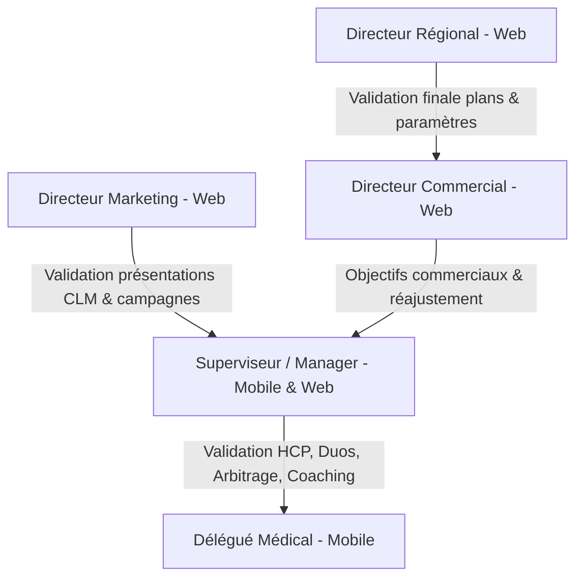
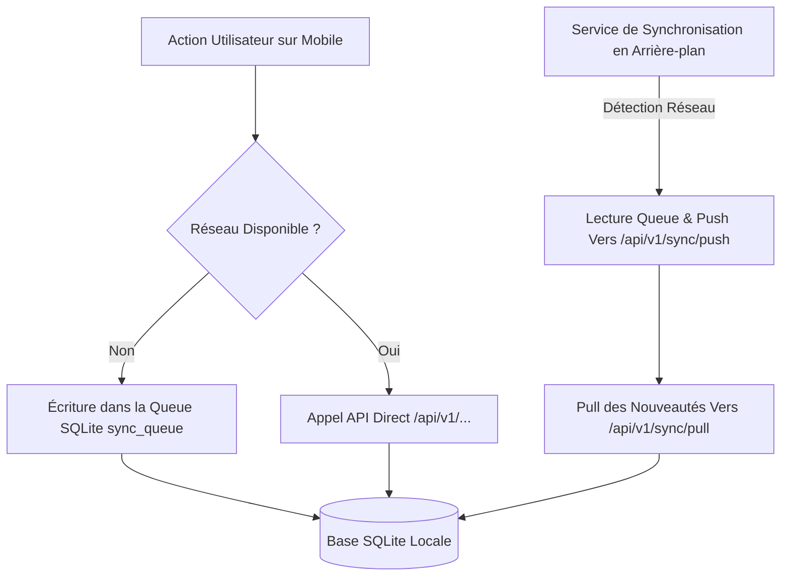

# 📖 GUIDE COMPLET DE SPÉCIFICATIONS, AUDIT DES ÉCRANS & PROMPTS DE DÉVELOPPEMENT MOBILE — MEDCRM PRO / CRM SKYNITY

Ce document est le **guide exhaustif et prêt à l'emploi** destiné à l'équipe de développement Mobile (Flutter). Il consolide l'ensemble des règles métier, la cartographie détaillée des rôles, l'audit comparatif de l'existant, les contrats de données d'API Backend (Laravel REST `/api/v1/`), l'architecture de base de données locale (SQLite / Offline-First), ainsi que des **prompts complets prêts à être envoyés aux développeurs mobile**.

---

## 📑 TABLE DES MATIÈRES
1. [Architecture Organisationnelle & Hiérarchie des Rôles](#1-architecture-organisationnelle--hiérarchie-des-rôles)
2. [Analyse Détaillée des 14 Workflows Métier Principaux](#2-analyse-détaillée-des-14-workflows-métier-principaux)
3. [Audit Comparatif des Écrans Mobile Existants vs Manquants](#3-audit-comparatif-des-écrans-mobile-existants-vs-manquants)
4. [Spécifications Techniques de l'Architecture Offline-First (SQLite + Sync Engine)](#4-spécifications-techniques-de-larchitecture-offline-first-sqlite--sync-engine)
5. [Spécifications Détaillées Écran par Écran & Contrats JSON API](#5-spécifications-détaillées-écran-par-écran--contrats-json-api)
6. [Prompts Complètes & Consignes de Code pour le Développeur Mobile](#6-prompts-complètes--consignes-de-code-pour-le-développeur-mobile)

---

## 1. ARCHITECTURE ORGANISATIONNELLE & HIÉRARCHIE DES RÔLES

L'application **MEDCRM PRO / CRM SKYNITY** est conçue pour piloter la force de vente pharmaceutique et médicale. L'organisation est strictement hiérarchisée :



### 1.1. Définition des Périmètres Géographiques et Équipes

#### 1. Notions d'Équipes et de Secteurs
- **Une Équipe** : Définie par **un Superviseur et les Délégués Médicaux rattachés**, indépendamment de leurs secteurs d'intervention. Une équipe ne correspond PAS à un secteur géographique unique.
- **Le Superviseur** : Rattaché au niveau **Région** (ex: Région Maritime au Togo), il couvre **plusieurs secteurs d'activité** (ex: Lomé Centre, Lomé Nord, Lomé Sud, Tsévié).
- **Le Délégué Médical (DM)** : Possède **1 secteur principal obligatoirement** (ex: Lomé Centre). Il peut exceptionnellement se voir attribuer des **secteurs secondaires** :
  - *Temporaires* : Remplacement d'un collègue en congé, secteur vacant.
  - *Permanents* : Renfort sur un secteur trop vaste pour un seul délégué.

#### 2. Niveaux Géographiques des Directeurs
- **Directeur Commercial (DC)** : Niveau **Filiale / National** (ex: Togo entier ou sous-région UEMOA). Responsable des ventes et des objectifs globaux.
- **Directeur Marketing (DMkt)** : Niveau **Filiale / National**. Responsable de la stratégie produit, des supports CLM et des campagnes.

---

## 2. ANALYSE DÉTAILLÉE DES 14 WORKFLOWS MÉTIER PRINCIPAUX

### 🔄 Workflow 1 : Validation du Plan d'Action Commercial
- **Logique Métier & Chaîne de Validation** :
  $$\text{Superviseur (Propose)} \longrightarrow \text{Directeur Commercial (Examine/Réajuste)} \longrightarrow \text{Directeur Régional (Valide)} \longrightarrow \text{Exécution Terrain}$$
- **Actions du Directeur Commercial (DC)** :
  - Accepter le plan tel quel.
  - Demander des modifications.
  - Réajuster directement certains objectifs ou actions.
- **Statuts de Suivi sur Mobile** :
  `Brouillon` ➔ `Soumis_DC` ➔ `Réajusté_DC` ➔ `Validé_DR` ➔ `En_Exécution`.

### 📦 Workflow 2 : Gestion & Distribution des Supports Commerciaux
- **Logique Métier** :
  - Les supports (documents promotionnels, présentations CLM, gadgets, équipements) sont enregistrés au niveau régional/supérieur par le DR.
  - Le Superviseur est responsable de la mise à disposition et de la distribution des supports aux délégués de son équipe.
- **Informations à suivre sur Mobile** :
  - Type de support / gadget / équipement.
  - Quantité attribuée au Délégué vs Quantité distribuée aux prescripteurs.
  - Historique des remises avec le destinataire (Prescripteur / Établissement).

### 💊 Workflow 3 : Gestion des Laboratoires et Fiche Produit
- **Règle d'Or Métier** : Un produit est rattaché à **un seul laboratoire fournisseur** dans le système.
- **Fiche Identité Produit Obligatoire** :
  1. DCI (Dénomination Commune Internationale)
  2. Nom Commercial du produit
  3. Forme galénique (Comprimé, Sirop, Injectable, Gel, Gélule, etc.)
  4. Conditionnement (ex: Boîte de 30 comprimés, Flacon de 100 ml)
  5. Classe thérapeutique (Anti-inflammatoire, Antibiotique, Antalgique, etc.)
  6. Indications principales & Posologie recommandée
  7. Effets secondaires & Contre-indications
  8. Description & Argumentaire marketing
  9. Prix Grossiste Hors Taxe (PGHT)
  10. Laboratoire fournisseur unique

### 🏥 Workflow 4 : Enregistrement et Validation des Prescripteurs (HCP)
- **Workflow de Validation** :
  $$\text{Délégué Médical} \xrightarrow{\text{Saisie Prescripteur}} \text{Superviseur} \xrightarrow{\text{Contrôle & Validation}} \text{Prescripteur Validé Base Officielle}$$
- **Règles d'Association** :
  - **1 Établissement Principal** (obligatoire).
  - **0 à N Établissements Secondaires** (optionnel, ex: cabinet privé + consultation hôpital public).
  - Renseigner obligatoirement la zone / secteur d'exercice.

### 🏢 Workflow 5 : Enregistrement et Validation des Établissements
- **Workflow** :
  $$\text{Délégué Médical} \xrightarrow{\text{Saisie Établissement}} \text{Superviseur} \xrightarrow{\text{Validation}} \text{Établissement Valide}$$
- **Pouvoir du Superviseur** : Le superviseur peut valider les établissements créés par ses délégués ou créer directement un établissement lui-même.

### 📝 Workflow 6 : Visites & Compte Rendu de Visite (CRV)
- **Données Obligatoires du Compte Rendu** :
  - **Informations Générales** : Délégué, Prescripteur, Établissement (Principal/Secondaire), Date & Heure, Motif de la visite, Produits présentés, Observations, Niveau d'intérêt ($1 \text{ à } 5 \text{ étoiles}$).
  - **Échantillons Remis** : Produit concerné, Caractéristiques, Quantité remise, Date de remise, **Numéro de lot** (traçabilité légale) et **Signature manuscrite tactile du médecin**.
  - **Gadgets / Équipements Remis** : Type de matériel, Quantité, Référence, Bénéficiaire.
  - **Prix Grossiste Hors Taxe (PGHT)** : Présent dans l'interface et lié au produit.

### ⏱️ Workflow 7 : Gestion des États du Compte Rendu de Visite
- **Cycle de Vie des États** :
  ```mermaid
  stateDiagram-v2
      [*] --> Brouillon : Saisie initiale / Progressive sur le terrain
      Brouillon --> Brouillon : Modification libre par le Délégué
      Brouillon --> Soumis_Definitif : Validation finale du Délégué
      Soumis_Definitif --> Validé_Superviseur : Contrôle et clôture par le Superviseur
      Soumis_Definitif --> Correction_Requise : Demande de modification du Superviseur
      Correction_Requise --> Soumis_Definitif : Resoumission
  ```

### 👥 Workflow 8 : Visites en Duo (Superviseur – Délégué)
- **Exigence Métier** : Minimum **2 duos par mois** par Superviseur.
- **Processus en 2 Phased** :
  1. **Phase 1 : Planification Amont (Avant le Duo)** :
     - Sélection du Délégué concerné.
     - Date prévue & Zone géographique.
     - Motif du duo & Prescripteurs/Établissements ciblés.
     - **Définition des Objectifs Prévus du Duo** (ex: Évaluer l'accroche sur le produit X, convaincre 5 prescripteurs indécis).
  2. **Phase 2 : Compte Rendu Aval (Après le Duo)** :
     - Activités réalisées & Observations du superviseur.
     - Difficultés rencontrées & Résultats obtenus.
     - **Tableau Comparatif : Objectifs Prévus vs Résultats Constatés** avec calcul du taux d'atteinte.
     - Recommandations et plan d'action d'accompagnement.

### 📊 Workflow 9 : Arbitrage & Gestion Dynamique du Portefeuille de Prescripteurs
- **Capacité Maximale du Portefeuille** : Définie par le Directeur Régional / Niveau supérieur (ex: Max 100 prescripteurs par délégué).
- **Processus d'Arbitrage par le Superviseur** :
  1. Le Délégué enregistre un nouveau prescripteur alors que sa jauge est au maximum ($100/100$).
  2. Le Superviseur analyse les statistiques de visite du portefeuille actuel du délégué.
  3. Le Superviseur identifie le prescripteur le moins visité ou n'atteignant pas les critères de ciblage.
  4. Ce prescripteur est **retiré du portefeuille actif** du délégué (l'historique et les anciennes visites sont intégralement conservés).
  5. Le nouveau prescripteur est affecté au délégué.
  6. Le prescripteur retiré réintègre le bassin régional et peut être réaffecté à un autre délégué.

### 📩 Workflow 10 : Demandes des Délégués
- **Workflow d'Escalade** :
  $$\text{Délégué} \xrightarrow{\text{Création Demande}} \text{Superviseur} \xrightarrow{\text{Valider / Rejeter}} \text{Directeur Commercial}$$
- **Règle** : Le Superviseur joue le rôle de filtre. Seules les demandes approuvées par le Superviseur parviennent au Directeur Commercial.

### 🎯 Workflow 11 : Cascade des Objectifs Commerciaux
- **Principe Hierarchique** :
  $$\text{Directeur Commercial} \xrightarrow{\text{Objectifs Superviseur}} \text{Superviseur} \xrightarrow{\text{Objectifs Délégués}} \text{Délégué Médical}$$
- **Indicateurs Cibles** : Quantité vendue (boîtes), Chiffre d'affaires (XOF/EUR), Nombre de visites prescripteurs Catégorie A, Taux de couverture de secteur.

### 📈 Workflow 12 : Suivi des Ventes Grossistes
- **Saisie & Consolidation** :
  - **Délégué** : Consulte et saisit les données de ventes des grossistes de son secteur (fréquence quotidienne ou mensuelle).
  - **Superviseur** : Saisit et suit les indicateurs sur toute sa zone/région avec une vue consolidée (ventes par délégué, évolution, écarts $\text{Objectifs} \text{ vs } \text{Réalisations}$, performance par produit/secteur).

---

## 3. AUDIT COMPARATIF DES ÉCRANS MOBILE EXISTANTS VS MANQUANTS

Une analyse approfondie de l'arborescence des vues Flutter (`lib/presentation/views/`) permet de cartographier la couverture actuelle du projet par rapport aux 14 workflows métier.

### 3.1. Cartographie Exhaustive des 18 Modules d'Écrans Mobile

| Module Fonctionnel | Fichier Écran Existant (`lib/presentation/views/`) | Statut du Code | Écarts Constatés & Actions à Effectuer |
| :--- | :--- | :---: | :--- |
| **Authentification** | `auth/login_view.dart`<br>`auth/security_verification_view.dart` | ✅ Conforme | Intégrer l'écran 2FA avec saisie et vérification OTP backend (`/api/v1/verify-otp`). |
| **Dashboard DM** | `delegate/delegate_dashboard_view.dart` | 🟡 À Rénover | Ajouter la jauge dynamique du portefeuille prescripteurs ($N/100$) et les alertes duos du mois. |
| **Agenda & Visites** | `delegate/delegate_planning_view.dart`<br>`delegate/delegate_visits_view.dart` | 🟡 À Rénover | Connecter les visites aux deux états : `Brouillon` et `Soumis_Definitif`. |
| **Exécution Visite** | `delegate/visit_execution_view.dart`<br>`delegate/visit_report_view.dart` | 🟡 À Rénover | Ajouter la signature manuscrite tactile du médecin, le numéro de lot pour les échantillons et le PGHT. |
| **Répertoire HCP** | `hcp/hcp_list_view.dart`<br>`delegate/delegate_hcp_detail_view.dart` | 🟡 À Rénover | Permettre l'association d'1 établissement principal + N établissements secondaires. |
| **Catalogue Produits**| `products/products_list_view.dart`<br>`products/product_detail_view.dart` | 🟡 À Rénover | Compléter la Fiche Produit (DCI, Forme galénique, PGHT, Contre-indications, Laboratoire unique). |
| **Gestion Stocks** | `delegate/stock_view.dart` | ✅ Conforme | Suivi des échantillons et gadgets en possession du délégué. |
| **Dashboard SUP** | `manager/supervisor_dashboard_view.dart`<br>`manager/manager_dashboard_view.dart` | 🟡 À Rénover | Intégrer le widget des 2 duos mensuels obligatoires et les alertes de validation d'établissements/HCP. |
| **Validations SUP** | `manager/manager_validations_view.dart`<br>`manager/activity_reports_validation_view.dart` | 🟡 À Rénover | Ajouter les boutons de validation/rejet des nouveaux prescripteurs et nouveaux établissements. |
| **Visites Duo SUP** | `manager/coaching_detail_view.dart`<br>`manager/coaching_form_modal.dart` | 🔴 À Refondre | Créer l'écran complet `supervisor_duo_view.dart` avec comparaison [Objectifs Prévus] vs [Résultats Constatés]. |
| **Arbitrage HCP** | N'existe pas sous forme dédiée | 🔴 Manquant | Créer `hcp_portfolio_arbitrage_view.dart` pour réaffecter le prescripteur le moins visité lorsque le quota est atteint. |
| **Demandes DM** | N'existe pas | 🔴 Manquant | Créer `delegate_requests_view.dart` pour le workflow DM ➔ SUP ➔ DC. |
| **Ventes Grossistes**| N'existe pas | 🔴 Manquant | Créer `wholesale_sales_entry_view.dart` pour la saisie et la consolidation des ventes grossistes par secteur. |
| **Plan d'Action** | `manager/strategic_campaigns_view.dart` | 🟡 À Rénover | Adapter pour représenter la chaîne de validation SUP ➔ DC ➔ DR. |
| **Supports CLM** | `documents/full_screen_edetailing_view.dart` | ✅ Conforme | Lecteur de présentations interactives avec enregistrement du temps par slide. |
| **Messagerie** | `messaging/internal_messaging_view.dart` | ✅ Conforme | Chat d'équipe entre Délégués et Superviseurs. |
| **Notifications** | `notifications/notifications_view.dart` | ✅ Conforme | Alertes en temps réel sur validations, rappels de visites et objectifs. |
| **Pharmacovigilance**| `pharmacovigilance/pharmacovigilance_view.dart` | ✅ Conforme | Formulaire de déclaration des effets indésirables avec transmission d'urgence. |

---

## 4. SPÉCIFICATIONS TECHNIQUES DE L'ARCHITECTURE OFFLINE-FIRST (SQLITE + SYNC ENGINE)

Compte tenu des contraintes d'infrastructures réseau sur le terrain, le client Mobile Flutter utilise une architecture **Offline-First**.

### 4.1. Flux de Synchronisation Bidirectionnel


### 4.2. Schéma des Tables SQLite Locales Principales (`sqflite`)

```sql
-- Table des Prescripteurs en local
CREATE TABLE local_contacts (
    id TEXT PRIMARY KEY,
    nom TEXT NOT NULL,
    prenom TEXT NOT NULL,
    titre TEXT,
    telephone TEXT,
    email TEXT,
    account_id_principal TEXT NOT NULL,
    statut_validation TEXT DEFAULT 'en_attente', -- en_attente, valide, rejete
    sync_status TEXT DEFAULT 'synced', -- synced, pending_insert, pending_update
    updated_at TEXT
);

-- Table des Comptes Rendus de Visites
CREATE TABLE local_visits (
    id TEXT PRIMARY KEY,
    contact_id TEXT NOT NULL,
    account_id TEXT NOT NULL,
    date_visite TEXT NOT NULL,
    motif TEXT NOT NULL,
    statut TEXT NOT NULL, -- brouillon, soumis_definitif
    notes TEXT,
    pght_total REAL DEFAULT 0.0,
    signature_svg TEXT,
    sync_status TEXT DEFAULT 'pending_insert',
    created_at TEXT
);

-- Table des Échantillons Remis
CREATE TABLE local_visit_samples (
    id TEXT PRIMARY KEY,
    visit_id TEXT NOT NULL,
    product_id TEXT NOT NULL,
    quantite INTEGER NOT NULL,
    num_lot TEXT NOT NULL,
    date_peremption TEXT,
    FOREIGN KEY(visit_id) REFERENCES local_visits(id)
);

-- Queue de Synchronisation Offline
CREATE TABLE sync_queue (
    id INTEGER PRIMARY KEY AUTOINCREMENT,
    endpoint TEXT NOT NULL,
    method TEXT NOT NULL, -- POST, PUT, DELETE
    payload_json TEXT NOT NULL,
    created_at TEXT NOT NULL
);
```

---

## 5. SPÉCIFICATIONS DÉTAILLÉES ÉCRAN PAR ÉCRAN & CONTRATS JSON API

### 5.1. Écran de Compte Rendu de Visite (`visit_report_view.dart`)
- **Méthodes HTTP / Endpoints Backend** :
  - Sauvegarde Brouillon : Stockage SQLite local uniquement (`sync_status = 'pending_brouillon'`).
  - Soumission Définitive : `POST /api/v1/activities`
- **Contrat JSON d'Envoi (Payload)** :
```json
{
  "contact_id": "01a06925-8391-739e-9129-9043632517a3",
  "account_id": "01a06925-8387-7370-aba9-da5d44dcbe79",
  "activity_type": "visite",
  "date_activite": "2026-09-18",
  "heure_debut": "09:30",
  "heure_fin": "10:15",
  "statut": "soumis_definitif",
  "motif": "Présentation gamme cardio et remise échantillons",
  "notes": "Médecin très intéressé par le produit CardioPulse. Demande étude comparative.",
  "niveau_interet": 4,
  "samples": [
    {
      "product_id": "prod_001",
      "quantite": 3,
      "num_lot": "LOT-2026-992",
      "date_peremption": "2028-12-31"
    }
  ],
  "gadgets": [
    {
      "gadget_id": "gad_102",
      "quantite": 1,
      "beneficiaire": "Dr. Jean Aka"
    }
  ],
  "signature_base64": "data:image/png;base64,iVBORw0KGgoAAAANSUhEUgAA..."
}
```

### 5.2. Écran des Visites en Duo Superviseur (`supervisor_duo_view.dart`)
- **Endpoints Backend** :
  - Création / Planification Duo : `POST /api/v1/coaching-sessions`
  - Clôture avec Compte Rendu : `PUT /api/v1/coaching-sessions/{id}/complete`
- **Contrat JSON Payload (Clôture Duo)** :
```json
{
  "delegate_id": "user_del_042",
  "date_duo": "2026-09-18",
  "zone": "Secteur Lomé Centre",
  "motif": "Évaluation compétences argumentation et gestion des objections",
  "objectifs_prevus": [
    "Présenter correctement l'argumentaire CardioPulse slide 3",
    "Obtenir 3 engagements de prescription"
  ],
  "activites_realisees": "4 visites effectuées conjointement au CHU Sylvanus Olympio",
  "resultats_constates": [
    "Argumentaire slide 3 maîtrisé avec succès",
    "2 engagements de prescription obtenus sur 3 prévus"
  ],
  "taux_atteinte_pct": 85.0,
  "commentaires_superviseur": "Excellente posture du délégué. Poursuivre le travail sur le closing.",
  "plan_action_recommande": "Revoir la fiche d'objection sur les effets secondaires."
}
```

### 5.3. Écran d'Arbitrage du Portefeuille Prescripteurs (`hcp_portfolio_arbitrage_view.dart`)
- **Endpoint Backend** : `POST /api/v1/contacts/arbitrage`
- **Contrat JSON Payload** :
```json
{
  "delegate_id": "user_del_042",
  "new_contact_id": "hcp_new_901",
  "removed_contact_id": "hcp_old_104",
  "reason": "Capacité maximale atteinte (100). Retrait du prescripteur non visité depuis 6 mois.",
  "action": "reallocate_to_regional_pool"
}
```

---

## 6. PROMPTS COMPLÈTES & CONSIGNES DE CODE POUR LE DÉVELOPPEUR MOBILE

Les prompts ci-après sont formatés pour être copiés directement dans les échanges avec vos développeurs Flutter ou intégrés dans vos tickets Jira/GitHub Issues.

---

### 🤖 PROMPT DÉVELOPPEUR 1 : Implémentation du Formulaire Complet de Visite & Traçabilité Échantillons

```markdown
### TÂCHE FLUTTER : Refonte du Compte Rendu de Visite avec Traçabilité Échantillons & Signature Tactile

**Fichiers à modifier / créer** :
- `lib/presentation/views/delegate/visit_report_view.dart`
- `lib/presentation/controllers/visit_report_controller.dart`
- `lib/presentation/widgets/doctor_signature_pad_modal.dart`

**Consignes d'implémentation** :
1. **Gestion des Deux États du Compte Rendu** :
   - Ajouter une barre d'actions inférieure avec deux boutons :
     - Bouton "Sauvegarder Brouillon" (Bouton secondaire) : Enregistre immédiatement l'état courant dans la base SQLite locale sans valider la présence de la signature ou des observations. Statut de la visite = `brouillon`.
     - Bouton "Soumettre Définitivement" (Bouton principal vert) : Vérifie la validité du formulaire. Si des échantillons sont ajoutés, la signature tactile est OBLIGATOIRE. Statut = `soumis_definitif`.

2. **Module d'Ajout d'Échantillons** :
   - Proposer un bouton "+ Ajouter un Échantillon".
   - Pour chaque ligne d'échantillon :
     - Dropdown de sélection du Produit (filtré sur les produits actifs).
     - Champ numérique "Quantité remise".
     - Champ texte "Numéro de Lot" (Champ obligatoire, valider avec RegExp `^[A-Z0-9-]+$`).
     - Sélecteur de Date "Péremption du Lot".

3. **Pad de Signature Tactile du Médecin** :
   - Bouton "Recueillir la Signature du Médecin".
   - Ouvrir la modale `DoctorSignaturePadModal` proposant une surface de dessin fluide (`hand_signature` ou `signature` package).
   - Boutons "Effacer" et "Valider la Signature".
   - Convertir la signature en chaîne Base64 PNG pour le stockage local et l'envoi API.

4. **Prix Grossiste Hors Taxe (PGHT)** :
   - Afficher le tarif PGHT pour chaque produit présenté et calculer automatiquement le total estimé de la visite.

**Contraintes de qualité** :
- Utiliser GetX pour la gestion d'état réactive (`RxList`, `RxBool`).
- Assurer le fonctionnement 100% Hors Ligne avec basculement automatique dans la table SQLite `local_visits`.
```

---

### 🤖 PROMPT DÉVELOPPEUR 2 : Écran de Planification et de Compte Rendu des Visites en Duo (Superviseur)

```markdown
### TÂCHE FLUTTER : Module de Visites en Duo pour Superviseurs

**Fichiers à créer** :
- `lib/presentation/views/manager/supervisor_duo_view.dart`
- `lib/presentation/controllers/supervisor_duo_controller.dart`

**Consignes d'implémentation** :
1. **Compteur de Quota de Duos Mensuels** :
   - En haut de l'écran, afficher la carte d'indicateur du mois : "Duos effectués ce mois : X / 2 minimum requis".
   - Afficher un badge de couleur (Rouge si < 2, Vert si >= 2).

2. **Onglet 1 - Planification du Duo** :
   - Sélecteur du Délégué concerné (Dropdown alimenté par l'équipe du superviseur).
   - Champ Date & Heure prévues.
   - Champ Secteur / Zone géographique.
   - Liste dynamique d'objectifs prévus (Ajout/Suppression de lignes d'objectifs).
   - Bouton "Enregistrer la Planification du Duo".

3. **Onglet 2 - Saisie du Compte Rendu & Bilan du Duo** :
   - Sélection du duo planifié à clôturer.
   - Tableau dynamique comparatif :
     - Colonne 1 : Objectif Prévu (rappelé automatiquement).
     - Colonne 2 : Résultat Obtenu (Champ texte / note).
     - Colonne 3 : Taux d'atteinte (Slider de 0% à 100%).
   - Saisie des observations globales du superviseur, des difficultés et du plan d'action d'accompagnement.
   - Bouton "Clôturer et Transmettre le Duo".

**Contraintes** :
- Connexion avec l'endpoint backend `POST /api/v1/coaching-sessions`.
- Respect du thème graphique Sombre / Modern Glassmorphism de MEDCRM PRO.
```

---

### 🤖 PROMPT DÉVELOPPEUR 3 : Écran d'Arbitrage et Réaffectation du Portefeuille Prescripteurs

```markdown
### TÂCHE FLUTTER : Écran d'Arbitrage du Portefeuille Prescripteurs

**Fichiers à créer** :
- `lib/presentation/views/manager/hcp_portfolio_arbitrage_view.dart`
- `lib/presentation/controllers/hcp_portfolio_arbitrage_controller.dart`

**Consignes d'implémentation** :
1. **Visualisation de la Jauge du Portefeuille** :
   - Afficher la barre de progression du portefeuille du délégué sélectionné (ex: 100 / 100 prescripteurs - Jauge saturée).

2. **Interface d'Arbitrage (Réaffectation)** :
   - Titre : "Demande d'ajout du prescripteur Dr. [Nom] (Capacité Max Atteinte)".
   - Liste des prescripteurs actuels triée automatiquement par **Date de dernière visite croissante** (le moins visité en haut).
   - Mettre en évidence le prescripteur recommandé au retrait avec un badge "Recommandé pour retrait (Non visité depuis X jours)".
   - Proposer une case à cocher pour confirmer le retrait du prescripteur recommandé ou autoriser la sélection manuelle d'un autre prescripteur.

3. **Action & Message d'Avertissement** :
   - Afficher une note explicative : "Attention : Le prescripteur retiré ne sera pas supprimé. Son historique complet reste conservé et il sera remis dans le bassin de réaffectation de la région."
   - Bouton d'action "Valider l'Arbitrage et Permuter les Prescripteurs".

**Contraintes** :
- Faire appel à l'API `POST /api/v1/contacts/arbitrage`.
- Gestion des erreurs et messages de confirmation avec GetX Snackbar.
```

---

### 🤖 PROMPT DÉVELOPPEUR 4 : Saisie et Consolidation des Ventes Grossistes par Secteur

```markdown
### TÂCHE FLUTTER : Saisie et Suivi des Ventes Grossistes par Secteur

**Fichiers à créer** :
- `lib/presentation/views/delegate/wholesale_sales_entry_view.dart`
- `lib/presentation/controllers/wholesale_sales_controller.dart`

**Consignes d'implémentation** :
1. **Mode Délégué (Saisie Terrain)** :
   - Sélecteur de mois/année et sélecteur du Grossiste du secteur (ex: LABOREX, CAMEG, TOGO-PHARMA).
   - Tableau interactif listant tous les produits rattachés au secteur.
   - Champs de saisie numérique : "Nombre de boîtes vendues par le grossiste".
   - Calcul automatique en temps réel du Chiffre d'Affaires total ($\text{Boîtes} \times \text{PGHT}$).
   - Bouton "Soumettre les Ventes Mensuelles".

2. **Mode Superviseur (Consolidation Régionale)** :
   - Basculement sur la vue "Synthese Régionale".
   - Graphique linéaire/barres (utilisant `fl_chart`) comparant :
     - Courbe 1 : Objectif de Vente Fixé par le DC.
     - Courbe 2 : Ventes Grossistes Réelles Saisies.
   - Tableau de classement par secteur et par délégué montrant le taux de réalisation ($%\text{ Ventes / Objectif}$).

**Contraintes** :
- Stockage local SQLite des ventes avant synchronisation.
- Envoi vers l'endpoint `POST /api/v1/sales`.
```

---

---

### 🤖 PROMPT DÉVELOPPEUR 5 : Workflow des Demandes des Délégués (Escalade DM ➔ SUP ➔ DC)

```markdown
### TÂCHE FLUTTER : Module de Demandes des Délégués avec Validation à Niveaux

**Fichiers à créer** :
- `lib/presentation/views/delegate/delegate_requests_view.dart`
- `lib/presentation/controllers/delegate_requests_controller.dart`

**Consignes d'implémentation** :
1. **Interface de Saisie Délégué** :
   - Formulaire de soumission de demande : Type de demande (Budget exceptionnel, Matériel promotionnel supplémentaire, Demande de formation, Congé/Absence).
   - Description détaillée et justification métier.
   - Attachement optionnel d'un justificatif PDF/Image.
   - Historique des demandes soumises avec badges de statut :
     - `En_Attente_Superviseur` (Jaune)
     - `Rejeté_Superviseur` (Rouge)
     - `Transmis_Directeur_Commercial` (Bleu)
     - `Validé_Final` (Vert)

2. **Interface de Validation Superviseur (Manager)** :
   - Liste des demandes reçues des délégués de l'équipe.
   - Boutons d'action pour chaque demande :
     - "Valider et Transmettre au DC" (Transmet au Directeur Commercial).
     - "Rejeter" (Exige la saisie d'un motif de rejet transmis au délégué).

**Contraintes** :
- Endpoint Backend : `POST /api/v1/requests` (Création) & `POST /api/v1/requests/{id}/approve` / `reject`.
- Synchronisation SQLite hors ligne.
```

---

## 7. NORMES DE DÉVELOPPEMENT, GESTION DES ERREURS & CHECKLIST AVANT LIVRAISON

### 7.1. Gestion des Erreurs HTTP & Offline
- Tous les appels `ApiClient` doivent être encapsulés dans un bloc `try/catch` avec gestion explicite des codes HTTP :
  - **401 Unauthorized** : Redirection automatique vers `/login` via `Get.offAllNamed('/login')`.
  - **422 Unprocessable Entity** : Extraire et afficher le dictionnaire de validation Laravel sous forme de messages d'erreur sous les champs formulaires.
  - **500 / Timeout / Absence de Réseau** : Basculer silencieusement sur la table SQLite locale et ajouter l'opération à la `sync_queue`.

### 7.2. Checklist Finale de Validation pour le Développeur Mobile
- [ ] Le code compile avec **0 erreur** lors de l'exécution de `dart analyze`.
- [ ] Les formulaires de compte rendu intègrent la signature tactile et la traçabilité des lots d'échantillons.
- [ ] L'écran des visites en duo permet la comparaison automatique [Objectifs Prévus] vs [Résultats Constatés].
- [ ] L'arbitrage du portefeuille prescripteurs gère la réaffectation sans suppression d'historique.
- [ ] Le mode hors-ligne permet de créer et consulter les visites sans connexion internet active.

