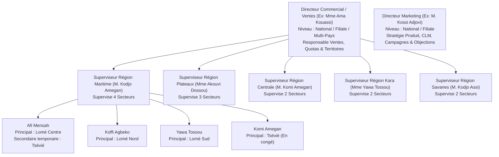

# 📋 CAHIER DES CHARGES & PROMPTS DE DÉVELOPPEMENT CRM SKYNITY (MEDCRM PRO)
## Intégration Complète Mobile (Flutter) & Backend (Laravel 12)
### Rôles : Délégué Médical ("Sophie") & Superviseur / Manager ("Karim")

> **Version :** 2.0 — Spécifications Opérationnelles et Règles Métier Territoriales  
> **Date :** 17 Septembre 2026  
> **Destination :** Équipes de Développement Backend (Laravel) & Frontend Mobile (Flutter)

---

## SOMMAIRE
1. [Architecture Métier & Organisation Géographique des Équipes](#1-architecture-métier--organisation-géographique-des-équipes)
2. [Mode d'Emploi des Prompts](#2-mode-demploi-des-prompts)
3. [PROMPT 1 : Stabilisation Immédiate & Correctifs Critiques Backend](#prompt-1--stabilisation-immédiate--correctifs-critiques-backend)
4. [PROMPT 2 : Refonte de la Sectorisation & Affectations Multi-Secteurs](#prompt-2--refonte-de-la-sectorisation--affectations-multi-secteurs)
5. [PROMPT 3 : Authentification Sécurisée, Flux 2FA (OTP) & Harmonisation des Contrats](#prompt-3--authentification-sécurisée-flux-2fa-otp--harmonisation-des-contrats)
6. [PROMPT 4 : Déroulement de Visite, Comptes Rendus & Validation Superviseur](#prompt-4--déroulement-de-visite-comptes-rendus--validation-superviseur)
7. [PROMPT 5 : Gestion des Échantillons, Pad de Signature Numérique & Stock Strict](#prompt-5--gestion-des-échantillons-pad-de-signature-numérique--stock-strict)
8. [PROMPT 6 : Visionneuse CLM Interactive & Tracking Détaillé Slide-par-Slide](#prompt-6--visionneuse-clm-interactive--tracking-détaillé-slide-par-slide)
9. [PROMPT 7 : Module de Coaching Superviseur & Programmation des Visites en Duo](#prompt-7--module-de-coaching-superviseur--programmation-des-visites-en-duo)
10. [PROMPT 8 : Alertes Superviseur, Suivi des No-Shows & Carte GPS Équipe](#prompt-8--alertes-superviseur-suivi-des-no-shows--carte-gps-équipe)
11. [PROMPT 9 : Référentiel des Objections Cliniques & Réponses Marketing](#prompt-9--référentiel-des-objections-cliniques--réponses-marketing)
12. [PROMPT 10 : Optimisation IA de Tournée & Géolocalisation Réelle](#prompt-10--optimisation-ia-de-tournée--géolocalisation-réelle)
13. [PROMPT 11 : Objectifs Commerciaux, Quotas & Calcul des Primes](#prompt-11--objectifs-commerciaux-quotas--calcul-des-primes)
14. [PROMPT 12 : Déclaration de Pharmacovigilance & Alertes Sanitaires d'Urgence](#prompt-12--déclaration-de-pharmacovigilance--alertes-sanitaires-durgence)
15. [PROMPT 13 : Moteur de Synchronisation Offline Bidirectionnelle & Base SQLite](#prompt-13--moteur-de-synchronisation-offline-bidirectionnelle--base-sqlite)

---

## 1. Architecture Métier & Organisation Géographique des Équipes

Ce chapitre fixe les règles métier et organisationnelles fondamentales régissant la force de vente pharmaceutique (validées selon le modèle de référence au Togo, extensible à toute filiale UEMOA / Afrique subsaharienne et internationale).

### 1.1. Synthèse Décisionnelle en 4 Principes
1. **Un superviseur supervise plusieurs secteurs (une région complète ou un laboratoire).** Il n'est jamais cantonné à un seul secteur.
2. **Un délégué médical a obligatoirement 1 secteur principal + potentiellement 0 à N secteurs secondaires** (temporaires avec dates de validité ou permanents).
3. **Le Directeur Commercial et le Directeur Marketing sont au niveau Filiale / National (voire multi-pays).**
4. **Une équipe commerciale = 1 Superviseur + ses Délégués médicaux rattachés.** Une équipe ne correspond JAMAIS à un secteur géographique unique.

---

### 1.2. Niveaux Hiérarchiques, Rôles & Périmètres Géographiques



#### A. Directeur Commercial / Ventes (Ex: Mme Ama Kouassi)
- **Niveau d'affectation :** **FILIALE / NATIONAL** (ou Direction Régionale Multi-Pays).
- **Périmètre d'action :** Coordonne l'ensemble de la force de vente, fixe les objectifs de chiffre d'affaires et de couverture, définit le découpage des régions et secteurs.
- **Règle multi-zones :**
  - Cas standard : Responsable de tout le pays (ex: l'ensemble des 5 régions du Togo).
  - Cas grand pays / sous-région : Peut coiffer plusieurs filiales (ex: Togo + Bénin + Ghana, ou Zone UEMOA Togo + Burkina + Niger). S'il y a plusieurs directeurs des ventes dans un très grand pays, leur zone respective est définie par régions administratives.

#### B. Directeur Marketing (Ex: M. Kossi Adjovi)
- **Niveau d'affectation :** **FILIALE / NATIONAL** (ou Siège International).
- **Périmètre d'action :** Pilotage stratégique des gammes de produits, conception et validation des supports de visite interactifs (CLM / e-Detailing), lancement des campagnes promotionnelles, analyse macroscopique des objections cliniques et des retours de pharmacovigilance.
- **Différence clé Directeur Commercial vs Directeur Marketing :**

| Critère | Directeur Commercial | Directeur Marketing |
|---|---|---|
| **Périmètre principal** | **Géographique / Humain** (Régions, équipes terrain) | **Produit / Stratégique** (Gammes, supports, messages) |
| **Responsabilité** | Chiffre d'affaires, taux de couverture, visites, quotas | Stratégie produit, campagnes CLM, argumentaires, veille |
| **Niveau hiérarchique** | Filiale / National / Multi-filiales | Filiale / National / Global |
| **Supervision directe** | Superviseurs régionaux et directeurs de zones | Chefs de produits, agences médicales, supports CLM |

#### C. Superviseur / Manager Régional (Ex: M. Kodjo Amegan, Karim)
- **Niveau d'affectation :** **RÉGION** ou **LABORATOIRE COMPLET**.
- **Périmètre d'action :** **Un superviseur n'est JAMAIS rattaché à un seul secteur.** Il manage l'ensemble des délégués opérant sur les différents secteurs de sa région.
- **Cas particulier laboratoires :** Un superviseur peut être manager exclusif d'un laboratoire et couvrir l'ensemble du territoire national. S'il y a deux superviseurs pour un même laboratoire, le Directeur Commercial délimite leurs régions respectives.
- **Répartition terrain constatée (Exemple Togo) :**

| Superviseur | Région Administrative | Nombre de Secteurs Couverts |
|---|---|:---:|
| **M. Kodjo Amegan** | Région Maritime | 4 secteurs |
| **Mme Akouvi Dossou** | Région Plateaux | 3 secteurs |
| **M. Komi Amegan** | Région Centrale | 2 secteurs |
| **Mme Yawa Tossou** | Région Kara | 2 secteurs |
| **M. Kodjo Assi** | Région Savanes | 2 secteurs |

#### D. Délégué Médical (Ex: Afi Mensah, Koffi Agbeko, Sophie)
- **Niveau d'affectation :** **SECTEUR GÉOGRAPHIQUE D'INTERVENTION**.
- **Règle générale :** En principe, un délégué médical est affecté à **1 SEUL SECTEUR PRINCIPAL**.
- **Règle multi-secteurs (Secteurs Secondaires) :** Un délégué peut intervenir simultanément sur un ou plusieurs secteurs secondaires selon 3 cas métier précis :

| Cas d'affectation | Définition & Exemple | Durée & Caractère |
|---|---|---|
| **Cas 1 : Secteur unique standard** | Afi Mensah affectée à **Lomé Centre** uniquement. | Permanent |
| **Cas 2 : Remplacement temporaire** | Afi Mensah affectée à **Lomé Centre** (principal) + **Tsévié** (secondaire) car Komi Amegan est en congé du 01/09 au 30/09/2026. | Temporaire (dates de début et fin obligatoires) |
| **Cas 3 : Renfort de secteur / Vacance** | Afi Mensah affectée à **Lomé Centre** (principal) + **Lomé Sud** (secondaire) car le secteur est trop vaste ou en attente de recrutement d'un nouveau délégué. | Temporaire ou Permanent |

---

### 1.3. Définition Formelle d'une Équipe Commerciale

Dans le CRM SKYNITY / MEDCRM PRO, il est primordial de dissiper toute confusion entre équipe et secteur :

```
❌ MODÈLE A (Rejeté) : 1 Équipe = 1 Secteur géographique
✅ MODÈLE B (Retenu)  : 1 Équipe = 1 Superviseur + N Délégués Médicaux couvrant M Secteurs
```

**Exemple d'équipe réelle au Togo : Équipe Maritime (Kodjo Amegan)**
```text
Équipe Kodjo Amegan (Région Maritime)
├── Afi Mensah    ──> Secteur Lomé Centre (Principal) + Tsévié (Secondaire temporaire)
├── Koffi Agbeko  ──> Secteur Lomé Nord (Principal)
├── Yawa Tossou   ──> Secteur Lomé Sud (Principal)
└── Komi Amegan   ──> Secteur Tsévié (Principal - en congé)
```
*L'équipe Amegan supervise 4 secteurs géographiques distincts.*

---

### 1.4. Spécification de la Table de Données : `sector_allocations`

Pour que le CRM gère nativement ces règles avec intégrité référentielle, le backend doit intégrer la table pivot temporelle `sector_allocations` :

| Colonne | Type SQL | Nullable | Description & Règle Métier |
|---|---|:---:|---|
| `id` | UUID | Non | Clé primaire |
| `user_id` | UUID (FK `users`) | Non | Référence du Délégué Médical |
| `sector_id` | UUID (FK `sectors`) | Non | Référence du Secteur Géographique |
| `type` | Enum (`'principal'`, `'secondaire'`) | Non | Type d'affectation (**Un seul secteur actif de type `'principal'` par délégué**) |
| `start_date` | Date | Non | Date de prise d'effet de l'affectation |
| `end_date` | Date | **Oui** | Date d'échéance (`null` si affectation permanente) |
| `reason` | String | Oui | Motif : `"Remplacement congé"`, `"Renfort volumétrie"`, `"Poste vacant"` |
| `is_active` | Boolean | Non | Indicateur d'activation (par défaut `true`) |
| `created_by` | UUID (FK `users`) | Oui | Manager ou Directeur ayant ordonné l'affectation |
| `timestamps` | Timestamps & SoftDeletes | Non | Traçabilité et historique complet |

**Règle de filtrage des données (Scope HasPerimeter) :**
- Un délégué a accès aux contacts (médecins, pharmaciens) et aux établissements situés dans son secteur principal **ET** dans ses secteurs secondaires dont la date courante est comprise entre `start_date` et `end_date`.
- Dès que `end_date` est passée, l'accès aux fiches du secteur secondaire est automatiquement révoqué.

---

### 1.5. Tableau Récapitulatif Global (Spécifications Togo)

| Question Clé | Réponse CRM | Cas d'Usage Togo |
|---|:---:|---|
| **Superviseur = 1 seul secteur ?** | ❌ **NON** (Région complète) | M. Kodjo Amegan supervise 4 secteurs de la région Maritime |
| **Délégué = 1 seul secteur ?** | ✅ **OUI** (pour le principal)<br/>➕ Secondaires possibles | Afi Mensah : Lomé Centre (principal) + Tsévié (secondaire temporaire) |
| **Directeur Commercial niveau ?** | 🌐 **Filiale / National** | Mme Ama Kouassi : responsable des 5 régions du Togo |
| **Directeur Marketing niveau ?** | 🔬 **Filiale / National** | M. Kossi Adjovi : responsable portefeuille produits & CLM Togo |
| **Équipe = 1 Secteur ?** | ❌ **NON** | Équipe Amegan = 4 délégués couvrant 4 secteurs distincts |
| **Délégué multi-secteurs ?** | ✅ **OUI** (avec période & motif) | Remplacement de Komi Amegan par Afi Mensah pendant son congé |

---

---

## 2. Mode d'Emploi des Prompts

Chaque prompt ci-dessous est conçu pour être **copié-collé directement** dans une invite d'agent ou transmis à un développeur.  
Chaque prompt comprend :
- 🎯 **Objectif & Contexte Métier** (faisant référence aux cas d'usage de Sophie ou Karim).
- 🛠️ **Spécifications Techniques Backend (Laravel 12)** : migrations, modèles Eloquent, FormRequests, contrôleurs, routes et payloads JSON.
- 📱 **Spécifications Techniques Mobile (Flutter)** : contrôleurs GetX/Providers, modèles de données, gestion d'état, vues et widgets requis.
- 🧪 **Critères d'Acceptation & Tests de Validation** : scénarios de vérification sans régression.

---

## PROMPT 1 : Stabilisation Immédiate & Correctifs Critiques Backend

```markdown
### RÔLE & CONTEXTE
Tu es un expert développeur backend Laravel 12. Tu dois corriger immédiatement les anomalies bloquantes identifiées dans le CRM SKYNITY pour permettre le bon fonctionnement des seeders, du modèle Activity et de la conformité des routes API.

### ANOMALIES IDENTIFIÉES À RÉSOUDRE
1. **Erreur de Syntaxe PHP dans `database/seeders/DatabaseSeeder.php`** :
   - Lignes 25 à 34 : L'instruction `app()[SpecialitySeeder::class, ...]->forgetCachedPermissions();` génère une erreur `PHP Parse error: syntax error, unexpected token ","`.
   - Action : Rétablir l'appel standard `app()[\Spatie\Permission\PermissionRegistrar::class]->forgetCachedPermissions();` et basculer les seeders de lookup dans le tableau `$this->call([...])`.
2. **Mass Assignment manquant dans `app/Models/Activity.php`** :
   - Les colonnes issues des dernières migrations (`activity_type_id`, `activity_result_id`, `report_status`, `report_content`, `validated_by_id`, `validation_date`, `rejection_reason`) ne sont pas dans `$fillable`.
   - Action : Ajouter ces 7 colonnes dans `$fillable` et définir les casts nécessaires (`validation_date => datetime`).
3. **Contrainte erronée dans `app/Http/Requests/StoreActivityRequest.php`** :
   - La règle `'subsidiary_id' => 'required|uuid|exists:subsidiaries,id'` échoue car la table `activities` n'a pas de colonne `subsidiary_id`.
   - Action : Supprimer l'obligation de `subsidiary_id` (la filiale découle de l'utilisateur authentifié).
   - Rendre flexible le type d'activité : accepter soit `activity_type_id` (UUID), soit `activity_type` (libellé textuel comme 'visite', 'appel').
4. **Validation des Devises et Types dans `app/Http/Requests/StoreExpenseRequest.php`** :
   - Le champ `currency` impose `size:3`, ce qui rejette `'FCFA'` envoyé par l'application mobile.
   - Action : Accepter `in:XOF,EUR,USD,FCFA` ou convertir automatiquement `'FCFA'` en `'XOF'` dans `prepareForValidation()`.
   - Accepter les catégories en français (`Déplacement`, `Restauration`, `Hébergement`, `Matériel`, `Autre`) et les mapper vers l'énumération anglaise (`travel`, `meal`, `accommodation`, `material`, `other`).
5. **Nettoyage des Routes Doublons dans `routes/api.php`** :
   - Supprimer la seconde déclaration de `analytics/team-performance` (ligne 232) qui pointe vers `ManagerDashboardController` et écrase le vrai contrôleur.
   - Vérifier que `Route::get('/analytics/dashboard', ...)` pointe vers un contrôleur implémentant réellement la méthode `dashboard` (ou implémenter la méthode renvoyant les KPIs agrégés du délégué).

### CRITÈRES D'ACCEPTATION
- `php -l database/seeders/DatabaseSeeder.php` s'exécute sans aucune erreur de syntaxe.
- `php artisan migrate:fresh --seed` s'exécute de bout en bout avec succès (Code 0).
- `POST /api/v1/activities` persiste correctement une activité avec ses champs de compte-rendu.
- `POST /api/v1/expenses` accepte une note de frais avec `currency = 'FCFA'` et `type = 'Déplacement'`.
```

---

## PROMPT 2 : Refonte de la Sectorisation & Affectations Multi-Secteurs

```markdown
### RÔLE & CONTEXTE MÉTIER
Tu es architecte logiciel spécialisé en applications pharmaceutiques. Tu dois adapter le backend Laravel et le frontend mobile au modèle d'affectation territoriale validé :
- Une **Équipe** = un Superviseur + ses Délégués rattachés (couvre plusieurs secteurs).
- Un **Superviseur (Ex: M. Kodjo Amegan, Karim)** = rattaché à une région (couvre 2 à 5 secteurs).
- Un **Délégué Médical (Ex: Afi Mensah, Sophie)** = 1 secteur principal permanent + 0 à N secteurs secondaires (temporaires avec date début/fin pour remplacement, ou permanents pour renfort).
- Un **Directeur Commercial (Ex: Mme Ama Kouassi, Philippe)** = niveau National / Filiale (supervise toutes les régions).
- Un **Directeur Marketing (Ex: M. Kossi Adjovi, Julie)** = niveau National / Filiale (stratégie produit, campagnes CLM).

### TÂCHES BACKEND (LARAVEL 12)
1. **Migration & Modèle `SectorAllocation`** :
   Créer la migration `create_sector_allocations_table` :
   ```php
   Schema::create('sector_allocations', function (Blueprint $table) {
       $table->uuid('id')->primary();
       $table->foreignUuid('user_id')->constrained('users')->cascadeOnDelete();
       $table->foreignUuid('sector_id')->constrained('sectors')->cascadeOnDelete();
       $table->enum('type', ['principal', 'secondaire'])->default('principal');
       $table->date('start_date');
       $table->date('end_date')->nullable(); // null = permanent
       $table->string('reason')->nullable(); // Ex: "Remplacement congé", "Renfort volumétrie"
       $table->boolean('is_active')->default(true);
       $table->foreignUuid('created_by')->nullable()->constrained('users')->nullOnDelete();
       $table->timestamps();
       $table->softDeletes();
       
       $table->index(['user_id', 'is_active', 'start_date', 'end_date']);
   });
   ```

2. **Règles Métier dans le Modèle `User` & Scope** :
   - Relation `allocations()` : `hasMany(SectorAllocation::class)`.
   - Méthode `currentSectors()` :
     ```php
     public function currentSectors()
     {
         return Sector::whereHas('allocations', function ($q) {
             $q->where('user_id', $this->id)
               ->where('is_active', true)
               ->whereDate('start_date', '<=', today())
               ->where(fn($sub) => $sub->whereNull('end_date')->orWhereDate('end_date', '>=', today()));
         });
     }
     ```
   - Règle de validation métier : un délégué ne peut avoir qu'UN SEUL secteur actif avec `type = 'principal'`.

3. **Mise à jour du Trait `HasPerimeter` / `PerimeterScope`** :
   - Lorsqu'un Délégué Médical interroge `/contacts` ou `/accounts`, filtrer les enregistrements appartenant à son secteur principal OU à ses secteurs secondaires actuellement actifs.
   - Lorsqu'un Superviseur interroge les données, filtrer les enregistrements de tous les secteurs gérés par les délégués de son équipe (appartenant à sa région administrative).

4. **Seeder Pilote `TogoTerritorialSeeder.php`** :
   Créer un seeder initialisant la hiérarchie validée du Togo :
   - Région Maritime (Kodjo Amegan) avec 4 secteurs : Lomé Centre (Afi Mensah), Lomé Nord (Koffi Agbeko), Lomé Sud (Yawa Tossou), Tsévié (Komi Amegan).
   - Affectation secondaire temporaire : Afi Mensah -> Tsévié (motif: "Remplacement congé de Komi Amegan").
   - Région Plateaux (Akouvi Dossou - 3 secteurs), Centrale (Komi Amegan - 2 secteurs), Kara (Yawa Tossou - 2 secteurs), Savanes (Kodjo Assi - 2 secteurs).
   - Directrice Commerciale Nationale : Mme Ama Kouassi (5 régions).
   - Directeur Marketing National : M. Kossi Adjovi.

5. **Endpoints de Gestion des Affectations** :
   - `GET /api/v1/users/{id}/allocations` : Historique et affectations actuelles.
   - `POST /api/v1/users/{id}/allocations` : Créer une affectation (réservé Manager/Admin).
   - `DELETE /api/v1/allocations/{id}` : Clôturer une affectation temporaire.

### TÂCHES FRONTEND MOBILE (FLUTTER)
1. Mettre à jour le modèle `UserModel` et `ContactModel` pour inclure `sectors` (liste des secteurs affectés avec distinction principal / secondaire).
2. Dans `HcpView` et `DelegatePlanningView`, ajouter un sélecteur déroulant par secteur :
   - "Mon secteur principal : Lomé Centre"
   - "Mon secteur de renfort : Tsévié (Actif jusqu'au 30/09 - Remplacement)"
3. Dans la vue Superviseur `ManagerTeamPlanningView`, afficher pour chaque délégué la liste des secteurs couverts et signaler les remplacements temporaires par un badge visuel ambre distinctif.

### CRITÈRES D'ACCEPTATION
- Un délégué en remplacement temporaire voit automatiquement les fiches HCP de son secteur de remplacement pendant la période définie, et ne les voit plus après la date de fin.
- Le superviseur voit l'ensemble consolidé des visites des 4 secteurs de sa région.
- `php artisan db:seed --class=TogoTerritorialSeeder` s'exécute sans erreur.
```

---

## PROMPT 3 : Authentification Sécurisée, Flux 2FA (OTP) & Harmonisation des Contrats

```markdown
### RÔLE & CONTEXTE MÉTIER
Tu es développeur full-stack. Tu dois harmoniser l'authentification entre l'application mobile Flutter et le backend Laravel 12. Le workflow exige une connexion par email/mot de passe, suivie d'un code de vérification à 6 chiffres (2FA / OTP) par email avant de délivrer le jeton d'accès Sanctum.

### TÂCHES BACKEND (LARAVEL 12)
1. **Contrôleur `AuthController.php`** :
   - Endpoint `POST /api/v1/login` :
     - Reçoit `{ "email": "...", "password": "..." }`.
     - Si valide, génère un code OTP à 6 chiffres stocké dans le cache Redis/Database pendant 10 minutes (`login_otp_{user_id}`).
     - Déclenche l'envoi de l'email via `SystemNotification` ou mail direct.
     - Retourne HTTP 200 : `{ "status": "otp_required", "user_id": "...", "email_masked": "u***@domain.com", "message": "Code OTP envoyé" }`.
   - Endpoint `POST /api/v1/verify-otp` :
     - Reçoit `{ "user_id": "...", "otp_code": "..." }`.
     - Vérifie le code. En cas de succès, crée le token Sanctum `createToken('mobile_app')->plainTextToken`.
     - Retourne le token, le profil utilisateur complet avec son rôle (`delegate`, `manager`), sa région, son équipe et ses secteurs d'intervention.
2. **Alias de Compatibilité Mobile** :
   - Ajouter `Route::post('/auth/login', [AuthController::class, 'login']);` pour éviter l'erreur 404 sur les versions existantes.
   - Ajouter `Route::apiResource('hcps', ContactController::class);` dans `routes/api.php` pour que `HcpRemoteDataSource` fonctionne sans modification lourde.

### TÂCHES FRONTEND MOBILE (FLUTTER)
1. **`AuthService.dart` & `AuthRepositoryImpl.dart`** :
   - Mettre à jour `login(email, password)` pour appeler `POST /api/v1/login`.
   - Si la réponse est `otp_required`, stocker temporairement le `user_id` et rediriger l'utilisateur vers `AppRoutes.securityVerification` avec GetX.
2. **`security_verification_view.dart`** :
   - Récupérer les 6 chiffres saisis dans les `TextEditingController`.
   - Au clic sur "Vérifier" (ou dès que le 6ème chiffre est saisi), appeler `POST /api/v1/verify-otp`.
   - Enregistrer le token JWT reçu dans `FlutterSecureStorage` via `AuthService.setToken(token, userId)`.
   - Charger le profil et rediriger selon le rôle : `AppRoutes.home` (Délégué) ou `AppRoutes.managerHome` (Superviseur).
   - Brancher le bouton "Renvoyer le code" sur un appel `POST /api/v1/login` pour regénérer un OTP.

### CRITÈRES D'ACCEPTATION
- La saisie d'identifiants valides déclenche la génération d'un OTP et redirige vers l'écran de vérification.
- Un mauvais code OTP affiche un message d'erreur rouge sans quitter la page.
- Le bon code OTP connecte l'utilisateur avec un Bearer Token valide injecté dans tous les headers HTTP suivants.
```

---

## PROMPT 4 : Déroulement de Visite, Comptes Rendus & Validation Superviseur

```markdown
### RÔLE & CONTEXTE MÉTIER
Tu développes le coeur opérationnel du CRM médical :
- **Sophie (Déléguée)** : arrive au cabinet, fait son Check-in GPS, présente les produits, remplit le compte-rendu (objections, niveau d'intérêt, prochaine action, date de suivi) et soumet la visite.
- **Karim (Superviseur)** : consulte la liste des comptes-rendus à valider, lit les détails cliniques, ajoute son commentaire et valide ou demande une modification.

### TÂCHES BACKEND (LARAVEL 12)
1. **Contrôleur `ActivityController.php` & Modèle `Activity.php`** :
   - Garantir que `POST /api/v1/activities` accepte :
     - `contact_id`, `account_id`, `tour_plan_id`
     - `date_activite`, `heure_debut`, `heure_fin`, `duree_minutes`
     - `gps_debut_lat`, `gps_debut_lng`, `gps_fin_lat`, `gps_fin_lng`
     - `products` (array : `product_id`, `quantity`, `customer_interest`, `reaction`, `remarques`)
     - `local_uuid` (pour la synchronisation offline)
2. **Contrôleur `ActivityReportController.php`** :
   - `PUT /api/v1/activities/{id}/report` :
     - Enregistre `report_content`, `notes`, `prochain_rdv`, `actions` et passe `report_status` à `'submitted'`.
     - Déclenche une notification in-app et push au superviseur de l'équipe : *"Sophie a soumis le compte-rendu du Dr. Martin"*.
   - `POST /api/v1/activities/{id}/report/validate` :
     - Réservé aux Superviseurs / Managers.
     - Paramètres : `action` (`'validate'` ou `'reject'`), `rejection_reason` (string, optionnel si validé), `supervisor_comment`.
     - Met à jour `report_status` (`'validated'` ou `'rejected'`), `validated_by_id`, `validation_date`.
     - Notifie le délégué de la décision.
3. **Endpoint de Filtrage pour le Manager** :
   - `GET /api/v1/activities?report_status=submitted` : retourne la liste des comptes-rendus en attente pour son équipe.

### TÂCHES FRONTEND MOBILE (FLUTTER)
1. **Raccordement de `visit_execution_view.dart`** :
   - Lors du clic sur "Démarrer la visite" : enregistrer l'horodatage de début et les coordonnées GPS de check-in (`geolocator`).
   - Lors du clic sur "Terminer et soumettre" :
     - Récupérer les coordonnées GPS de fin.
     - Appeler `POST /api/v1/activities` pour créer l'activité, puis `PUT /api/v1/activities/{id}/report` avec le compte rendu, les produits présentés et la prochaine action.
     - Supprimer le menu de test statique "Changer statut de validation (Test)".
2. **Création de l'écran Superviseur `ActivityReportsValidationView`** :
   - Ajouter un onglet ou un écran dédié accessible depuis `ManagerValidationsView` ou le Drawer.
   - Afficher la liste des comptes-rendus en attente : nom du délégué, praticien, heure, motif.
   - Au clic sur une visite : afficher la vue détaillée (produits, objections, notes).
   - Proposer deux boutons d'action :
     - "Valider le compte-rendu" (vert) -> appelle l'API avec `action: 'validate'`.
     - "Demander modification" (orange) -> ouvre un champ de saisie du motif de refus et appelle l'API avec `action: 'reject'`.

### CRITÈRES D'ACCEPTATION
- La visite terminée par Sophie passe immédiatement en statut `submitted` côté serveur.
- Karim voit apparaître la visite dans ses validations en attente.
- La validation par Karim verrouille la visite (`is_locked = true`) et notifie Sophie.
```

---

## PROMPT 5 : Gestion des Échantillons, Pad de Signature Numérique & Stock Strict

```markdown
### RÔLE & CONTEXTE MÉTIER (SOPHIE 4.4)
Dans la voiture ou au cabinet, Sophie distribue des boîtes d'échantillons médicaux (ex: 2 boîtes de DiaBex 5mg, Lot LOT-2025-0451). La réglementation pharmaceutique impose :
1. Une vérification stricte du stock personnel disponible (impossible de distribuer plus que ce qu'on a en dotation).
2. L'enregistrement du numéro de lot.
3. La signature tactile du médecin sur l'écran du mobile/tablette.
4. La décrémentation automatique du stock en temps réel.

### TÂCHES BACKEND (LARAVEL 12)
1. **Sécurisation de `SampleMovementController.php` (`POST /api/v1/sample-movements`)** :
   - Paramètres requis :
     - `product_id` (UUID)
     - `contact_id` (UUID, médecin destinataire)
     - `movement_type` (`'distribution'`)
     - `quantity` (integer > 0)
     - `batch_number` (string, numéro de lot)
     - `signature_data` (longtext/base64 ou chemin d'image uploadé)
   - **Contrôle strict :** Calculer le stock actuel du délégué pour ce produit (`Dotations reçues - Déjà distribué`). Si `quantity > stock_disponible`, rejeter immédiatement avec `HTTP 422 : {"message": "Stock insuffisant. Solde disponible : 1 boîtes"}`.
   - Enregistrer le mouvement dans une transaction `DB::transaction()`.
   - Si le stock passe sous le seuil d'alerte (`stock_alerte`), émettre une notification `low_stock` au superviseur.

### TÂCHES FRONTEND MOBILE (FLUTTER)
1. **Création du Widget `DoctorSignaturePadModal`** :
   - Créer un modal avec un composant de capture de tracé vectoriel (utiliser `CustomPainter` ou la bibliothèque `signature`).
   - Boutons : "Effacer", "Confirmer la signature".
   - Export de la signature en format Base64 PNG.
2. **Refonte du Modal de Remise dans `stock_view.dart`** :
   - Remplacer le code bouchonné actuel (qui fait un simple SnackBar) par un formulaire complet :
     - Sélection du produit avec affichage du stock réel disponible (`quantityAvailable`).
     - Validation : champ quantité bloqué si supérieur au stock disponible.
     - Saisie ou scan du numéro de lot (`batch_number`).
     - Bouton "Recueillir la signature du médecin" ouvrant `DoctorSignaturePadModal`.
   - Au clic sur "Valider la remise" : appeler `POST /api/v1/sample-movements`.
   - À la réponse 201 : décrémenter immédiatement le compteur local et afficher un SnackBar de succès confirmant le nouveau solde.

### CRITÈRES D'ACCEPTATION
- Tentative de remise supérieure au stock disponible bloquée côté client ET rejetée avec message clair côté serveur.
- La signature du médecin est transmise et persistée.
- Le solde dans `StockView` s'actualise immédiatement sans redémarrer l'application.
```

---

## PROMPT 6 : Visionneuse CLM Interactive & Tracking Détaillé Slide-par-Slide

```markdown
### RÔLE & CONTEXTE MÉTIER (SOPHIE 4.3 & JULIE 1.2)
Face au cardiologue, Sophie ouvre sur sa tablette la présentation validée "DiaBex v3". Elle fait défiler les slides d'études cliniques.  
Le système doit enregistrer de manière totalement transparente :
- Quelles slides ont été montrées.
- Le temps passé précisément sur chaque slide (en secondes).
- La durée totale d'affichage.
Ces données sont cruciales pour le marketing afin de mesurer l'impact réel des messages scientifiques.

### TÂCHES BACKEND (LARAVEL 12)
1. **Migration & Schéma `clm_presentation_analytics`** :
   Créer la table `clm_presentation_analytics` :
   - `id` (UUID, primary)
   - `activity_id` (foreignUuid -> activities, cascadeOnDelete)
   - `document_id` (foreignUuid -> documents, cascadeOnDelete)
   - `user_id` (foreignUuid -> users)
   - `contact_id` (foreignUuid -> contacts)
   - `total_duration_seconds` (integer)
   - `slides_data` (JSON : `[{"slide_index": 0, "duration_seconds": 35}, {"slide_index": 1, "duration_seconds": 60}]`)
   - `completed` (boolean)
   - `timestamps`
2. **Endpoint d'Enregistrement** :
   - `POST /api/v1/activities/{activity}/clm-analytics`
   - Valide le payload et enregistre les statistiques de visionnage.
3. **Endpoint d'Agrégation Marketing & Superviseur** :
   - `GET /api/v1/analytics/edetailing-summary` : Taux d'utilisation des supports, temps moyen par slide, slides les plus regardées.

### TÂCHES FRONTEND MOBILE (FLUTTER)
1. **Connexion de `full_screen_edetailing_view.dart` & `product_presentation_modal.dart`** :
   - `FullScreenEDetailingView` calcule déjà `PresentationAnalytics` (`totalTimeSeconds`, `slidesSeen`, `slideDurations`).
   - Actuellement, ces données restent en mémoire et sont perdues.
   - Action : Transmettre l'objet `PresentationAnalytics` généré à `visit_execution_view.dart` via le callback `onPresentationCompleted`.
2. **Envoi lors de la Clôture de Visite** :
   - Lors de la finalisation de la visite dans `visit_execution_view.dart`, inclure dans la requête `POST /api/v1/activities/{id}/clm-analytics` les métriques de chaque support projeté.

### CRITÈRES D'ACCEPTATION
- Chaque seconde passée sur une slide est comptabilisée lors du défilement dans la visionneuse plein écran.
- Les données d'audience CLM sont consultables sur l'écran Superviseur `EDetailingAnalyticsView`.
```

---

## PROMPT 7 : Module de Coaching Superviseur & Programmation des Visites en Duo

```markdown
### RÔLE & CONTEXTE MÉTIER (KARIM 3.2 & 3.5)
Karim suit Nadia Benali qui est en difficulté sur ses objectifs (27 visites réalisées sur 45 cibles).  
Karim doit pouvoir :
1. Consulter la fiche coaching de Nadia.
2. Analyser ses points forts (ex: bonne qualité de compte-rendu) et ses points faibles (ex: retards, tournées mal organisées).
3. Rédiger un plan d'action formel (ex: "Replanifier les tournées le lundi matin").
4. Fixer une date de prochain entretien d'étape.
5. Programmer une visite conjointe sur le terrain ("Visite en Duo / Accompagnement terrain").

### TÂCHES BACKEND (LARAVEL 12)
1. **Migration & Modèle `CoachingSession`** :
   Créer la table `coaching_sessions` :
   - `id` (UUID, primary)
   - `supervisor_id` (foreignUuid -> users)
   - `delegate_id` (foreignUuid -> users)
   - `strengths` (text, points forts identifiés)
   - `weaknesses` (text, axes d'amélioration)
   - `action_plan` (text, plan d'action formalisé)
   - `next_review_date` (date, date du prochain point)
   - `status` (enum: `'draft'`, `'active'`, `'completed'`)
   - `timestamps` & `softDeletes`
2. **Visites en Duo (Co-visites)** :
   - Ajouter un champ `accompanying_user_id` (foreignUuid -> users, nullable) sur la table `activities` pour marquer une visite réalisée en binôme Superviseur + Délégué.
3. **Contrôleur `CoachingController.php`** :
   - `GET /api/v1/coaching/delegates/{id}` : Récupère les sessions de coaching d'un délégué.
   - `POST /api/v1/coaching/sessions` : Crée une nouvelle session de coaching et notifie le délégué concerné.
   - `POST /api/v1/activities/duo` : Planifie une visite conjointe synchronisée dans l'agenda de Karim et de Nadia.

### TÂCHES FRONTEND MOBILE (FLUTTER)
1. **Création de l'Écran `CoachingDetailView.dart`** :
   - Remplacer le simple modal informatif de `manager_team_planning_view.dart` par un écran complet avec formulaire :
     - Affichage des KPIs actuels du délégué (taux d'atteinte, no-shows).
     - Champs de saisie : Points forts, Points faibles, Actions à mener.
     - Sélecteur de date pour le prochain point d'étape.
     - Bouton "Enregistrer et transmettre au délégué".
2. **Action "Programmer Visite en Duo"** :
   - Permet à Karim de choisir un créneau et un praticien commun, créant l'activité simultanément dans son agenda et dans celui du délégué.

### CRITÈRES D'ACCEPTATION
- Karim enregistre un plan de coaching pour Nadia ; Nadia reçoit immédiatement une notification in-app et voit son plan d'action dans son profil.
- Les visites en duo sont labellisées avec un badge "DUO" dans le planning de Sophie et de Karim.
```

---

## PROMPT 8 : Alertes Superviseur, Suivi des No-Shows & Carte GPS Équipe

```markdown
### RÔLE & CONTEXTE MÉTIER (KARIM 3.1, 3.6 & TEAM MAP)
Karim supervise 4 secteurs. Chaque matin, il doit réagir instantanément :
1. **Alertes opérationnelles** : savoir immédiatement quels délégués sont en retard, ont eu des no-shows (praticien absent / annulé), ou ont un retard critique sur leurs objectifs.
2. **Carte d'équipe en direct** : voir sur la carte OpenStreetMap la dernière position connue de chaque délégué lors de son dernier pointage de visite et savoir s'il est "En visite" ou "Disponible".

### TÂCHES BACKEND (LARAVEL 12)
1. **Enrichissement de `AnalyticsController@teamPerformance`** :
   - Ajouter dans l'agrégation par délégué :
     - `no_show_count` (nombre d'activités avec `statut = 'manquee'` ou `'annulee'`)
     - `completed_visits` (`statut = 'realisee'`)
     - `in_progress_visits` (`statut = 'en_cours'`)
     - `target_visits` (issu de la table `objectifs`)
2. **Endpoint Dédié aux Alertes Superviseur** :
   - `GET /api/v1/supervisor/alerts`
   - Calcule dynamiquement et retourne :
     - `late_delegates` (délégués ayant des visites planifiées passées non clôturées)
     - `high_no_show_delegates` (délégués avec >= 3 no-shows ce mois)
     - `urgent_pharmacovigilance` (déclarations de gravité "Grave" reçues dans les 48h)
     - `pending_reports` (visites en attente de validation > 24h)
3. **Endpoint de Localisation Équipe `GET /api/v1/users/locations`** :
   - Vérifier qu'il renvoie bien les membres réels de l'équipe du manager connecté avec `lat`, `lng`, `status` et `last_seen`.

### TÂCHES FRONTEND MOBILE (FLUTTER)
1. **Raccordement Réel de `team_map_view.dart`** :
   - Supprimer la liste statique en dur `_delegatesOnMap` (Jean Dupont, Sarah Lawson...).
   - Créer un contrôleur appelant `GET /api/v1/users/locations` au chargement et toutes les 60 secondes.
   - Positionner les marqueurs dynamiquement sur `FlutterMap` avec code couleur :
     - Vert : En visite (avec nom du praticien et établissement)
     - Bleu : Disponible / En déplacement
2. **Écran des Alertes dans `SupervisorDashboardView`** :
   - Raccorder la section "Alertes" à `GET /api/v1/supervisor/alerts`.
   - Afficher les badges d'urgence cliquables redirigeant vers l'action corrective (coaching, validation ou appel direct du délégué).

### CRITÈRES D'ACCEPTATION
- Tout check-in de visite fait par un délégué actualise sa position sur la carte de Karim.
- Les no-shows remontent en temps réel dans les KPIs de performance d'équipe.
```

---

## PROMPT 9 : Référentiel des Objections Cliniques & Réponses Marketing

```markdown
### RÔLE & CONTEXTE MÉTIER (SOPHIE 4.5, KARIM 3.4, JULIE 1.4)
Face au Dr. Martin, Sophie rencontre l'objection : *"DiaBex a trop d'effets secondaires"*.  
Actuellement, les objections sont saisies en texte libre dans les notes, ce qui empêche toute analyse statistique par le marketing.  
Le CRM doit proposer un référentiel structuré :
- Sophie sélectionne l'objection dans une liste officielle validée.
- L'application lui suggère immédiatement l'argument validé (ex: *"Étude clinique 2% vs 5%"*).
- Sophie note si le médecin a été convaincu ou non.

### TÂCHES BACKEND (LARAVEL 12)
1. **Migration & Modèle `Objection`** :
   Créer la table `objections` :
   - `id` (UUID, primary)
   - `product_id` (foreignUuid -> products)
   - `title` (string : ex: "Effets secondaires", "Prix trop élevé", "Préfère le générique")
   - `recommended_argument` (text : réponse scientifique validée)
   - `supporting_document_id` (foreignUuid -> documents, optionnel)
   - `timestamps`
2. **Table Pivot `activity_objections`** :
   - `id` (primary)
   - `activity_id` (foreignUuid -> activities)
   - `objection_id` (foreignUuid -> objections)
   - `physician_reaction` (enum: `'convaincu'`, `'partiellement_convaincu'`, `'refus'`)
   - `notes` (string, optionnel)
3. **Endpoints API** :
   - `GET /api/v1/products/{product}/objections` : Référentiel des objections par produit.
   - `POST /api/v1/activities/{activity}/objections` : Enregistrer les objections traitées lors de la visite.
   - `GET /api/v1/marketing/objections-stats` : Statistiques de fréquence et taux de conviction par région.

### TÂCHES FRONTEND MOBILE (FLUTTER)
1. **Création du Widget `ObjectionSelectorModal`** :
   - Dans `visit_execution_view.dart`, à côté de chaque produit présenté, ajouter un bouton "Ajouter une objection".
   - Ouvre une liste d'objections issues du référentiel serveur (ou du cache local offline).
   - Au choix de l'objection : affichage dans un encadré bleu clair de l'argumentaire préconisé.
   - Sélecteur de résultat : "Convaincu" / "Neutre" / "Objection persistante".
2. Transmission des objections dans le payload de clôture de visite.

### CRITÈRES D'ACCEPTATION
- Sophie dispose des réponses types du marketing en temps réel au cabinet sans chercher dans des PDF volumineux.
- Le compte-rendu reçu par Karim mentionne clairement les objections traitées et leur issue.
```

---

## PROMPT 10 : Optimisation IA de Tournée & Géolocalisation Réelle

```markdown
### RÔLE & CONTEXTE MÉTIER (SOPHIE 4.1 & DELEGATE TOURNEE)
Sophie a 5 visites planifiées aujourd'hui à Lomé (Clinique Saint-Jean, CHU Tokoin, Cabinet Pasteur...).  
Dans sa voiture à 8h30, elle clique sur "Optimiser l'itinéraire".  
Le CRM doit calculer l'ordre de passage optimal (Traveling Salesman / Nearest Neighbor) à partir de sa position GPS actuelle afin de minimiser le temps de trajet et la consommation de carburant.

### TÂCHES BACKEND (LARAVEL 12)
1. **Vérification de `TourPlanController@optimize` (`POST /api/v1/tour-plans/optimize`)** :
   - S'assurer que la méthode accepte :
     - `tour_plan_id` (UUID du plan de tournée du jour)
     - `current_lat` (latitude actuelle du délégué)
     - `current_lng` (longitude actuelle du délégué)
   - Calculer via la formule Haversine les distances successives entre les coordonnées GPS des comptes/contacts rattachés aux activités du jour.
   - Retourner la liste triée chronologiquement des activités avec `total_distance_km`, `estimated_duration_minutes` et `ordered_activities`.

### TÂCHES FRONTEND MOBILE (FLUTTER)
1. **Raccordement de `delegate_tournee_view.dart`** :
   - Remplacer la méthode locale `_reoptimizeRoute()` (qui ne fait que tracer des lignes factices) par un appel HTTP réel :
     1. Obtenir la position GPS réelle via `MapNavigationService.getCurrentLocation()`.
     2. Envoyer `current_lat`, `current_lng` et le `tour_plan_id` à `POST /api/v1/tour-plans/optimize`.
     3. À la réception, réordonner la liste des arrêts `_stops` selon l'ordre optimal retourné par le serveur.
     4. Mettre à jour les marqueurs numérotés (1, 2, 3...) sur la carte `FlutterMap` et afficher la distance et durée estimées réelles.
   - En cas de perte de connexion, conserver un fallback de tri local gracieux.

### CRITÈRES D'ACCEPTATION
- Le clic sur "Optimiser l'itinéraire" réordonne réellement les visites sur la carte en partant de la position GPS actuelle.
- Les distances et temps affichés proviennent du calcul algorithmique du backend.
```

---

## PROMPT 11 : Objectifs Commerciaux, Quotas & Calcul des Primes

```markdown
### RÔLE & CONTEXTE MÉTIER (SOPHIE 4.7 & KARIM 3.7)
- **Sophie** consulte son onglet "Mes Objectifs" : elle doit voir sa progression mensuelle en temps réel : 32 visites réalisées sur 40 prévues (80%), 15 médecins de catégorie A vus sur 18 (83%), DiaBex prioritaire à 68% et sa prime estimée calculée automatiquement (ex: 450 € / 300 000 FCFA).
- **Karim** consulte l'état de son équipe et peut ajuster individuellement les quotas d'un délégué pour le mois ou le trimestre.

### TÂCHES BACKEND (LARAVEL 12)
1. **Extension du Modèle `Objectif.php` & `ObjectifController.php`** :
   - S'assurer que le modèle supporte les types :
     - `nombre_visites`
     - `couverture_categorie_a`
     - `produit_prioritaire`
     - `ca_ventes`
   - Ajouter un endpoint de calcul consolidé pour le délégué authentifié :
     - `GET /api/v1/me/objectifs-summary` :
       Retourne pour le mois en cours les objectifs fixés, les valeurs réelles calculées depuis les activités clôturées, le pourcentage d'atteinte et le montant de prime variable estimé selon la grille paramétrée.
2. **Permissions Manager** :
   - Permettre au superviseur de créer ou modifier les objectifs des délégués de son équipe via `POST /api/v1/objectifs` et `PUT /api/v1/objectifs/{id}`.

### TÂCHES FRONTEND MOBILE (FLUTTER)
1. **Création de la Vue Dédiée `DelegateObjectivesView.dart`** :
   - Écran accessible depuis le Drawer ou le Dashboard affichant 4 cartes de jauges circulaires :
     1. Nombre de visites (Réalisé / Cible)
     2. Taux de couverture Médecins A (Prioritaires)
     3. Focus Produit Prioritaire
     4. Encart Prime Variable Estimée
   - Appel à `GET /api/v1/me/objectifs-summary` avec rafraîchissement au tirage vers le bas (Pull-to-refresh).
2. **Écran Superviseur `ManagerObjectivesManagementView.dart`** :
   - Liste des délégués de la région avec leur taux d'atteinte global.
   - Possibilité d'ouvrir une boîte de dialogue pour éditer la valeur cible d'un délégué.

### CRITÈRES D'ACCEPTATION
- Toute visite clôturée et validée incrémente instantanément le compteur d'objectifs du délégué.
- Le montant de prime estimé s'actualise dynamiquement selon le taux d'atteinte.
```

---

## PROMPT 12 : Déclaration de Pharmacovigilance & Alertes Sanitaires d'Urgence

```markdown
### RÔLE & CONTEXTE MÉTIER (SOPHIE 4.6 & SÉCURITÉ PATIENT)
Lors d'une visite, le Dr. Martin signale à Sophie un effet indésirable inattendu sur un patient traité par DiaBex 5mg (ex: vertiges sévères, homme de 62 ans).  
Sophie doit transmettre immédiatement un signalement de Pharmacovigilance depuis son mobile.  
Le système doit :
1. Enregistrer la déclaration en base sécurisée.
2. Déclencher une alerte immédiate (Push FCM, Email, In-app) vers la Direction Médicale et le Superviseur.
3. Consigner l'horodatage pour conformité réglementaire ANSM / Ministère de la Santé.

### TÂCHES BACKEND (LARAVEL 12)
1. **Sécurisation de `PharmacovigilanceReportController@store`** :
   - Vérifier les champs validés :
     - `contact_id` (médecin déclarant)
     - `product_id` (médicament suspecté)
     - `patient_initials`, `patient_age`, `patient_gender`
     - `adverse_event_description`
     - `severity` (`'non_grave'`, `'moderee'`, `'grave'`, `'deces'`)
     - `report_date`
   - Dans le contrôleur, lors de la création :
     - Dispatcher une notification d'urgence via `NotificationService` avec le flag `priority = 'URGENT'`.
     - En cas de sévérité `'grave'` ou `'deces'`, envoyer un email immédiat au Responsable de Pharmacovigilance de la filiale.

### TÂCHES FRONTEND MOBILE (FLUTTER)
1. **Raccordement Réel de `pharmacovigilance_view.dart`** :
   - Remplacer le code actuel (qui ferme l'écran avec un faux SnackBar) par un appel HTTP réel :
     - Récupérer les données saisies du formulaire.
     - Appeler `POST /api/v1/pharmacovigilance-reports`.
     - Afficher un indicateur de chargement pendant l'envoi.
     - En cas de succès : afficher un dialogue de confirmation avec le numéro d'enregistrement officiel (ex: `PV-2026-0089`) et clore le formulaire.
     - En cas d'erreur de connexion : sauvegarder la déclaration dans la file d'attente locale offline pour expédition prioritaire dès le retour réseau.

### CRITÈRES D'ACCEPTATION
- La déclaration est enregistrée dans la table `pharmacovigilance_reports` du serveur.
- Le superviseur Karim et la direction médicale reçoivent l'alerte urgente en temps réel.
```

---

## PROMPT 13 : Moteur de Synchronisation Offline Bidirectionnelle & Base SQLite

```markdown
### RÔLE & CONTEXTE MÉTIER (SOPHIE 4.10 - MODE HORS LIGNE)
Dans les cabinets médicaux, centres hospitaliers ou zones rurales, la connexion internet est fréquemment coupée ou instable.  
Sophie doit pouvoir continuer à travailler normalement :
- Consulter son planning, ses fiches praticiens et le catalogue produits.
- Faire défiler les présentations CLM.
- Rédiger ses comptes-rendus de visite.
- Distribuer des échantillons et faire signer le médecin.
Dès que le terminal retrouve le réseau (4G/Wi-Fi), la synchronisation s'exécute automatiquement en arrière-plan sans perte de données.

### TÂCHES BACKEND (LARAVEL 12)
1. **Consolidation de `SyncController.php`** :
   - `GET /api/v1/sync/pull` :
     - Vérifier que l'enveloppe renvoie l'intégralité des entités modifiées depuis `last_sync` : `contacts`, `accounts`, `products`, `activities`, `tour_plans`, `tasks`, `documents`, `sample_movements`, `objectifs`.
     - Transmettre les IDs supprimés dans le nœud `deleted`.
     - Filtrer les données selon le périmètre du délégué (secteur principal + secteurs secondaires actifs).
   - `POST /api/v1/sync/push` :
     - Traiter les éléments un par un avec gestion d'idempotence basée sur `local_uuid`.
     - Renvoyer la table de correspondance `mapping: { "local_uuid": "server_id" }`.

### TÂCHES FRONTEND MOBILE (FLUTTER)
1. **Mise en Place du Stockage Local Persistant** :
   - Remplacer le stockage basique actuel de `local_data_source.dart` (qui ne gère que 3 clés) par une base de données locale relationnelle SQLite (via le package `sqflite` ou `drift`).
   - Tables locales : `contacts`, `products`, `activities`, `sync_queue`.
2. **File d'Attente des Opérations Hors-Ligne (`sync_queue`)** :
   - Toute création ou modification hors-ligne (nouvelle visite, compte-rendu, remise d'échantillon) génère un `local_uuid` (UUID v4) et est stockée dans la table locale `sync_queue`.
3. **Raccordement Réel de `sync_view.dart`** :
   - Supprimer les valeurs statiques (79%, 3 420 fiches).
   - Afficher l'état réel de synchronisation :
     - Dernière synchronisation réussie (ex: *"Aujourd'hui à 08:15"*).
     - Nombre d'opérations en attente dans la file locale (ex: *"3 visites à envoyer"*).
   - Au clic sur "Synchroniser maintenant" :
     1. Exécuter `POST /api/v1/sync/push` avec le contenu de `sync_queue`.
     2. Mettre à jour les identifiants locaux avec le mapping retourné.
     3. Vider la file d'attente locale des éléments validés.
     4. Exécuter `GET /api/v1/sync/pull` avec le timestamp de la dernière synchro pour mettre à jour la base locale.
     5. Actualiser la jauge de 0 à 100% au fur et à mesure du traitement.

### CRITÈRES D'ACCEPTATION
- Une visite créée en mode avion est enregistrée localement sans bloquer l'application.
- Dès la désactivation du mode avion, la visite remonte sur le serveur avec son `local_uuid`.
- Aucun doublon n'est créé même si l'utilisateur clique plusieurs fois sur "Synchroniser".
```

---

## 3. Matrice Récapitulative de Correspondance (Checklist Développeurs)

Ce tableau permet aux chefs de projet et développeurs de valider l'avancement tâche par tâche :

| Domaine Métier | Rôle Concerné | Composant Mobile (Flutter) | Endpoint Backend (Laravel) | Statut Actuel | Action Requise |
|---|---|---|---|---|---|
| **Connexion & Sécurité** | Sophie & Karim | `security_verification_view.dart` | `POST /api/v1/verify-otp` | ⚠️ Mocké côté mobile | Raccorder la saisie OTP au serveur |
| **Secteurs Multiples** | Sophie | `HcpView`, `DelegatePlanningView` | `GET/POST /api/v1/users/{id}/allocations` | ❌ Inexistant | Implémenter table `sector_allocations` |
| **Fiche Praticien HCP** | Sophie | `delegate_hcp_detail_view.dart` | `GET /api/v1/contacts/{id}` | ⚠️ Erreur route /hcps | Créer alias route `/hcps` |
| **Exécution Visite** | Sophie | `visit_execution_view.dart` | `POST /api/v1/activities` | ⚠️ Rejet 422 | Corriger FormRequest backend |
| **Compte-Rendu Visite** | Sophie | `visit_execution_view.dart` | `PUT /api/v1/activities/{id}/report` | ⚠️ Ignoré par Eloquent | Ajouter colonnes dans `$fillable` |
| **Validation Rapport** | Karim | *Écran à créer : `ActivityReportsValidationView`* | `POST /api/v1/activities/{id}/report/validate` | ❌ Écran mobile absent | Développer l'écran de validation CR |
| **Remise Échantillons** | Sophie | `stock_view.dart` | `POST /api/v1/sample-movements` | ⚠️ Mocké (SnackBar) | Câbler l'API et contrôle de stock |
| **Signature Médecin** | Sophie | *Composant à créer : `DoctorSignaturePadModal`* | `POST /api/v1/sample-movements` | ❌ Inexistant | Intégrer canvas de signature tactile |
| **Visionneuse CLM** | Sophie | `full_screen_edetailing_view.dart` | `POST /api/v1/activities/{id}/clm-analytics` | ⚠️ Données perdues | Créer table et persister tracking |
| **Coaching Délégué** | Karim | *Écran à créer : `CoachingDetailView`* | `POST /api/v1/coaching/sessions` | ❌ Inexistant | Développer module coaching complet |
| **Alertes Superviseur** | Karim | `supervisor_dashboard_view.dart` | `GET /api/v1/supervisor/alerts` | ⚠️ Mocké visuellement | Implémenter agrégation no-shows/retards |
| **Carte GPS Équipe** | Karim | `team_map_view.dart` | `GET /api/v1/users/locations` | ⚠️ Délégués en dur | Brancher sur l'endpoint existant |
| **Optimisation Tournée**| Sophie | `delegate_tournee_view.dart` | `POST /api/v1/tour-plans/optimize` | ⚠️ Calcul local factice | Brancher sur l'algorithme backend |
| **Objectifs & Primes** | Sophie & Karim | *Écran à créer : `DelegateObjectivesView`* | `GET /api/v1/me/objectifs-summary` | ⚠️ Chiffres en dur | Créer endpoint agrégé et écran |
| **Pharmacovigilance** | Sophie | `pharmacovigilance_view.dart` | `POST /api/v1/pharmacovigilance-reports` | ⚠️ Mocké (SnackBar) | Raccorder l'envoi HTTP d'urgence |
| **Mode Hors-Ligne** | Sophie | `sync_view.dart` | `GET/POST /api/v1/sync/*` | ⚠️ Vue figée à 79% | Implémenter base SQLite et boucle sync |

---

## 4. Recommandations Finales de Déploiement

1. **Ne pas mélanger les couches :** Commencer impérativement par le **Prompt 1** (correctifs backend) et le **Prompt 2** (organisation géographique) avant d'attaquer les écrans mobiles.
2. **Priorité Zéro Régression :** Après l'exécution du Prompt 1, lancer la commande de validation :
   ```bash
   php artisan migrate:fresh --seed
   php artisan test
   ```
3. **Validation Mobile :** Après chaque raccordement d'écran mobile, exécuter :
   ```bash
   flutter analyze
   flutter test
   ```
   pour garantir le maintien d'un niveau d'erreur nul.
