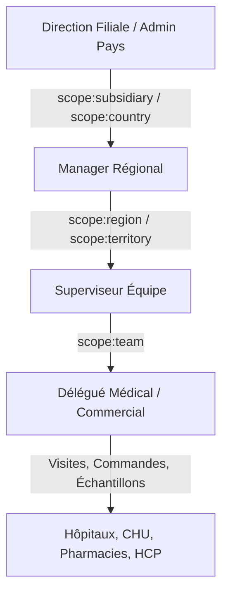
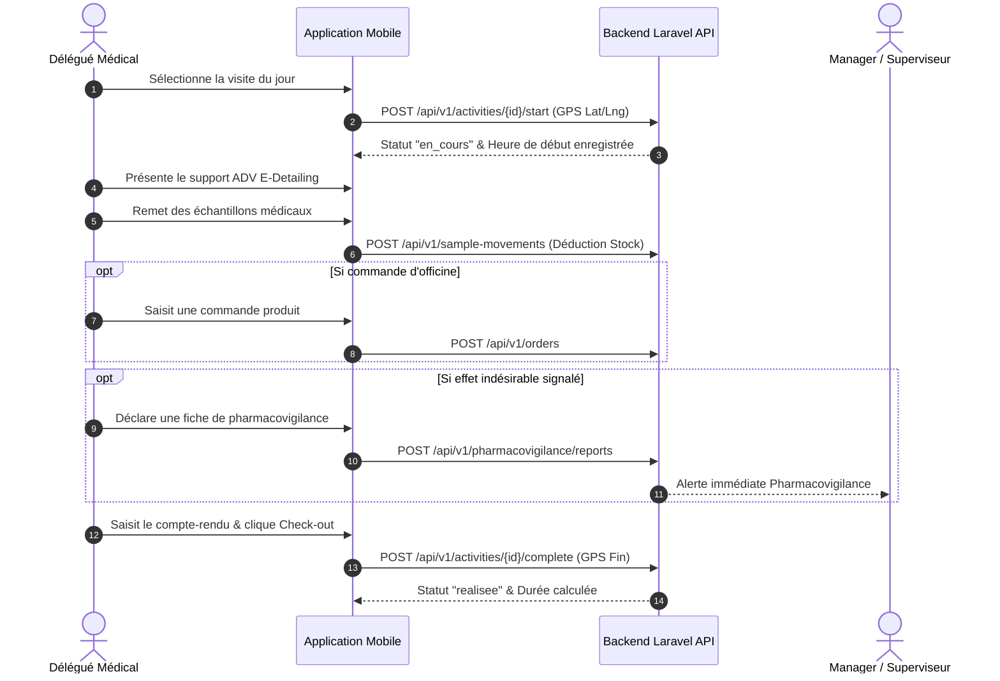
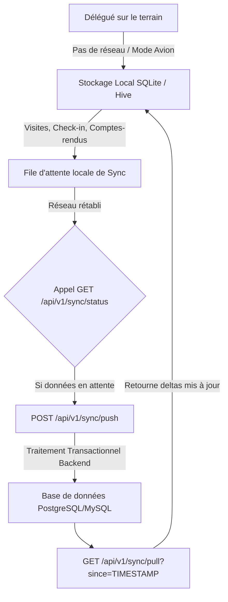

# Spécification du Workflow & Architecture Métier du CRM (CRM-SKYNITY)

## Sommaire
1. [Vision Générale & Enjeux du CRM Médical & Commercial](#1-vision-générale--enjeux-du-crm-médical--commercial)
2. [Architecture Hiérarchique & Modèle RBAC (Scopes)](#2-architecture-hiérarchique--modèle-rbac-scopes)
3. [Workflow Opérationnel Détaillé (Étape par Étape)](#3-workflow-opérationnel-détaillé-étape-par-étape)
4. [Diagrammes de Flux & Processus (Mermaid)](#4-diagrammes-de-flux--processus-mermaid)
5. [Composants Clés Indispensables d'un CRM Moderne (Best Practices)](#5-composants-clés-indispensables-dun-crm-moderne-best-practices)
6. [Cartographie des Endpoints API Backend](#6-cartographie-des-endpoints-api-backend)

---

## 1. Vision Générale & Enjeux du CRM Médical & Commercial

Le CRM **CRM-SKYNITY** est une solution complète de **Sales Force Automation (SFA)** et de gestion de la relation client spécialement conçue pour l'industrie pharmaceutique et la promotion médicale.

Il répond à 4 objectifs majeurs :
1. **Pilotage de l'Activité Terrain des Délégués Médicaux** : Planification des tournées, géolocalisation des visites, comptes-rendus automatisés et optimisation des déplacements.
2. **Promotion Médicale & E-Detailing (ADV)** : Présentation dynamique des supports digitaux, brochures et arguments scientifiques auprès des Professionnels de Santé (HCP).
3. **Traçabilité Réglementaire & Sécurité** : Suivi strict des dotations d'échantillons médicaux, enregistrement des signalements de pharmacovigilance et respect des normes sanitaires (ex: ANSM).
4. **Supervision & Analytics Managers** : Suivi en temps réel des performances individuelles et collectives, atteinte des objectifs et contrôle budgétaire.

---

## 2. Architecture Hiérarchique & Modèle RBAC (Scopes)

### 2.1 Hiérarchie Territoriale (7 Niveaux)
L'organisation des données est structurée selon une arborescence géographique stricte :

```
Pays (Country) 
 └── Filiale (Subsidiary)
      └── Région (Region)
           └── Territoire (Territory)
                └── Zone (Zone)
                     └── Secteur (Sector)
                          └── Équipe (Team)
```

### 2.2 Modèle de Sécurité & Scopes de Permissions
L'accès aux données est filtré selon le rôle et le niveau hiérarchique de l'utilisateur via Spatie Laravel-Permission :



* **`scope:global`** (Administrateur Groupe) : Accès à l'ensemble du système, multi-pays et multi-filiales.
* **`scope:country` / `scope:subsidiary`** (Admin Pays / Directeur) : Accès complet aux données de la filiale.
* **`scope:region` / `scope:territory`** (Manager Régional) : Vision consolidée sur son territoire ou sa région.
* **`scope:team`** (Délégué Médical) : Isolation stricte des portefeuilles clients, visites et commandes attribués à l'équipe ou au délégué.

### 2.3 Cartographie & Matrice Complète des Rôles & Profils Système

Le backend gère **7 rôles nativement configurés** (`RoleAndPermissionSeeder`) ainsi que des **profils fonctionnels spécialisés** :

| Rôle Backend | Code Guard | Scope d'Accès | Périmètre & Attributions Métier |
| :--- | :--- | :--- | :--- |
| **Super Administrateur** | `super-admin` | `scope:global` | Configuration globale multi-pays, gestion des tenants, rôles/permissions, champs personnalisés et logs d'audit. |
| **Administrateur Pays** | `admin-pays` | `scope:country` | Gestion des utilisateurs filiale, attribution des territoires, structure géographique, catalogues produits filiale. |
| **Directeur Général** | `dir-general` | `scope:subsidiary` | Vision consolidée BI/Analytics, suivi macro du chiffre d'affaires, taux d'atteinte des objectifs stratégiques. |
| **Directeur Commercial** | `dir-commercial` | `scope:subsidiary` | Pilotage du pipeline de ventes, validation des remises grands comptes, fixation des objectifs commerciaux. |
| **Directeur Médical** | `dir-medical` | `scope:subsidiary` | Stratégie scientifique, gestion des KOL (Key Opinion Leaders), validation des supports ADV et congrès médicaux. |
| **Manager Régional** | `manager` | `scope:region` / `scope:team` | Validation des plannings (TourPlan), approbation des notes de frais/congés, coaching et suivi GPS d'équipe. |
| **Délégué Médical** | `delegue` | `scope:team` | Visites terrain, e-detailing ADV, distribution d'échantillons, prise de commandes, comptes-rendus et Check-in GPS. |

---

## 3. Workflow Opérationnel Détaillé (Étape par Étape par Rôle)

Le cycle de vie complet d'une tournée et d'une visite médicale s'articule en **7 étapes majeures** :

```
┌─────────────────┐     ┌─────────────────┐     ┌─────────────────┐     ┌─────────────────┐
│ 1. Planification│ ──> │ 2. Exécution GPS│ ──> │ 3. Visite & ADV │ ──> │ 4. Échantillons │
│    & Validation │     │    Check-in     │     │    E-Detailing  │     │    & Commandes  │
└─────────────────┘     └─────────────────┘     └─────────────────┘     └─────────────────┘
                                                                                 │
┌─────────────────┐     ┌─────────────────┐     ┌─────────────────┐              │
│ 7. Analytics    │ <── │ 6. Frais & Admin│ <── │ 5. Check-out &  │ <────────────┘
│    & Reporting  │     │    Validation   │     │    Compte-rendu │
└─────────────────┘     └─────────────────┘     └─────────────────┘
```

### Étape 1 : Planification & Préparation de la Semaine
* **Action Délégué** :
  1. Le délégué crée son plan de tournée hebdomadaire (`TourPlan`) en sélectionnant les établissements (`Account`: CHU, Hôpitaux, Pharmacies) et les professionnels de santé (`Contact` / HCP).
  2. Il planifie ses activités de visite (`Activity`). *Règle métier : La date et heure (`planned_at`) ne peuvent pas être situées dans le passé.*
  3. Il soumet son planning hebdomadaire au manager pour validation avant l'échéance de fin de semaine.
* **Action Manager** : Reçoit la notification et valide ou demande des ajustements sur le planning.

### Étape 2 : Exécution de la Tournée GPS & Géolocalisation
* **Optimisation de Parcours** : Le délégué utilise l'algorithme d'optimisation GPS (`POST /api/v1/tour-plans/optimize`) pour trier les visites par ordre du plus proche voisin (*Nearest Neighbor Algorithm*) et calculer la distance totale (km) et le temps estimé.
* **Arrivée sur Site (Check-in GPS)** : À son arrivée chez le médecin ou l'établissement, le délégué déclenche le Check-in (`POST /api/v1/activities/{id}/start`). Le système capture instantanément les coordonnées GPS réelles (`gps_debut_lat`, `gps_debut_lng`) et passe la visite au statut `en_cours`.

### Étape 3 : Visite Médicale & Présentation ADV (E-Detailing)
* **Présentation Interactive** : Le délégué présente les supports digitaux d'aide à la vente (`DigitalSupport`) et consulte la documentation médicale ANSM (`Document`).
* **Suivi d'Engagement** : Le temps passé sur chaque diapositive et les interactions sont enregistrés pour l'analyse marketing.

### Étape 4 : Prise de Commandes & Échantillons Médicaux
* **Distribution d'Échantillons** : Enregistrement de la remise d'échantillons médicaux (`SampleMovement`). Le système vérifie et déduit le solde en stock du délégué.
* **Prise de Commandes (Pharmacies / Grossistes)** : Saisie directe des commandes de réapprovisionnement (`Order`) avec calcul automatique du montant total et de la remise.

### Étape 5 : Clôture de Visite & Compte-Rendu (Check-out)
* **Départ du Site (Check-out GPS)** : Le délégué clôture la visite (`POST /api/v1/activities/{id}/complete`) qui enregistre les coordonnées GPS de fin (`gps_fin_lat`, `gps_fin_lng`), passe le statut à `realisee` et calcule la durée effective.
* **Compte-Rendu & Qualification** : Saisie des notes d'entretien, des produits présentés et qualification d'opportunités commerciales (`Opportunity`).
* **Pharmacovigilance (Si applicable)** : En cas de déclaration d'effet indésirable par le médecin, saisie immédiate d'un rapport de pharmacovigilance (`PharmacovigilanceReport`) avec alerte prioritaire.

### Étape 6 : Notes de Frais & Administration
* **Note de Frais (`Expense`)** : Enregistrement des frais de déplacement (carburant, repas, hébergement) avec photo du justificatif.
* **Messagerie & Notifications** : Échanges en temps réel avec le manager ou les collègues via la messagerie interne (`Conversation`).

### Étape 7 : Supervision, Validation & Analytics Manager
* **Tableau de Bord Manager** :
  * Suivi de la performance d'équipe (`GET /api/v1/analytics/team-performance`).
  * Géolocalisation temps réel de la position des délégués (`GET /api/v1/users/locations`).
  * Suivi d'atteinte des objectifs mensuels/trimestriels (`Objectif`).
* **Validation des Frais & Demandes** : Le manager approuve ou rejette les notes de frais (`Expense`) et demandes de congés/révisions de planning.

### 3.8 Workflows Spécifiques selon les Rôles et Profils Utilisateurs

En complément du workflow terrain du délégué, chaque rôle dispose d'un workflow dédié au sein de la plateforme :

#### 1. Workflow du Directeur Général (`dir-general`)
* **Consultation du Dashboard Exécutif** : Vision globale du CA, de la couverture du portefeuille HCP et des performances par région/filiale.
* **Pilotage Budgétaire & Objectifs** : Consultation des rapports consolidés (`GET /api/v1/analytics/executive-summary`).

#### 2. Workflow du Directeur Commercial (`dir-commercial`)
* **Fixation des Objectifs de Vente** : Attribution des quotas de ventes et nombre de visites cibles par équipe (`POST /api/v1/objectifs`).
* **Pipeline Commercial & grands Comptes** : Validation des remises exceptionnelles sur commandes officines (`Order`) et suivi des opportunités stratégiques (`Opportunity`).

#### 3. Workflow du Directeur Médical (`dir-medical`)
* **Gestion du Référentiel KOL** : Identification et suivi des Key Opinion Leaders / Médecins référents (`KolProfile`).
* **Gouvernance des Content ADV & E-Detailing** : Validation et mise à disposition des supports digitaux d'aide à la vente (`DigitalSupport`) et documents scientifiques (`Document`).
* **Suivi des Formations Médicales** : Organisation des sessions de formation continue pour les délégués (`Training`).

#### 4. Workflow du Responsable Pharmacovigilance (Profil Sécurité)
* **Réception & Traitement des Signalements** : Réception immédiate des fiches de pharmacovigilance saisies sur le terrain (`PharmacovigilanceReport`).
* **Enquête & Notification** : Validation scientifique, qualification de la gravité de l'effet indésirable et export pour transmission aux autorités de santé (ANSM/EMA).

#### 5. Workflow du Responsable Logistique / Stock Échantillons (Profil ADV)
* **Approvisionnement des Dotations** : Attribution des lots d'échantillons médicaux aux délégués (`SampleMovement` type `entre`).
* **Contrôle d'Inventaire & Péremptions** : Suivi des stocks par délégué/dépôt, blocage des lots périmés et audit des retraits.

#### 6. Workflow de l'Administrateur Pays & Super Admin (`admin-pays` / `super-admin`)
* **Gestion des Utilisateurs & Rôles** : Création des comptes utilisateurs, affectation aux équipes et attribution des rôles Spatie (`POST /api/v1/users`, `POST /api/v1/roles`).
* **Paramétrage des Champs Personnalisés** : Configuration dynamique des attributs métier (`CustomField`).

---

## 4. Diagrammes de Flux & Processus (Mermaid)

### 4.1 Processus d'Exécution d'une Visite Médicale


### 4.2 Pipeline de Synchronisation Hors-Ligne (Offline First)


---

## 5. Composants Clés Indispensables d'un CRM Moderne (Best Practices)

Un CRM commercial et médical professionnel exige les **6 piliers fondamentaux** suivants :

### 1. Architecture Offline-First & Synchronisation Delta
* Les délégués médicaux travaillent souvent dans des zones blanches (sous-sols d'hôpitaux, zones rurales).
* Le backend doit fournir une API de synchronisation delta (`SyncController`) basée sur les horodatages `updated_at` pour ne transférer que les enregistrements modifiés depuis la dernière synchronisation.

### 2. Moteur de Champs Personnalisés Dynamiques (Custom Fields)
* Permet d'ajouter des attributs spécifiques sans modifier le schéma de la base de données (ex: *Spécialité secondaire du médecin*, *Potentiel prescription*, *Équipement clinique*).
* Géré via les tables `custom_fields` et `custom_field_values`.

### 3. Traçabilité & Journalisation Audit Trail
* Chaque modification sur les clients, commandes, dotations et permissions doit enregistrer qui a fait quoi et quand (`ActivityLog`).
* Indispensable pour la conformité réglementaire et la résolution des conflits.

### 4. Module Pharmacovigilance & Sécurité Sanitaire
* Tout signalement d'effet secondaire lors d'une visite doit déclencher une alerte prioritaire et bloquer/notifier les responsables scientifiques.

### 5. Suivi des Stocks & Dotations d'Échantillons
* Gestion en temps réel des entrées/sorties d'échantillons attribués au délégué avec alertes sur les péremptions et les seuils critiques (`SampleMovement`).

### 6. Moteur de Règles d'Objectifs & Rémunération Variable
* Calcul automatique des taux d'atteinte des objectifs de visites et de chiffre d'affaires (`Objectif` & `Indicator`).

---

## 6. Cartographie des Endpoints API Backend

Le tableau ci-dessous associe les fonctionnalités métiers du workflow aux contrôleurs de l'application Laravel :

| Module Métier | Route API | Méthode | Contrôleur Laravel |
| :--- | :--- | :--- | :--- |
| **Authentification** | `/api/v1/login` | `POST` | `AuthController::login` |
| **Vérification OTP** | `/api/v1/verify-otp` | `POST` | `AuthController::verifyOtp` |
| **Profil & Session** | `/api/v1/me` | `GET` | `AuthController::me` |
| **Planning Hebdomadaire** | `/api/v1/tour-plans` | `GET/POST` | `TourPlanController` |
| **Optimisation GPS IA** | `/api/v1/tour-plans/optimize` | `POST` | `TourPlanController::optimize` |
| **Check-in Visite** | `/api/v1/activities/{id}/start` | `POST` | `ActivityController::start` |
| **Check-out Visite** | `/api/v1/activities/{id}/complete` | `POST` | `ActivityController::complete` |
| **Référentiel Établissements** | `/api/v1/accounts` | `GET/POST/PUT` | `AccountController` |
| **Référentiel Médecins (HCP)**| `/api/v1/contacts` | `GET/POST/PUT` | `ContactController` |
| **Profils KOL** | `/api/v1/kol-profiles` | `GET/POST` | `KolProfileController` |
| **Catalogue Produits** | `/api/v1/products` | `GET` | `ProductController` |
| **Échantillons Médicaux** | `/api/v1/sample-movements` | `GET/POST` | `SampleMovementController` |
| **Prise de Commandes** | `/api/v1/orders` | `GET/POST` | `OrderController` |
| **Supports ADV / E-Detailing** | `/api/v1/digital-supports` | `GET` | `DigitalSupportController` |
| **GED & Base Documentaire** | `/api/v1/documents` | `GET` | `DocumentController` |
| **Pharmacovigilance** | `/api/v1/pharmacovigilance/reports` | `POST` | `PharmacovigilanceController` |
| **Notes de Frais** | `/api/v1/expenses` | `GET/POST` | `ExpenseController` |
| **Messagerie Interne** | `/api/v1/conversations` | `GET/POST` | `ConversationController` |
| **Notifications** | `/api/v1/notifications` | `GET` | `NotificationController` |
| **Performances Équipe** | `/api/v1/analytics/team-performance` | `GET` | `AnalyticsController::teamPerformance` |
| **Géolocalisation Délégués** | `/api/v1/users/locations` | `GET` | `AnalyticsController::usersLocations` |
| **Synchronisation Offline** | `/api/v1/sync/push` & `pull` | `POST/GET` | `SyncController` |
