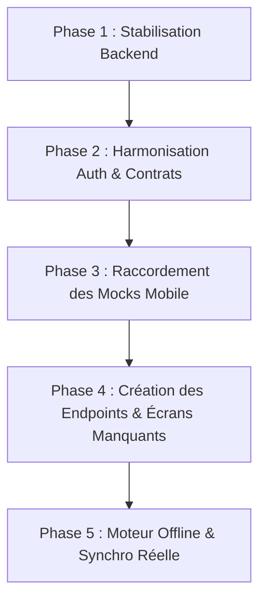

# 📊 AUDIT COMPARATIF COMPLET DU CRM (MOBILE & BACKEND)
## Rôles : Délégué Médical ("Sophie") & Superviseur / Manager ("Karim")

> **Date de l'audit :** 17 Septembre 2026  
> **Périmètre :** Application Mobile (Flutter) & API Backend (Laravel 12)  
> **Objectif :** Analyse exhaustive d'adéquation entre le guide métier MEDCRM PRO et les codebases existantes. Identification des endpoints présents, manquants, sous-exploités, des fonctionnalités mockées et des écrans à créer.

---

## SOMMAIRE
1. [Synthèse & Vue d'Ensemble](#1-synthèse--vue-densemble)
2. [Matrice 1 : Endpoints attendus par le Mobile côté Backend](#2-matrice-1--endpoints-attendus-par-le-mobile-côté-backend)
3. [Matrice 2 : Endpoints présents au Backend mais NON utilisés par le Mobile](#3-matrice-2--endpoints-présents-au-backend-mais-non-utilisés-par-le-mobile)
4. [Matrice 3 : Endpoints manquants au Backend (à créer selon le guide métier)](#4-matrice-3--endpoints-manquants-au-backend-à-créer-selon-le-guide-métier)
5. [Matrice 4 : Fonctionnalités Mobile actuellement "Bouchonnées" (Mocks)](#5-matrice-4--fonctionnalités-mobile-actuellement-bouchonnées-mocks)
6. [Matrice 5 : Écrans manquants côté Mobile](#6-matrice-5--écrans-manquants-côté-mobile)
7. [Feuille de Route & Plan de Résolution Recommandé](#7-feuille-de-route--plan-de-résolution-recommandé)

---

## 1. Synthèse & Vue d'Ensemble

Le CRM a été développé avec une richesse fonctionnelle et visuelle avancée, tant sur le mobile que sur le backend. Cependant, il existe aujourd'hui un **fossé d'intégration** :

- **Côté Backend (Laravel 12)** : Une très grande partie des fonctionnalités critiques (optimisation GPS de tournée, géolocalisation d'équipe, déclarations de pharmacovigilance, validation de comptes rendus, moteur de synchronisation offline) est déjà codée et testée, mais souffre de quelques anomalies de contrat (champs manquants dans `$fillable`, validations de formulaires trop restrictives, routes doublons).
- **Côté Mobile (Flutter)** : L'application possède une ergonomie soignée et compile sans aucune erreur (0 erreur Dart). Cependant, **plus de 60% des actions opérationnelles du Délégué et du Manager sont simulées visuellement** (boutons affichant un `SnackBar` sans faire d'appel HTTP, listes de validation codées en dur, absence de capture de signature sur les échantillons, calcul d'itinéraire OpenStreetMap local déconnecté de l'algorithme serveur).

---

## 2. Matrice 1 : Endpoints attendus par le Mobile côté Backend

Ce tableau liste tous les endpoints appelés explicitement dans le code Dart de l'application mobile (`ApiClient`, `DataSources`, `Controllers`, `Providers`) pour les rôles Délégué et Manager :

| # | Endpoint appelé par Flutter | Méthode | Fichier Mobile Appelant | Statut Backend Réel | Diagnostic & Divergence |
|---|---|---|---|---|---|
| **1.1** | `auth/login` | `POST` | `AuthService.dart`, `AuthRepositoryImpl.dart` | ❌ **404 Not Found** | Le backend attend `/api/v1/login` et non `/api/v1/auth/login`. Le mobile échoue et bascule sur ses identifiants locaux de démonstration. |
| **1.2** | `/login` / `verify-otp` | `POST` | `security_verification_view.dart` | ⚠️ **Non branché** | Le backend exige une validation 2FA par code OTP (`POST /api/v1/verify-otp`). L'écran mobile simule la saisie et redirige directement vers l'accueil sans contacter le backend. |
| **1.3** | `hcps` & `hcps/{id}` | `GET` | `HcpRemoteDataSource.dart` | ❌ **404 Not Found** | Le backend expose `/api/v1/contacts` et non `/api/v1/hcps`. Manque un alias ou harmonisation du datasource. |
| **1.4** | `/contacts` | `GET, POST, PUT, DELETE` | `ContactRemoteDataSource.dart` | ✅ **Présent** (`ContactController`) | Fonctionnel. Gère les professionnels de santé avec pagination et filtres. |
| **1.5** | `/activities` | `GET, POST, PUT, DELETE` | `ActivityRemoteDataSource.dart` | ⚠️ **Rejet 422 à la création** | Le backend requiert `subsidiary_id` et `activity_type_id` (UUID) dans `StoreActivityRequest`, alors que le mobile envoie un libellé `activity_type: "Visite médicale"` sans `subsidiary_id`. |
| **1.6** | `/my-stock` | `GET` | `StockController.dart` | ✅ **Présent** (`SampleMovementController@myStock`) | Fonctionnel. Renvoie le stock d'échantillons du délégué authentifié. |
| **1.7** | `/products` | `GET` | `ProductsController.dart` | ✅ **Présent** (`ProductController`) | Fonctionnel. Renvoie le catalogue des médicaments avec prix, formes et dosages. |
| **1.8** | `/expenses` | `GET, POST, PUT, DELETE` | `ExpenseRemoteDataSource.dart` | ⚠️ **Rejet 422 à la création** | Le mobile envoie `currency: 'FCFA'` (4 caractères) alors que le backend exige `size:3` (`XOF`). Le mobile envoie aussi des types en français (`Déplacement`). |
| **1.9** | `/trainings` & `trainings/{id}/progress` | `GET, PATCH` | `TrainingsController.dart` | ✅ **Présent** (`TrainingController`) | Fonctionnel. Gère la progression e-learning. |
| **1.10** | `/kol-profiles` / `/kols` | `GET` | `KolController.dart` | ✅ **Présent** (`KolProfileController`) | Fonctionnel. Liste des Key Opinion Leaders avec score d'engagement. |
| **1.11** | `/leaves` & `leaves/{id}/status` | `GET, POST, PATCH` | `LeavesController.dart` | ✅ **Présent** (`LeaveController`) | Fonctionnel. Demandes et statuts de congés délégué/manager. |
| **1.12** | `/conversations` & messages | `GET, POST` | `ConversationsController.dart` | ✅ **Présent** (`ConversationController`) | Fonctionnel. Messagerie interne instantanée entre délégué et équipe/superviseur. |
| **1.13** | `/notifications` & mark-read | `GET, POST` | `NotificationsController.dart` | ✅ **Présent** (`NotificationController`) | Fonctionnel. Historique in-app des notifications. |
| **1.14** | `analytics/dashboard` | `GET` | `DelegateDashboardProvider.dart` | ❌ **Erreur 500** | La route pointe vers `AnalyticsController::class, 'dashboard'`, mais la méthode `dashboard` n'existe pas dans la classe ! |
| **1.15** | `analytics/team-performance` | `GET` | `TeamPerformanceController.dart` | ⚠️ **Collision de route** | Déclaré deux fois dans `routes/api.php`. La seconde déclaration écrase la vraie requête Eloquent par un mock retournant "Alice Déléguée". |
| **1.16** | `manager/performance` | `GET` | `ManagerDashboardProvider.dart` | ❌ **404 Not Found** | Le provider appelle cette URL qui n'est déclarée dans aucune route Laravel. |

---

## 3. Matrice 2 : Endpoints présents au Backend mais NON utilisés par le Mobile

Ces endpoints ont été implémentés dans Laravel 12 (avec règles métier et documentation Swagger), mais **l'application mobile ne les appelle pas** et utilise à la place des données simulées ou des comportements locaux :

| # | Endpoint Backend Existant | Description Métier | Ce que fait le Mobile à la place |
|---|---|---|---|
| **2.1** | `POST /api/v1/tour-plans/optimize` | **Optimisation GPS IA de tournée** : Algorithme du Plus Proche Voisin (Nearest Neighbor) calculant l'ordre optimal des visites, la distance totale réelle et la durée estimée. | Dans `delegate_tournee_view.dart`, le bouton "Optimiser l'itinéraire" recalcule une ligne OpenStreetMap locale et affiche un message texte fictif : *"Gain estimé : 1.8 km / 20 min"*. Aucun appel au serveur. |
| **2.2** | `GET /api/v1/users/locations` | **Géolocalisation d'équipe en temps réel (Superviseur Karim)** : Extrait la dernière position GPS lors du check-in de chaque délégué et indique son statut ("En visite" ou "Disponible"). | Dans `team_map_view.dart`, les délégués affichés sont codés en dur dans une liste Dart `_delegatesOnMap` (Jean Dupont, Sarah Lawson, Ousmane Sow). L'endpoint backend n'est jamais interrogé. |
| **2.3** | `POST /api/v1/activities/{activity}/report/validate` | **Workflow de validation du compte-rendu (Karim 3.4)** : Permet au superviseur de valider ou rejeter un compte-rendu avec motif de rejet et notification automatique au délégué. | Aucun écran mobile ne permet à Karim d'approuver ou rejeter les rapports de visite soumis. `ManagerValidationsView` ne possède aucun onglet pour les comptes-rendus d'activités. |
| **2.4** | `POST /api/v1/sample-movements` | **Distribution d'échantillons (Sophie 4.4)** : Sortie de stock avec contrôle strict du solde disponible (erreur 422 si stock insuffisant), association du numéro de lot et du contact HCP. | Dans `stock_view.dart`, le bouton "Valider la Remise" appelle `fetchStock()` sans enregistrer de mouvement, puis affiche un SnackBar de succès. Aucune sortie n'est envoyée au serveur. |
| **2.5** | `POST /api/v1/pharmacovigilance-reports` | **Signalement d'effet indésirable (Sophie 4.6)** : Enregistrement de la déclaration (produit, gravité, patient, description, date) et alerte immédiate de la pharmacovigilance. | Dans `pharmacovigilance_view.dart`, le bouton "Envoyer Déclaration" ferme la boîte de dialogue et affiche un SnackBar rouge de confirmation sans exécuter de requête HTTP. |
| **2.6** | `GET /api/v1/objectifs` & `POST /api/v1/objectifs` | **Objectifs Délégué & Quotas Manager (Sophie 4.7 & Karim 3.7)** : Suivi des quotas (nombre de visites, couverture cibles A, CA), taux d'atteinte et primes. | Les objectifs affichés dans l'application mobile proviennent de calculs simulés dans `DelegateDashboardProvider` ou de chaînes statiques dans `PerformanceDashboardView`. |
| **2.7** | `GET /api/v1/sync/pull` & `POST /api/v1/sync/push` | **Moteur de synchronisation offline bidirectionnel (Sophie 4.10)** : Échange incrémental basé sur `last_sync`, gestion des suppressions et idempotence via `local_uuid`. | Dans `sync_view.dart`, l'écran est une vue figée affichant 79% et "3 420 fiches". Il n'effectue aucun échange de données réel avec les endpoints de synchronisation. |
| **2.8** | `POST /api/v1/media/upload` | **Télédéversement de fichiers multimédias** : Upload de justificatifs de frais, photos et signatures électroniques avec stockage public et génération d'UUID. | Non connecté aux flux de notes de frais ni à la signature des remises d'échantillons. |
| **2.9** | Table pivot `activity_document` & `/digital-supports` | **Association des supports présentés à la visite (Sophie 4.3)** : Enregistrement des documents montrés avec le temps d'affichage. | L'analytique recueillie par `FullScreenEDetailingView` n'est jamais transmise lors de l'enregistrement de l'activité. |

---

## 4. Matrice 3 : Endpoints manquants au Backend (à créer selon le guide métier)

Ces fonctionnalités sont expressément décrites dans le guide narratif de Sophie et Karim, mais **n'existent pas encore dans l'API Laravel 12** :

| # | Fonctionnalité Métier Requise | Description du Besoin Métier | Spécification de l'Endpoint à Créer |
|---|---|---|---|
| **3.1** | **Module de Coaching Superviseur** *(Karim 3.2 & 3.5)* | Karim doit pouvoir suivre un délégué en difficulté : évaluer ses points forts, ses points faibles, formaliser un plan d'action (ex: replanification des tournées) et programmer une date de prochain point. | `GET /api/v1/coaching/delegates/{id}` (Historique coaching) `POST /api/v1/coaching/sessions` (Création d'une session de coaching avec points forts/faibles/actions) `PATCH /api/v1/coaching/sessions/{id}` (Suivi de l'état) |
| **3.2** | **Tracking Détaillé CLM Slide-par-Slide** *(Sophie 4.3 & Julie 1.2)* | Le guide indique : *"Le CRM enregistre automatiquement combien de temps elle a passé sur chaque slide, quelles slides ont été vues, le temps total de présentation."* | `POST /api/v1/activities/{activity}/clm-analytics` Payload : `{ "document_id": "uuid", "total_seconds": 120, "slides": [{"slide_index": 1, "duration_seconds": 25}, ...] }` |
| **3.3** | **Suivi des No-Shows / Rendez-vous Manqués** *(Karim 3.1 & 3.6)* | Le superviseur doit voir en temps réel les no-shows de son équipe (ex: *"Nadia a 5 no-show ce mois"*). Actuellement, `teamPerformance` ne compte que les visites réalisées (`statut = 'realisee'`). | Ajouter `no_show_count` et `cancelled_count` dans la réponse de `GET /api/v1/analytics/team-performance` Créer `GET /api/v1/analytics/no-shows` (Détail par praticien et délégué) |
| **3.4** | **Référentiel des Objections & Réponses Types** *(Sophie 4.5 & Karim 3.4)* | Le guide détaille : *"Objection : Effets secondaires, Réponse utilisée : Étude 2% vs 5%, Niveau d'intérêt..."*. Il manque un catalogue standardisé pour éviter la saisie libre. | `GET /api/v1/objections` (Référentiel des objections par produit) `POST /api/v1/activities/{activity}/objections` (Enregistrement objection rencontrée + argument utilisé) |
| **3.5** | **Alertes Métier du Superviseur** *(Karim 3.1 & 3.6)* | Karim consulte un écran "Alertes" centralisant : délégués en retard, objectifs non atteints à mi-mois, signalements de pharmacovigilance urgents, visites non validées. | `GET /api/v1/supervisor/alerts` (Agrégation des anomalies opérationnelles de l'équipe) |
| **3.6** | **Signature Électronique des Échantillons** *(Sophie 4.4)* | Traçabilité réglementaire ANSM : signature tactile du praticien rattachée au bon de remise et au numéro de lot. | `POST /api/v1/sample-movements/{id}/signature` ou inclusion du champ `signature_base64` dans le payload de création du mouvement. |
| **3.7** | **Programmation de Visite en Duo (Coaching Terrain)** *(Karim 3.5)* | Karim doit pouvoir planifier une visite conjointe avec Sophie pour l'accompagner sur le terrain. | `POST /api/v1/activities/duo` ou ajout d'un champ `accompanying_user_id` (co-visiteur) sur le modèle `Activity`. |

---

## 5. Matrice 4 : Fonctionnalités Mobile actuellement "Bouchonnées" (Mocks)

Cette section recense les vues et widgets mobiles qui présentent une interface complète mais dont la logique métier est **factice ou non raccordée** :

| Écran / Vue Mobile | Fichier Source Flutter | Données Factices / Comportement Bouchonné | Ce qu'il faut brancher |
|---|---|---|---|
| **Déroulement de Visite** | `visit_execution_view.dart` | La clôture de visite fait `Navigator.pop()` et affiche *"Données enregistrées dans la file de synchro hors-ligne"*. Rien n'est stocké ni envoyé. Un menu de test dans l'AppBar permet de basculer arbitrairement entre "Validée" et "En attente". | Appeler `POST /api/v1/activities` lors du check-in GPS, puis `PUT /api/v1/activities/{id}/report` à la clôture avec les produits, réactions et commentaires réels. |
| **Centre de Synchronisation** | `sync_view.dart` | Cercle de progression figé à 79%, compteurs textuels en dur (*"3 420 / 4 380 fiches"*). Aucun échange réseau. | Créer un `SyncController` mobile pilotant la boucle `GET /sync/pull` (avec horodatage `last_sync`) et `POST /sync/push` pour vider la file d'attente locale. |
| **Optimisation Tournée GPS** | `delegate_tournee_view.dart` | Bouton `_reoptimizeRoute()` recalculant la liste locale sans interroger le solveur d'optimisation serveur. | Envoyer les coordonnées GPS actuelles et l'ID du `TourPlan` à `POST /api/v1/tour-plans/optimize`, puis réordonner les arrêts selon la réponse de l'algorithme. |
| **Carte Équipe Manager** | `team_map_view.dart` | Liste `_delegatesOnMap` codée en dur avec des positions GPS statiques de test (CHU Tokoin, Blvd du 13 Janvier, etc.). | Remplacer la liste statique par l'appel à `GET /api/v1/users/locations` et rafraîchir les marqueurs périodiquement. |
| **Remise d'Échantillons** | `stock_view.dart` | Modal `_showRegisterRemiseModal` effectuant un simple `fetchStock()` sans envoyer la quantité, le médecin ni le produit au serveur. Absence de pad de signature. | Envoyer la transaction à `POST /api/v1/sample-movements` (`movement_type = 'distribution'`) et décrémenter le stock localement. |
| **Déclaration Pharmacovigilance** | `pharmacovigilance_view.dart` | Bouton "Envoyer Déclaration" fermant la fenêtre avec un SnackBar sans aucun appel réseau. | Appeler `POST /api/v1/pharmacovigilance-reports` avec `contact_id`, `product_id`, `severity`, `symptoms`. |
| **Validation Manager** | `manager_validations_view.dart` | L'ensemble des 7 onglets (Contacts, Plannings, Dépenses, Échantillons, Congés, Objectifs) est alimenté par des listes `List<Map<String, dynamic>>` codées en dur. | Raccorder chaque onglet à son contrôleur API respectif (`GET /expenses?status=submitted`, `GET /leaves?status=pending`, etc.). |
| **Vérification Sécurité OTP** | `security_verification_view.dart` | Méthode `_verify()` redirigeant vers `AppRoutes.home` dès que 6 chiffres sont saisis, sans vérifier le code auprès du serveur. | Appeler `POST /api/v1/verify-otp` avec `{ "user_id": ..., "otp_code": ... }` et stocker le token Sanctum retourné. |
| **Suivi Commercial & CA** | `commercial_monitoring_view.dart` | Graphiques, jauges et indicateurs financiers 100% statiques. Aucun contrôleur ni appel d'API. | Brancher les agrégations sur les endpoints de reporting commercial `/orders` et `/analytics`. |

---

## 6. Matrice 5 : Écrans manquants côté Mobile

En comparant le récit d'usage du **Délégué Médical ("Sophie")** et du **Superviseur ("Karim")** avec l'arborescence des vues Flutter, voici les **écrans ou composants manquants** à développer :

### 👤 Pour le Superviseur ("Karim") :
1. **Écran de Validation des Comptes-Rendus de Visite (`ActivityReportsValidationView`)** :
   - *Besoin du guide (Karim 3.4)* : Écran dédié permettant à Karim de filtrer les comptes-rendus soumis par ses délégués, de consulter le détail clinique (médecin, produits présentés, objections, niveau d'intérêt), d'écrire un commentaire de feedback et de cliquer sur "Valider" ou "Demander modification".
   - *État actuel* : Inexistant. `ManagerValidationsView` gère les congés et les dépenses, mais pas les visites médicales.
2. **Écran / Fiche de Coaching Délégué (`CoachingDetailView` & `CoachingPlanView`)** :
   - *Besoin du guide (Karim 3.5)* : Interface structurée permettant de formaliser l'évaluation d'un délégué : saisie des points forts, des axes d'amélioration, définition des actions concrètes (ex: réorganisation de tournée, formation produit), fixation de la date du prochain entretien et envoi d'une copie au délégué.
   - *État actuel* : Uniquement un modal visuel de démonstration sans saisie ni persistance dans `manager_team_planning_view.dart`.
3. **Écran d'Attribution & Ajustement des Objectifs Individuels (`ManagerObjectivesManagementView`)** :
   - *Besoin du guide (Karim 3.7)* : Permettre au superviseur d'ajuster le quota mensuel de visites, de fixer un objectif spécial (ex: focus sur le lancement DiaBex) ou de modifier les paramètres de prime d'un délégué.
   - *État actuel* : L'écran de performance affiche des chiffres consultatifs mais ne permet aucune édition.

### 👩‍⚕️ Pour le Délégué Médical ("Sophie") :
4. **Composant Pad de Signature Numérique Praticien (`DoctorSignaturePadModal`)** :
   - *Besoin du guide (Sophie 4.4 & 4.5)* : Boîte de dialogue tactile permettant au médecin de signer directement sur l'écran lors de la remise d'échantillons ou de la clôture de visite pour validation réglementaire.
   - *État actuel* : Le champ `signature` existe dans `ActivityModel` mais aucun widget de tracé tactile (canvas) n'est proposé dans l'interface de remise d'échantillons.
5. **Écran Détail "Mes Objectifs & Primes" (`DelegateObjectivesView`)** :
   - *Besoin du guide (Sophie 4.7)* : Vue dédiée récapitulant les 4 indicateurs clés : nombre de visites / cible (ex: 32/40), taux de couverture des médecins catégorie A (ex: 15/18), part du produit prioritaire (ex: 68%) et calcul de la prime estimée en temps réel.
   - *État actuel* : Dispersé sous forme de mini-cartes sur l'accueil sans écran d'analyse complet.
6. **Sélecteur & Gestionnaire d'Objections Cliniques (`ObjectionSelectorModal`)** :
   - *Besoin du guide (Sophie 4.5)* : Dans le déroulement de visite, pouvoir sélectionner l'objection formulée par le médecin (ex: "Effets secondaires", "Prix"), afficher immédiatement l'argumentaire validé par le marketing (ex: "Étude clinique 2% vs 5%") et enregistrer si le médecin a été convaincu.
   - *État actuel* : Uniquement un champ texte libre de commentaires généraux.

---

## 7. Feuille de Route & Plan de Résolution Recommandé

Pour finaliser l'application sans toucher au code de manière désordonnée, voici la séquence logique des travaux à exécuter :

### 🔹 Étape 1 : Stabilisation du Backend (Correctifs Immédiats)
1. Réparer la syntaxe de `DatabaseSeeder.php` (supprimer l'erreur de parenthèses conteneur) pour garantir l'exécution de `php artisan migrate:fresh --seed`.
2. Mettre à jour `$fillable` dans `Activity.php` avec `report_status`, `report_content`, `validated_by_id`, `validation_date`, `rejection_reason`, `activity_type_id`.
3. Corriger `StoreActivityRequest.php` : supprimer la contrainte `subsidiary_id` inexistante en base et autoriser le libellé textuel de visite.
4. Corriger `StoreExpenseRequest.php` : accepter `FCFA` et mapper les types français vers les clés anglaises.
5. Nettoyer `routes/api.php` : supprimer la seconde route écrasante de `team-performance` et implémenter la méthode `dashboard` dans `AnalyticsController`.

### 🔹 Étape 2 : Harmonisation des Contrats d'Authentification
1. Aligner le chemin de connexion mobile vers `POST /api/v1/login`.
2. Raccorder l'écran `security_verification_view.dart` à `POST /api/v1/verify-otp` pour valider le code à 6 chiffres et stocker le token Sanctum.
3. Ajouter un alias de route `Route::apiResource('hcps', ContactController::class)` pour la compatibilité avec `HcpRemoteDataSource`.

### 🔹 Étape 3 : Raccordement des Écrans Délégué & Manager
1. Remplacer les SnackBars factices de `visit_execution_view.dart` par de vrais appels `POST /api/v1/activities` et `PUT /api/v1/activities/{activity}/report`.
2. Brancher l'optimisation de tournée de `delegate_tournee_view.dart` sur `POST /api/v1/tour-plans/optimize`.
3. Brancher la carte des délégués de `team_map_view.dart` sur `GET /api/v1/users/locations`.
4. Brancher la remise d'échantillons de `stock_view.dart` sur `POST /api/v1/sample-movements`.
5. Brancher le formulaire de `pharmacovigilance_view.dart` sur `POST /api/v1/pharmacovigilance-reports`.

### 🔹 Étape 4 : Développement des Modules Métier Spécifiques
1. **Module Coaching** : Créer le modèle, la migration et le contrôleur `CoachingController` côté backend, et l'écran `CoachingDetailView` côté mobile.
2. **Validation des Visites** : Ajouter un onglet "Comptes-Rendus" dans `ManagerValidationsView` branché sur `activities?report_status=submitted` et `activities/{id}/report/validate`.
3. **Signature Tactile** : Intégrer un pad de signature dans le modal de remise d'échantillons et dans le compte-rendu.
4. **Tracking CLM** : Envoyer les données collectées par `FullScreenEDetailingView` dans la relation `activity_document`.

### 🔹 Étape 5 : Finalisation du Mode Hors-Ligne
1. Mettre en place un stockage persistant local (SQLite via `sqflite` ou `drift`) pour stocker les fiches médecins, produits et activités reçus du `pull`.
2. Gérer une file d'attente locale des modifications hors-ligne (`local_uuid`) et connecter le bouton de `sync_view.dart` à `POST /api/v1/sync/push`.
